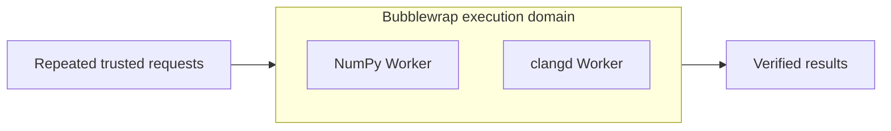
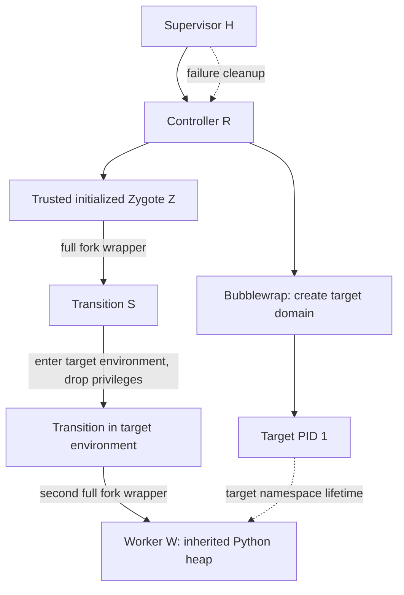

# ShimOS

**An exploratory systems research project for Linux-native execution and runtime state reuse.**

ShimOS investigates lightweight sandboxing, worker reuse, and cross-domain runtime state sharing for agent-oriented workloads. It combines Bubblewrap, Linux namespaces, cgroup v2, and fork/clone3 to study how isolation domains and initialized application state can have different lifetimes.

This repository contains research prototypes and bounded experimental results. It is **not a production sandbox**, a general-purpose agent runtime, or a claim of a new architecture relative to all prior work. The project’s own open-source license is **not yet selected**; see [license status](LICENSE-STATUS.md).

## Why this project?

Creating a lightweight isolation domain can cost less than preparing the application inside it. In an early fixed configuration, persistent-domain construction took about 8–11 ms, including setup and identity checks. Python dependency loading and code-analysis initialization could be more expensive.

We asked whether domains could be created and released as needed while useful initialization state survived longer. We implemented persistent workers, then cross-domain state inheritance, and compared alternatives before checking their relevance to real agent execution.

## Architecture

### Bubblewrap + persistent workers

A trusted application worker stays alive inside a persistent domain and serves repeated requests. We implemented fixed NumPy and clangd workers and measured same-domain versus separate-domain layouts. Dynamic placement and a general Worker Pool scheduler were **not implemented**.



### Cross-domain Zygote

A **Zygote** is a trusted, single-threaded process holding initialized Python state. Bubblewrap creates the destination first. A transition process joins its environment and forks the worker, which inherits memory without execing Python again.



Arrows describe creation/control, not a single process tree: W remains S's child; joining a namespace does not reparent it to target PID 1. The second fork is needed because selecting a PID namespace affects subsequent children. H retains cleanup responsibility when R fails. See [architecture](docs/architecture.md) for real wait ownership, permission boundaries and resource accounting.

## Implemented and evaluated

- Bubblewrap isolation and persistent execution domains, including B-strict process-group lifecycle management.
- Repeated requests to fixed NumPy and clangd workers; explicit state and input checks.
- Z → S → W state inheritance across independently created domains.
- cgroup resource controls and atomic child creation into cgroups on the qualified paths.
- Per-attempt identities, execution gates, cancellation, true wait, output EOF and resource-release checks; UNKNOWN results are retained when knowledge is lost.
- A pinned glibc **candidate D** preserving the native fork wrapper and CPython hooks; restricted runtime compatibility tests.
- Fixed, trusted NumPy CPU admission; G0–G4 comparisons, bounded concurrency, memory pressure and template-switch experiments.
- Separate controlled Native Tool Exec experiments and public-agent workload characterization.

These capabilities have different qualification scopes. They do not imply arbitrary dependency preload, transparent CLI execution, multitenant safety or production reliability. [Capability matrix](docs/limitations.md).

## Selected results

### Persistent Worker reuse

| Fixed workload | Fresh Worker | Reused Worker |
|---|---:|---:|
| NumPy integer reduction | 555 ms | 163 ms |
| clangd symbol query | 643 ms | 178 ms |

Both columns use one persistent domain. Values are medians for a **complete sequence of four requests**, including initialization, validation and cleanup: six sequences per cell, two VM initializations on one host. They are not single-request startup times or agent end-to-end speedups. [Report](research/shimos_worker_pool/06-benchmark-results.md).

### Independent domain per request

| Architecture | N=100 complete sequence |
|---|---:|
| G0: native cold Python | 53.793 s |
| G1: new cross-domain Zygote per request | 61.759 s |
| G2: shared warm cross-domain Zygote | 22.503 s |

Fixed CPython 3.10.12, NumPy 2.2.6 / OpenBLAS 0.3.29 CPU single-thread recipe; 8 MiB float64 array and 128×128 matrix operation. Sequential requests, a new Bubblewrap domain each time, 4 vCPU / 4 GiB, three paired VM blocks on one physical host. **Initial warming and final shutdown are charged.** Natural page cache is retained. [Report](research/shimos_worker_pool/architecture_comparison_round1/round1-final-report.md).


Further comparisons deliberately challenged shared warming:

- For N=50 with the same domain-reuse policy, G2 was faster at measured K≤5 requests/domain; domain-local Zygote G3 was faster at K≥10. This is a measured crossing interval, not a universal threshold.
- Persistent Worker G4 reduced cost for fixed trusted requests with known-state reset: a K=100 read-only sequence took 8.604 s versus G3's 14.022 s. G4 does **not** provide a fresh process per request.
- Higher concurrency and more warming were not always better. Under a common 96 MiB root budget, both evaluated architectures had incomplete sequences; failures remain in the reports. Net system-wide physical-memory savings remain unknown.
- A single-template-slot alternating workload cost more than grouped requests. This demonstrates switching costs, not an implemented scheduling algorithm.
- The A+B integration passed **29 restricted correctness attempts in eight private VM sessions**, including expected failures/cancellation. This is not 29 successful business requests or arbitrary-runtime qualification.

See [experiments](docs/experiments.md) and the [complete architecture study](research/shimos_worker_pool/architecture_comparison_full/reports/shimos-round3-complete-report.md), including negative results and contract differences.

## Getting started

The portable entry point uses Python 3.10+ and the standard library:

```sh
python3 scripts/check_release.py
python3 benchmarks/reproduce_tables.py
python3 scripts/inspect_protocol.py
```

These commands check the release, recompute the two headline tables from included numeric exports and demonstrate the existing bounded request/oracle protocol. They do **not** execute an isolated workload or certify sandbox safety.

Actual sandbox experiments require x86-64 Linux, cgroup v2 delegation, namespace support, clone3 with CLONE_INTO_CGROUP, pidfds, seccomp, GCC, QEMU/KVM, Bubblewrap 0.13.1 and the matching guest runtime. Cross-domain Python inheritance additionally requires the pinned candidate D libc/loader pair. Guest tests belong in a disposable private VM. Do not install candidate libc over a host libc or run guest controllers on a shared host.

The source is included; VM images, dependency bundles and private run trees are not. Start with:

```sh
python3 scripts/check_vm_inputs.py
```

A clean checkout reports **BLOCKED** with missing assets, rather than silently building a different fixture. The [reproduction guide](docs/reproduction.md) gives the historical runner commands, exact prerequisites and limits. This is a source/evidence release, **not a one-command reproduction of the frozen laboratory**.

## Repository map

```text
README.md
LICENSE-STATUS.md          # no project license invented
THIRD_PARTY_NOTICES.md
prototypes/README.md       # entry points into real source trees
scripts/                  # safe inspection and release/asset checks
benchmarks/               # offline result reproduction
research/                 # selected source, runners, final reports, numeric exports
  shimos_worker_pool/      # B-strict, workers, Zygote, G0–G4, runtime work
  real_agent_workload/     # analysis code and final workload report
  shimos_next_architecture/# dependency and multi-session conclusions
docs/                    # architecture, experiments, limits and research history
```

Distinct study implementations retain their original relative paths to make their provenance visible. [Source manifest](docs/source-manifest.json) maps every imported file to its original path and hashes. Reports are sanitized snapshots; links to deliberately omitted artifacts are labeled.

## Limits and research history

Only fixed trusted runtime/initialization combinations have been qualified. Unknown dependencies, native callbacks and multithreaded templates have no general admission. There is no complete automatic joint scheduler, general transparent CLI classifier, or proof of broad real-agent end-to-end benefit. Do not use these prototypes for untrusted production multitenancy.

The research progressed through **Bubblewrap → Worker Pool → cross-domain Zygote → architecture evaluation → real-agent workload analysis → transparent CLI exploration**. The last direction remained conceptual: no new transparent execution system or corresponding performance claim. New core implementation on these directions was paused pending a clearer workload-backed mechanism gap. This does not negate the measured prototype results. [Research history](docs/research-history.md).

## Related work

We explicitly build on and compare with [SAND](https://www.usenix.org/conference/atc18/presentation/akkus), [SOCK](https://www.usenix.org/conference/atc18/presentation/oakes), [OpenLambda](https://github.com/open-lambda/open-lambda), [FaasCache](https://doi.org/10.1145/3445814.3446757), [Forklift](https://github.com/open-lambda/forklift), and [Archipelago](https://arxiv.org/abs/1911.09849).

The later CLI exploration considered [pyforkexec](https://github.com/cykerway/pyforkexec), [pytest-fast](https://github.com/prostomarkeloff/pytest-fast), the inspected same-name [Zygo](https://github.com/mhmtskrc2/zygo) project and Containerless. Their capabilities and contracts differ; a shared label does not establish equivalence. Fixed revisions and source-level qualifications are in the [exploration archive](research/shimos_next_architecture/reports/07_transparent_cli_warm_execution_exploration.md).
