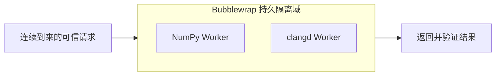
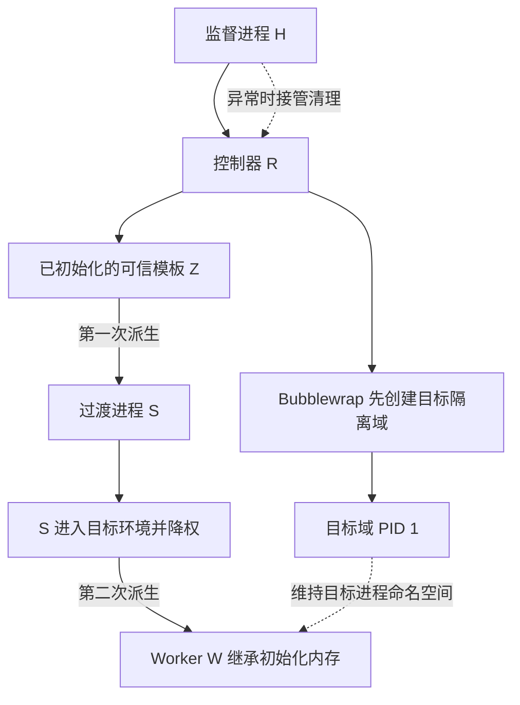
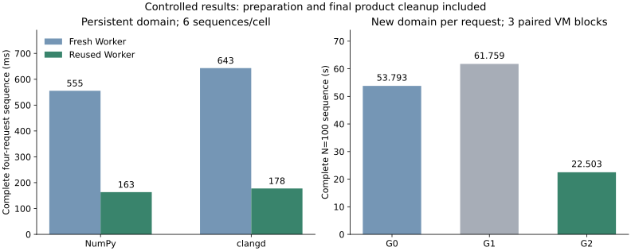

# ShimOS

**一个围绕 Linux 轻量隔离、Worker 复用和跨域状态共享展开的探索性系统研究项目。**

我们从 Bubblewrap 出发，研究一个问题：**如果隔离环境可以低成本创建，能否让它按需创建和回收，同时让昂贵的程序初始化状态保留得更久？**

围绕这个问题，我们实现了持久 Worker、跨隔离域 Zygote 和多种执行原型，完成了受控性能对照，也回到真实 Agent 工作负载中检查这些机制的适用范围。这个仓库保存了实现、实验结果和研究过程，供阅读、复核与后续研究使用。

## 为什么做这件事？

启动一个程序，往往不只是创建进程。Python 需要加载依赖，NumPy 需要准备运行状态，clangd 也需要初始化代码分析环境。如果任务反复使用相同的程序，这些准备工作可能重复发生。

早期固定配置中，Bubblewrap 持久域的创建准备约需 **8–11 ms**，已经包含初始化和身份检查。我们因此想到：相比继续压缩建域时间，是否更值得把环境里的程序准备状态复用起来？

这里的“隔离域”，可以理解成一个限制程序文件视图、进程视图和资源使用的独立执行环境；Worker 则是真正处理任务的程序进程。

## 我们做出了什么？

### 1. 让准备好的 Worker 留下来

我们基于 Bubblewrap 建立持久域，实现 NumPy 和 clangd Worker，让同一个进程连续处理多次请求。同时比较了 Worker 放在同域、分域时的成本，并测量保留热状态的内存开销。



这一步验证了复用的价值，但也提出了新问题：完整 Worker 会占内存，还可能保留上一次请求的业务状态。我们没有实现通用的自动 Worker Pool 调度器。

### 2. 让不同隔离域共享一次初始化

进一步，我们实现了跨域 Zygote。**Zygote 是一个只做可信初始化、用于派生新进程的准备态模板。**它保留 Python 和获准依赖的初始化内存，再为独立执行域创建新的 Worker。



实际路径是 **Z → S → W**，图中的两处 S 是同一个进程的前后状态。Worker 不重新启动 Python，而是继承模板内存；执行域结束后，模板仍可服务后续任务。图中包含控制关系，不能把所有箭头都当作父子关系。

为了让它成为可验证的执行机制，我们还处理了取消、异常退出、真实进程等待、输出结束和资源回收，并修复了固定环境下的 fork 运行时兼容问题。具体实现见[架构说明](docs/architecture.md)。

## 实验得到了什么？

### Worker 复用确实能减少重复准备

| 固定任务 | 每请求新建 Worker | 复用同一 Worker |
|---|---:|---:|
| NumPy 整数归约 | 555 ms | 163 ms |
| clangd 代码符号查询 | 643 ms | 178 ms |

两列都只建立一次持久域。表中是**连续四次请求的完整耗时中位数**，包含初始化、验证和回收；每格 6 个序列，来自同宿主的两个 VM。它不是单次启动时间，也不是真实 Agent 的端到端加速。[原始报告](research/shimos_worker_pool/06-benchmark-results.md)。

### 每请求需要新域时，共享 Zygote 有实际收益

| 执行方式 | N=100 完整序列耗时 |
|---|---:|
| G0：每次新域、新 Python，冷启动 | 53.793 s |
| G1：每次重建 Zygote，再跨域派生 | 61.759 s |
| G2：不同新域共享一个预热 Zygote | 22.503 s |

条件：固定 CPython 3.10.12、NumPy 2.2.6 / OpenBLAS 0.3.29 单线程 CPU 配方，8 MiB 数组和 128×128 矩阵计算；串行请求，每请求新域；4 vCPU / 4 GiB，同宿主三个配对 VM 块。**首次预热和最终关闭都已计入**，没有人为清空系统文件缓存。[原始报告](research/shimos_worker_pool/architecture_comparison_round1/round1-final-report.md)。



### 复用方式需要随任务条件变化

我们没有只保留对共享 Zygote 有利的结果，而是继续比较域内模板 G3 和持久 Worker G4，并改变请求密度、并发和内存预算。

- **同一域用得更多，域内模板开始划算。**固定 N=50、相同留域政策时，已测每域 K≤5 的点由 G2 更快，K≥10 的点由 G3 更快。这是固定任务的交叉区间，不是通用阈值。
- **持久 Worker 还能省成本，但状态要求不同。**同域 K=100 的只读任务中，G3/G4 为 14.022/8.604 s，已包含 G4 的已知状态恢复；G4 不提供每请求新进程隔离。
- **预热和并发不是越多越好。**严格的 96 MiB 总预算下，两种受测架构都出现未完成序列；频繁切换模板也可能抵消复用收益。尚不能宣称系统净物理内存一定更少。
- **正确性验证有明确范围。**生命周期与运行时的 A+B 集成在 8 个私有 VM 会话中通过了 29 次受限资格测试，包括正确处理取消、失败和结果未知；不等于 29 次业务全部成功。

完整条件、资源指标和负结果见[实验汇总](docs/experiments.md)及[架构比较报告](research/shimos_worker_pool/architecture_comparison_full/reports/shimos-round3-complete-report.md)。

## 真实 Agent 中也能获得同样收益吗？

我们分析了 **122 次公开真实 Agent 运行、108 个任务、5,288 次工具动作**，并在私有 VM 中观察了固定真实轨迹的进程执行。

观察表明，任务常常已经复用一个持久容器和工作区，内部再反复启动 Shell、Python、测试等进程。**多次工具调用不等于多次合法的 Python 内存复用机会。**普通文件和字节码缓存也能消除一部分重复初始化成本。

因此，受控实验验证了机制在特定条件下有效，但我们尚未证明它能普遍加速真实 Agent 的完整任务。有关数据和边界见[真实负载报告](research/real_agent_workload/reports/real_agent_workload_and_benchmark_final.md)。

## 从哪里开始阅读和运行？

| 想了解什么 | 建议入口 |
|---|---|
| 主要原型和源码位置 | [原型导航](prototypes/README.md) |
| 进程关系、跨域派生和回收 | [架构说明](docs/architecture.md) |
| 实验条件、数据和适用范围 | [实验汇总](docs/experiments.md) |
| 哪些已经验证、哪些还没有 | [当前能力与限制](docs/limitations.md) |
| 四次想法如何逐步演变 | [研究历程](docs/research-history.md) |
| 怎样复核结果、重跑需要什么 | [复现说明](docs/reproduction.md) |

只需 Python 3.10+ 和标准库，就可以先做离线检查：

```sh
python3 scripts/check_release.py       # 检查源码、来源摘要和文档链接
python3 benchmarks/reproduce_tables.py # 从已收录的 CSV 复算主要表格
python3 scripts/inspect_protocol.py    # 查看请求与参考结果的实际协议
```

这些入口不启动隔离任务。真正重跑实验还需要固定的 Linux 私有 VM、Bubblewrap、cgroup v2、QEMU/KVM、GCC 和对应依赖；跨域 Python 路径还依赖实验 glibc D 及配套加载器。

```sh
python3 scripts/check_vm_inputs.py
```

干净检出时，这条命令会列出缺失资产并返回 **BLOCKED**。仓库没有分发 VM 镜像和依赖二进制，不能直接一条命令恢复完整实验室环境。请按[复现说明](docs/reproduction.md)准备，勿将实验 libc 安装到宿主系统。

## 仓库结构

```text
README.md
prototypes/               # 各阶段原型的阅读入口
scripts/                  # 离线检查、协议查看、VM 资产检查
benchmarks/               # 历史数据复算与绘图
docs/                     # 架构、实验、限制和研究历程
research/                 # 精选源码、实验驱动、最终报告和数值导出
  shimos_worker_pool/      # Worker、Zygote、运行时与 G0–G4
  real_agent_workload/     # 真实 Agent 轨迹分析
  shimos_next_architecture/# 多 Session、依赖与后期方向探索
LICENSE-STATUS.md         # 项目许可证状态
THIRD_PARTY_NOTICES.md    # 第三方来源与许可说明
```

各阶段源码保留原相对路径，便于对应实验，不强行拼成一个统一的生产 API。[来源清单](docs/source-manifest.json)记录原始与发布文件的 SHA256；[收录范围](docs/release-scope.md)说明哪些资产没有上传。

## 当前定位

这是一个**探索性研究项目**。我们已经做出原型、验证过机制，也记录了性能边界和负结果；这些成果不等于任意依赖安全、通用 Agent 平台或生产级多租户保障。

自动联合调度器和透明 CLI 分类器仍未实现。后期透明 CLI 方向主要完成了语义与先例分析，没有新的执行原型或对应性能结果。目前暂停这些方向的新增核心实现，保留研究资产，等待更明确的真实问题和机制增量。

仓库用于研究资料展示与归档，项目自身的开源许可证尚未确定；详见[许可证状态](LICENSE-STATUS.md)。

## 相关研究

本项目借鉴并对照了 [SAND](https://www.usenix.org/conference/atc18/presentation/akkus)、[SOCK](https://www.usenix.org/conference/atc18/presentation/oakes)、[OpenLambda](https://github.com/open-lambda/open-lambda)、[FaasCache](https://doi.org/10.1145/3445814.3446757)、[Forklift](https://github.com/open-lambda/forklift) 和 [Archipelago](https://arxiv.org/abs/1911.09849)。跨域 Zygote、模板树和缓存调度本身均有直接先例。

透明 CLI 探索还核查了 [pyforkexec](https://github.com/cykerway/pyforkexec)、[pytest-fast](https://github.com/prostomarkeloff/pytest-fast)、相关同名 [Zygo](https://github.com/mhmtskrc2/zygo) 项目及 Containerless。它们的接口和保障各有不同，不能合并理解成任意 CLI 已可透明预热。固定版本与具体依据见[方向归档](research/shimos_next_architecture/reports/07_transparent_cli_warm_execution_exploration.md)。
