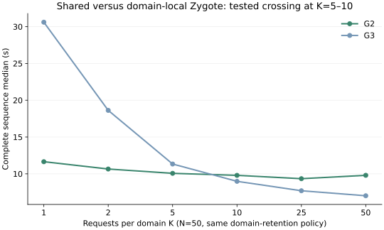

# 实验汇总：效果、条件与适用范围

这些实验的目的，是比较不同执行与复用方式各自适合什么条件。我们保留了反向结果、失败和未知指标，没有把所有模式放进一个无条件排行榜。

## 建议阅读顺序

1. [早期 Worker 实验](../research/shimos_worker_pool/06-benchmark-results.md)：新建与复用、同域与分域。
2. [A+B 集成](../research/shimos_worker_pool/integration_ab/integration-report.md)与[资格矩阵](../research/shimos_worker_pool/integration_ab/analysis/qualification-ab-02-matrix.md)：生命周期和运行时是否在同一路径成立。
3. [NumPy 准入](../research/shimos_worker_pool/numpy_admission/numpy-admission-report.md)：固定可信 CPU 配方。
4. [G0/G1/G2 对照](../research/shimos_worker_pool/architecture_comparison_round1/round1-final-report.md)：每请求新域。
5. [完整架构比较](../research/shimos_worker_pool/architecture_comparison_full/reports/shimos-round3-complete-report.md)：G2/G3/G4、并发、内存、模板切换与工具执行。
6. [真实 Agent 研究](../research/real_agent_workload/reports/real_agent_workload_and_benchmark_final.md)和[依赖诊断](../research/shimos_next_architecture/reports/03_dependency_and_state_reuse.md)：现实中能复用什么。

## 固定实验环境

主要架构对照使用同一物理宿主上的 KVM，4 vCPU / 4 GiB；冻结 Linux 6.18.49-agentic-runtime-opt-v1、Bubblewrap 0.13.1、CPython 3.10.12、基于 Ubuntu glibc 2.35 的 candidate D，以及固定 NumPy 2.2.6 / OpenBLAS 0.3.29 单线程 CPU 配方。精确版本、构建参数和哈希见原报告及来源清单。

VM 是实验环境，不是为每次请求创建的隔离单元。这里的冷启动指新进程与应用初始化，不表示清空系统文件缓存。原有冻结内核/镜像没有随仓库分发，也不能直接用另一个构建替代后声称复现原资格。

## 持久 Worker：四次请求的完整成本

两列使用同一个持久域；每个样本包含初始化、四次请求、结果验证和最终回收。

| 固定任务 | 每请求新 Worker | 复用同一 Worker | 每格序列数 |
|---|---:|---:|---:|
| NumPy 整数归约 | 555.406 ms | 163.325 ms | 6 |
| clangd C 文件符号查询 | 643.113 ms | 177.554 ms | 6 |

复用在这个固定协议下确实节省时间。独立单次快照中，保留热完整域的 PSS 约为 NumPy 30.5 MiB、clangd 104.9 MiB；这不是峰值或长期平均。同域/分域只做了静态布局对照，没有实现动态放置策略。

## 每请求新域：N=100

| 模式 | 完整序列中位数 | 产品根 cgroup CPU 中位数 |
|---|---:|---:|
| G0 原生冷启动 | 53.793 s | 49.679 s |
| G1 跨域 Cold | 61.759 s | 55.805 s |
| G2 共享热模板 | 22.503 s | 16.904 s |

三个配对 VM 块；8 MiB float64 数组、128×128 矩阵配方，与早期整数归约是不同任务。首次预热和最终 H/Z 真实 wait 都计入。G2 在 N=1 时比 G0 慢，不能把重复调用的收益当作单次请求也有的收益。

G2 的 N=100 根记账内存峰值约 61.27 MiB，高于 G0 的 45.46 MiB。时间、CPU、峰值、内存时间积分和实际物理内存是不同指标，不能用其中一个代替全部资源成本。

## 共享模板与域内模板：N=50

| 每域请求数 K | G2 跨域共享 | G3 域内模板 |
|---:|---:|---:|
| 1 | 11.644 s | 30.608 s |
| 2 | 10.651 s | 18.623 s |
| 5 | 10.065 s | 11.331 s |
| 10 | 9.791 s | 8.979 s |
| 25 | 9.337 s | 7.697 s |
| 50 | 9.797 s | 7.016 s |

两组使用相同域数、每域请求数与留域政策。该实验按顺序建立、使用、销毁域，不是同时常驻所有模板。交叉落在 K=5–10 的已测区间；详细报告保留了配对差值和资源观测缺口。

## 进一步比较与负结果

- **G4 持久 Worker：**K=100 只读序列为 8.604 s，G3 为 14.022 s。已知状态恢复约 14.5–14.9 ms/请求，已计入；适用条件比每请求新进程更窄。
- **并发：**四核 VM 中，G2 从 C=4 增至 C=8，完整耗时没有改善（2.513→2.529 s），根记账峰值却上升。
- **内存压力：**96 MiB 共同根预算下，两组受测序列均未完成。业务失败与资源回收通过分开记，未把它们放进成功吞吐排名。
- **模板切换：**单槽双 profile 的集中与交替请求分别为 4.645/11.198 s，包含切换及关闭。它说明切换有成本，没有证明新缓存算法已经有效。
- **外部工具：**T2 不经 Python heap，直接启动最终要 exec 的工具，在多数受测场景更直接；反向和噪声较大的 ELF 样本也保留。工具组有单独安全合同，不能与 NumPy 混排。

## 真实 Agent 观察

公开数据包含 122 次真实运行、108 个 task ID、5,288 次工具动作；另有 13 个任务、414 次动作、102 次 Python 执行的私有 VM 固定轨迹观察。这些数字不能直接换算成合法 heap 或模板命中次数。

后续 B0/B1 适配没有取得共同完整资格，因此没有给出无条件的双执行器加速比。独立 mpmath 新 Python 导入探针用普通字节码缓存将约 231–233 ms 降到 70 ms，也提醒我们先与成熟缓存比较。它不是在线 Agent 端到端收益。

## 怎样复算？

运行 `python3 benchmarks/reproduce_tables.py`，可从收录的 CSV 复算两张主要结果表。脚本明确选择正式成本样本，保留导出文件中的其他诊断行。这是历史数据复核，不会启动新实验；原始未脱敏日志没有分发，当前仓库也不能单独重新认证全部历史资格。
