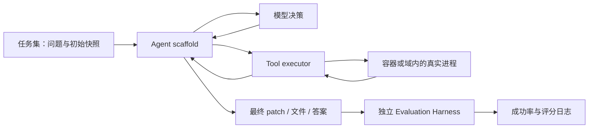

# 主流 Agent Benchmark：任务、执行器与评分边界

审查日期：2026-10-20。本文是官方资料和冻结源码审查，**不把静态审查写成运行资格**。真实轨迹和私有 VM 测量另见本研究的第 3、4、7 份报告。本文没有调用模型 API、运行下载来的代码、启动容器或云资源。

## 先说清楚四个对象

| 对象 | 本轮例子 | 决定什么 | 不决定什么 |
|---|---|---|---|
| Benchmark 任务集 | SWE-bench Verified、Pro V2、Terminal-Bench 2.0、DABstep | 初始问题、文件/依赖、答案或测试 | 不统一规定每次 action 要不要创建进程/沙箱 |
| Agent scaffold | mini-SWE-agent、SWE-agent、OpenHands、Terminus 2 | 模型与工具如何交替、何时停止 | 不能仅凭名称推断所有版本/Environment 的状态语义 |
| Tool executor | mini DockerEnvironment、SWE-ReX Bash session、OpenHands terminal/Jupyter | 实际 shell/解释器/工作区、超时和进程管理 | 不决定最终 patch 是否解决 Benchmark |
| Evaluation harness | SWE-bench `run_evaluation`、Harbor verifier、DS-1000 checker | 独立验证产物、记录分数/失败 | 其测试容器、ProcessPool 不等于 Agent 自主工具调用负载 |

因此，“SWE-bench 用 Docker”不能推出“Agent 每次调用新建 Docker”；“容器内执行 50 次 Python”不能推出“复用了 50 次 Python heap”。本报告将这些问题保留给有具体版本的执行器审查和进程追踪。

## 版本及可获取性核对

以下是本次实际下载并冻结的身份，不使用浮动 `latest` 作为可复现标识。完整 SHA、URL、许可及逐文件 SHA 见 来源目录 (`sources/benchmark_catalog/`, omitted from this source release)；12 个条目、35 个字段见 CSV (`benchmark_survey/benchmark_catalog.csv`, omitted from this source release) / JSON (`benchmark_survey/benchmark_catalog.json`, omitted from this source release)。机器表逐条覆盖能力、来源、语言、输入、初始化、进程/域复用、结束、评分、轨迹、可观测性、私有 VM 条件和成本问题。

| 任务集或框架 | 固定版本/实际规模 | 本次代码身份（缩写） | 重要边界 |
|---|---|---|---|
| SWE-bench Full | test 2,294，12 个 Python 仓库 | `02e7a74ffd0b` | 官方评分与 Agent 运行是两条路径 |
| SWE-bench Lite | test 300；dev 23 | 同上 | 筛选较自包含修改，不是任意生产任务随机样本 |
| SWE-bench Verified | 500 人工筛选任务 | 同上 | 人工检查不代表没有数据/测试缺陷 |
| SWE-bench Multilingual | 300，42 仓库，9 语言 | 同上 | C/C++/Go/Java/JS/TS/PHP/Ruby/Rust，不能按 Python 负载归纳 |
| SWE-bench Pro V1 public | HF `v1`，731 | `66f92766bba6` 中保留的 V1 路径 | 2025 S3 轨迹属于 V1 |
| SWE-bench Pro V2 public | 2026-09-22，642；HARD-51 | `66f92766bba6`，`v2/` | HF `default` 已切到 V2；Agent 离线运行，最终 fresh-sandbox 重评分 |
| Terminal-Bench 1 | legacy core 0.1.1，80 个指定 task | harness `d28711d0da26`；dataset `91e10457b541` | registry 的 0.1.0 是 71；不能混为同版本 |
| Terminal-Bench 2.0 | 89 个 `task.toml` | `2fd12b88aafd` | 2.1、3.0、4.0 已另外发布，本轮不替换成新版本 |
| Harbor | harness；没有统一 task 数 | `96ff9c6db90c`，tag 列表至 v0.24.0 | main 源码与 TB2 首发时 harness 不同，必须联合冻结 |
| DS-1000 | 1,000；2024 simplified format | `b39aab71da6d` | 单题代码生成/评分，不是多轮 Agent 数据 |
| DA-Code | 论文 500；repo 给 100 个 source 样例入口 | `b211daf51fdc` | Python 动作实际重新启动脚本解释器 |
| DABstep | 冻结 default 450、dev 10 | Space `d4431c2e4a69` | 多步 Python；官方固定 smolagents 1.3.0，默认 AST 执行器跨步保留状态 |

官网的 SWE-bench 规模见[官方任务列表](https://www.swebench.com/)；Lite 筛选规则见[官方说明](https://www.swebench.com/lite.html)；Multilingual 语言和构建筛选见[官方说明](https://www.swebench.com/multilingual.html)。Terminal-Bench 的[版本页](https://www.tbench.ai/benchmarks)目前列有 2.1/3/4，访问旧 `leaderboard/terminal-bench/2.0` 已重定向首页并显示 4.0。**这是一项实际发现的版本混淆风险，不应使用落地页标题代替请求版本。**

许可也应分层：SWE-bench/Pro/DA-Code 代码仓库为 MIT，Harbor/TB 为 Apache-2.0，DS-1000 为 CC-BY-SA-4.0，DABstep 数据为 CC-BY-4.0。SWE Full/Lite/Verified 和 Pro 的本次 HF card 未单列数据许可，不能把 MIT harness 自动扩展到每个原仓库、补丁、轨迹或第三方数据。DABstep Space 的 LICENSE 指向 CC-BY-4.0，而 setup.py 分类写 MIT；记录冲突，不自行认定更宽授权。仅本地研究保存已获取公开资料，本轮未发布或重新分发。

## 软件工程任务：SWE-bench 家族

### Full、Lite、Verified、Multilingual

输入通常是 issue 描述和修复前的仓库快照；Agent 可读写代码、运行测试并产出 patch。Full 的来源是实际 GitHub issue/PR。Lite 在原集基础上排除大修改、跨文件等情况；Verified 增加人工检查；Multilingual 扩展到非 Python 语言，也过滤了构建过慢或无法本地构建的仓库。因此它们都是有选择偏差的可执行任务集，不能当作企业全部开发工作的自然抽样。

**实际评分源码已经核查：**冻结的 `swebench/harness/run_evaluation.py:229–428::run_instance` 从实例 image 创建容器，应用模型 patch，复制 `/eval.sh`，`exec_run_with_timeout` 运行测试，解析 F2P/P2P 状态，finally 清理容器。当前 `utils.py:251::make_test_spec` 和数据中的 image/eval_script 是复现依据；不能只抄旧论文“三层构建镜像”当成当前代码路径。源码链接：[run_instance](https://github.com/SWE-bench/SWE-bench/blob/02e7a74ffd0b707aab73d203fe87bdc7c76afc8e/swebench/harness/run_evaluation.py#L229)。

这条路径**不包含 Agent 的模型决策循环**。Agent 可能在一个持久容器中多次 `docker exec`，也可能使用其他 executor；模型自己跑的 pytest 与最终 harness 测试是不同事件。应分别计量 `T_agent`、`T_tool`、`T_official_score`，不要把最终评分建域当成 Agent 每 action 支出的成本。

公开轨迹通常来自 SWE-bench/experiments 的实际提交目录、提交者 assets 或 S3。数据集里的 issue、gold patch、测试列表不是轨迹。可观察到的工具命令和输出由具体提交格式决定，PID、namespace、cgroup 一般仍缺失。完整自然样本的纳入数量由本轮 `trajectory_manifest.csv` 决定，而不是用 leaderboard 行数充数。

私有 VM 应先选择已有镜像和正确性参考的小任务，再扩到科学 Python 或 C/C++/Rust 构建；4 GiB 不是全量可运行保证。直接相关机制是持久域、工作区连续性和 Native Exec。重复 `pytest` 可以形成初始化**候选**，但其中还会导入正在被 Agent 修改的项目代码，不能直接放进长期可信 Z。

### SWE-bench Pro：V1 与 V2 必须拆开

2025 论文总规模 1,865 包含公开、保留和商业集合；本轮只讨论可获取公开集，不能把 1,865 当成本地可下载数。V1 public 是 731，主要公开仓库使用较强 copyleft 许可。V2 发布目录与 HF card 已实际核实：642/11 仓库、HARD-51、公开 GHCR 镜像和专门的 `v2/tooling/`。版本来源：[固定 README](https://github.com/scaleapi/SWE-bench_Pro-os/blob/66f92766bba642462d4bbe5479e83f91f9211862/README.md#L9)、[V2 说明](https://github.com/scaleapi/SWE-bench_Pro-os/blob/66f92766bba642462d4bbe5479e83f91f9211862/v2/README.md)。

已读实际实现，而不只接受“fresh sandbox”标签：

- `v2/tooling/locked_mini_swe.py:19–83` 在 Agent 所在环境安装 mini、限制运行时长，在 finally 捕获 `model.patch`。安装可涉及下载、系统包和独立 Python 3.12，应计入准备账本；不能只按仓库 Python 版本标记 Agent 控制面。
- `patch_replay.py:25–75` 是另一次 Harbor trial 的 Agent：从原运行找到 patch，把它应用到新环境，再由 verifier 评分。只搬 patch，不保留 Agent 环境内修改过的 pytest/python/git。这是**安全评分隔离**，不是跨工具 Worker 复用。
- 本次抽读的 11 个仓库代表 `task.toml` 均有 Agent `no-network` 和独立 verifier 网络设置。示例 NodeBB 配额为 1 CPU、4,096 MiB、10,240 MiB storage，Agent/verifier 各 3,000 秒；这是**配置声明，不是实测成本**。一个 4 GiB VM 还要承载 guest/harness，不能因为容器声明 4 GiB 就保证装得下。

源码：[locked mini](https://github.com/scaleapi/SWE-bench_Pro-os/blob/66f92766bba642462d4bbe5479e83f91f9211862/v2/tooling/locked_mini_swe.py#L19)、[patch replay](https://github.com/scaleapi/SWE-bench_Pro-os/blob/66f92766bba642462d4bbe5479e83f91f9211862/v2/tooling/patch_replay.py#L25)。

官方 traj README 声称下载 S3 需 AWS 账号，但本轮轨迹收集已通过**匿名公开 GET**取得 V1 完整 `.traj`；实际取得方式优先于文档中的账号建议。未使用账号或产生付费请求。V1 轨迹可研究长任务动作，但不能给 V2 填入运行成绩。V2 本地 Docker 是否完整满足 locked per-phase 网络合同仍须实际验证；不能未经允许改用 Modal/付费模型来“补跑”。

## 终端任务与 Harbor

### Terminal-Bench 1 与 2.0

它们覆盖系统工具、构建、依赖修复、数据处理、服务和终端交互，不仅是修复 GitHub issue。任务由贡献者据实际工作设计并验证；Oracle 脚本用于确认环境和测试，不是自主 Agent 轨迹。TB2 论文讨论质量检查和 Agent 运行，但本轮不从其 published wall time 推导 ShimOS 加速。[论文](https://arxiv.org/html/2601.11868v1)

旧 harness 的 `Harness._run_trial:703–825` 是清晰证据：`spin_up_terminal` 包住整个 trial，创建 Agent tmux session，运行 Agent，再按 `run_tests_in_same_shell` 决定是否另建测试 shell。**另建 shell 不等于另建隔离域。**原始源码：[legacy harness](https://github.com/harbor-framework/terminal-bench-1/blob/d28711d0da2675d0bb1d56de45ae5df6082438a3/terminal_bench/harness/harness.py#L703)。

TB2 使用 `instruction.md/task.toml/environment/tests/solution` 格式和 Harbor。冻结树实际数得 89 个 task config。仅为说明任务依赖差异，已读 `build-cython-ext`：环境 Python 3.13 + NumPy 2.3.0，1 CPU/2 GiB，测试还安装 pytest；与 ShimOS 已准入的 Python 3.10/NumPy 2.2.6 **不是同一依赖合同**。该任务可用于真实构建和冷 import 研究，但不能无声替换成现有 NumPy 模板。[配置](https://github.com/harbor-framework/terminal-bench-2/blob/2fd12b88aafdd04a52c298e3940bcb189f9766d6/build-cython-ext/task.toml)、[环境](https://github.com/harbor-framework/terminal-bench-2/blob/2fd12b88aafdd04a52c298e3940bcb189f9766d6/build-cython-ext/environment/Dockerfile)。

逐项解析 89 个冻结配置：69 项声明 2 GiB、17 项 4 GiB、3 项 8 GiB；84 项声明 1 CPU、3 项 2 CPU、2 项 4 CPU，均声明 0 GPU。这是资源请求，不是实测消耗；当前 4 GiB VM 不能默认容纳所有档位。可重算配置摘要 (`benchmark_survey/tb2-task-config-summary.json`, omitted from this source release)

优先选择无需 GPU、外部凭据或宿主配置的 CPU 任务。会启动服务、后台进程或使用持久终端的任务尤其能揭示“每 action 新 shell”的语义缺口，但只有真实运行才能统计进程数。官方 terminal cast、ATIF/native trajectory 有望提供动作；包含未解析 RSC 引用的网页抓取不能当完整轨迹。

### Harbor 是 Harness，不是固定负载

固定源码 `src/harbor/trial/trial.py` 明确把环境启动、Agent setup/run、verifier、artifact 下载和 stop 分开。`_run_agent_phase:585–669` 记录 Agent 时间、选择 phase 网络、调用 Agent 的 run/resume/load；`_start_agent_environment:1729–1741` 是环境启动；`_stop_agent_environment:1914+` 在取消下保护 stop 完成。不同阶段是值得直接加 hook 的测量边界。[Trial 源码](https://github.com/harbor-framework/harbor/blob/96ff9c6db90cc015f0fc0987d896670c9c5f1fad/src/harbor/trial/trial.py#L585)。

Docker 后端 `exec:1358–1373 → _compose_exec:1401+` 组装容器 exec、cwd/env/user 和平台 shell；不是每次新容器。Terminus 2 又在这个接口之上用 `tmux new-session ... bash --login` 保留终端（`tmux_session.py:398–411`）。所以“Harbor exec”与“Agent Bash 语义”仍需分层检查。[Docker executor](https://github.com/harbor-framework/harbor/blob/96ff9c6db90cc015f0fc0987d896670c9c5f1fad/src/harbor/environments/docker/docker.py#L1358)。

当前 Harbor 支持 shared/separate verifier；`Verifier.verify:196–306` 上传测试、执行 verifier、读取 reward.txt/json。是否新评分域由 task 与配置决定，不能把 Pro V2 专用 fresh regrade 泛化给所有 Harbor 任务。多服务 compose 也意味着一个 trial 可能不止一个容器。精确统计应记录 environment/trial/service ID，再关联 PID/ns/cgroup。

## Python 与数据分析任务

### DS-1000：真实代码，但不是自然 Agent 循环

数据包括 NumPy 220、Pandas 291、SciPy 106、Matplotlib 155、Scikit-learn 115、PyTorch 68、TensorFlow 45。默认流程读取已生成代码答案，创建测试程序，再运行正确性检查；它不能提供自然 `K_tool` 或模型思考空隙。[官方代码和说明](https://github.com/xlang-ai/DS-1000/tree/b39aab71da6d23ef8d3cac59a7c5f834516ab334)

`test_ds1000.py:22–49` 用外层 ProcessPoolExecutor；`execution.check_correctness:16–77` 内部另建 Manager 和 Process，临时目录中 exec，超时 join/kill。这不是 Linux 安全沙箱，且代码明确没有启用 reliability_guard。不能在宿主直接执行，也不能将外层池 worker 数当业务题数。

官方特别指出 TensorFlow/Matplotlib 的状态，以及 `import a.b` 对后续导入语义的影响，要求各题独立进程。因此 DS-1000 是**独立进程正确性和真实依赖初始化**的有用补充；透明换成持久 G4 会改变合同。使用其中 NumPy 题也需确认固定版本、代码依赖和受信范围，不能因为同名库就继承旧准入。

### DA-Code：持久容器，Python 脚本仍冷启动

论文是 500 个多步数据处理/分析任务，仓库提供 100 个 source 样例与外部全量数据入口，使用 Bash/Python/SQL，最终按生成文件/数据评分。[论文](https://aclanthology.org/2024.emnlp-main.748/)、[固定代码](https://github.com/yiyihum/da-code/tree/b211daf51fdc9b52d5087c9df28ac50191bcabed)

本轮直接读到 `PythonController.execute_command:77–95` 调用容器 `exec_run(["bash","-c",...],workdir=...)`；`execute_python_file:104–117` 写脚本后运行 `python3 file`。环境 `DA_Agent_Env:64–76,156–204` 构造并持续持有 Docker，close 才 stop/remove。文件持续、cwd 部分由 controller 跟踪，但这不是持续 Python heap；重复数据读取/import 是待观测候选，不是已确认可 fork 的模板。

`run.py` 与 `evaluate.py` 分离。源码还能看到 execute_command 收到 exit_code 却主要返回解码输出，应保持它原本的返回语义并另外观测真实退出状态。自然轨迹全量公开可用性目前 UNKNOWN；有代码入口不等于已经有真实运行日志。

### DABstep：值得区分的 Python 执行模型

本次官方 HF revision 实际解析到 default 450（hard 378、easy 72）和 dev 10。任务要求结合 CSV/JSON 与说明文档回答真实金融分析问题；dev 有公开答案，default ground truth 隐藏。最终 scorer 比较 factoid 答案，不是运行 SWE 测试补丁。[数据卡](https://huggingface.co/datasets/adyen/DABstep)、[论文](https://arxiv.org/html/2506.23719v1)

官方 Space 的 `baseline/run.py:62–105` 每 task 创建 CodeAgent 并 `agent.run`，`utils.py:90–119` 配置 read-only open 工具；`baseline/requirements.txt` 固定 **smolagents 1.3.0、litellm 1.58.2**。追到该版本 commit `cd3ebb6bdde976fc247cf4ac45cc30418edc389d`：`agents.py:934–947,1023–1028` 默认选 LocalPythonInterpreter；`local_python_executor.py:1384–1478` 直接 AST 求值，`self.state` 跨步保留变量，未在每步 fork/exec Python。它不是 IPython，也不是每次启动脚本；import 经 `importlib` 在当前 Python 进程执行（`:1049–1070`）。这是**固定源码的状态持久证据，尚非本项目 PID、内存与安全资格的运行证据**。import 白名单不能替代 namespace/cgroup 隔离。[固定 smolagents 源码](https://github.com/huggingface/smolagents/blob/cd3ebb6bdde976fc247cf4ac45cc30418edc389d/src/smolagents/local_python_executor.py)

小型 dev 集可用于未来不同执行模型验证，但必须固定运行时、外包私有 VM、另测状态重置/业务正确性。本轮未调用模型。官方代码会把 args 写入 config，因此若后续运行，不能把 API key 放 `--api-key` 参数或原样 args 日志里。公开 submissions 常只保存答案/分数，不能算完整多步轨迹。

## Agent 框架与补充任务的选择边界

mini-SWE-agent、SWE-agent、OpenHands 是本研究第 2 份文档的逐函数执行器审查对象；它们可以跑相同 Benchmark，却有不同 shell/Python 状态。mini 的 DockerEnvironment、SWE-ReX Bash session、OpenHands terminal/Jupyter 必须分开版本与模式，不能给一个“通用 Agent 每动作建域”结论。

OSWorld 的主要挑战是桌面应用与图形交互；AgentBench 混合多个环境，其中 OS 子集更相关。它们可用于补充协议边界，但本次不把浏览器/桌面等待或远程服务动作混入 Linux 工具进程比例。没有为了类别覆盖额外下载大套 GUI 镜像。[OSWorld 官方入口](https://os-world.github.io/)、[AgentBench 官方入口](https://github.com/THUDM/AgentBench)

## 给后续测量的具体约束

1. **优先固定一个 Benchmark task + 一个 Agent commit + 一个 executor 配置。**任务集、镜像 digest、工具版本都应冻结；`latest`、Pro HF default、TB 旧网页重定向均已出现版本漂移。
2. **以可复现任务为单位先资格。**SWE 小仓库适合工作区/测试闭环，TB2 CPU 任务适合持久终端/后台作业，DA-Code/DABstep 补数据分析模型，DS-1000补初始化机制；它们的任务数不能合为一个无条件分母。
3. **记录至少四条时钟边界。**环境准备、Agent自主执行、工具层响应、官方评分分别计量。镜像下载/构建、Agent安装、模型推理、最终清理都不能无声免费。
4. **状态匹配先于性能。**持久 shell、长期 Python executor、每请求新解释器是不同合同；T2最直接适用于外部命令，G2/G3/G4必须先证明任务接受相应状态模型。
5. **成本仍为 UNKNOWN 的地方不填估计秒数。**配置中的900/3000秒是上限，论文人工完成估计不是机器实测；本目录没有在线 Agent 成本、净物理内存或 ShimOS 加速数据。
6. **执行器可观测不等于已观察。**私有 VM 可以读 PID/ns/cgroup 并加 hook；公开 trajectories 通常只能支持动作分析。实际覆盖率、丢事件与追踪扰动由运行报告给出。

## 复核入口与已知限制

- 机器对照表 (`benchmark_survey/benchmark_catalog.json`, omitted from this source release)：逐条保留 UNKNOWN、代码/数据许可差别和18项问题对应字段。
- 生成脚本 (`benchmark_survey/build_catalog.py`, omitted from this source release)：只读来源元数据，生成 CSV/JSON；不执行 Benchmark。
- 来源获取脚本 (`sources/benchmark_catalog/fetch_sources.py`, omitted from this source release)、HF 获取脚本 (`sources/benchmark_catalog/fetch_hf.py`, omitted from this source release)：匿名下载官方文档/源码，有失败记录。`huggingface/dabstep` GitHub 猜测入口返回404，已保留并改用官方 HF Space；未伪造缺失 Git repo。
- 完整 task/rootfs/images 未全部下载；本目录审阅源码不是运行环境准备完成。Pro V2 官方 gate 642/642 是作者结果，不是本项目复测。
- 本轮不决定 ShimOS 保留哪条架构。上述材料只确定可以公平测什么、不能从哪些现象推出 heap 复用，以及下一批运行必须固定哪些对象。
