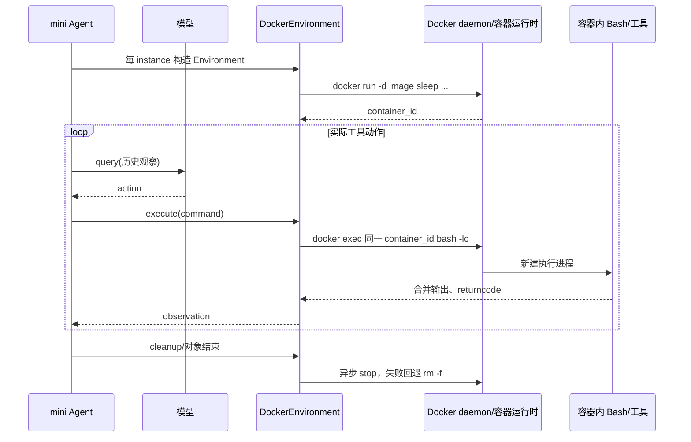
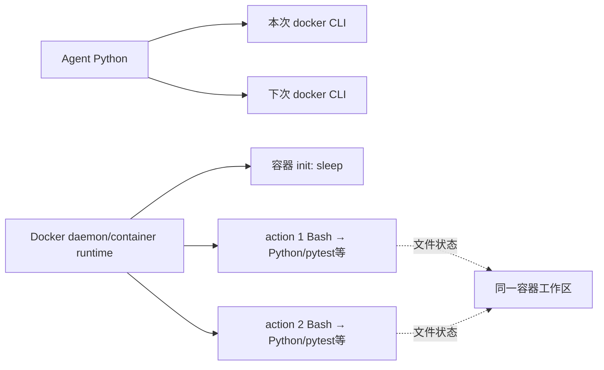
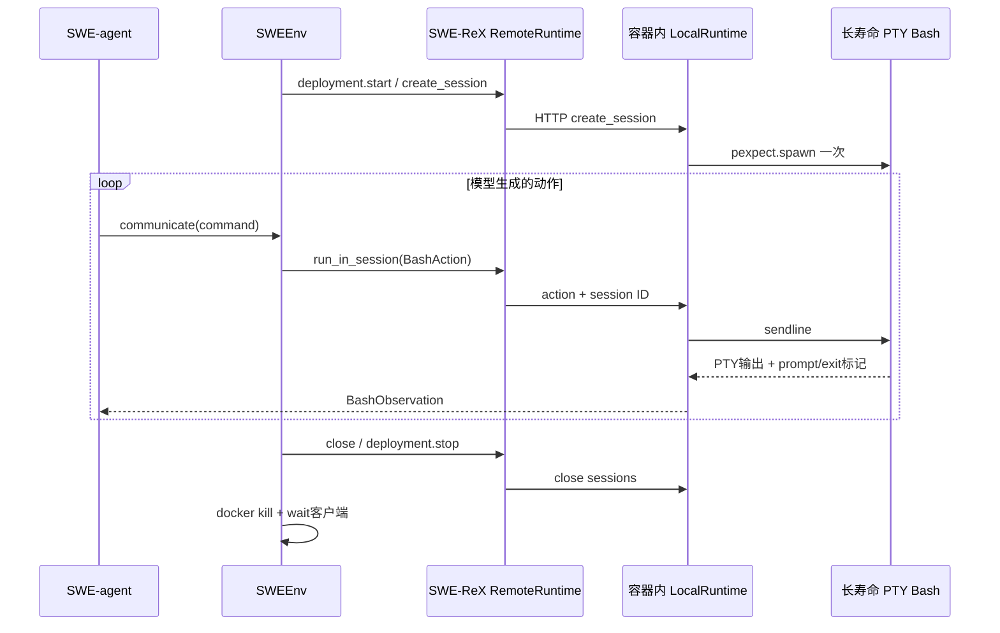
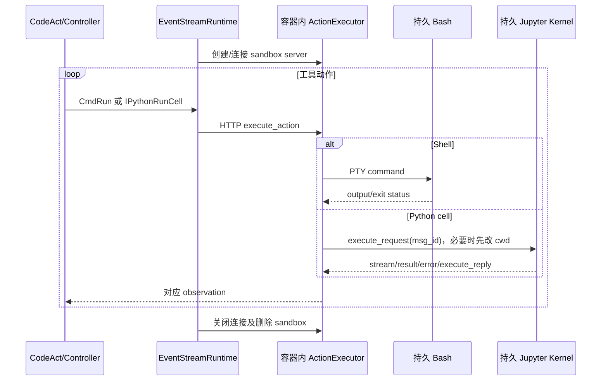
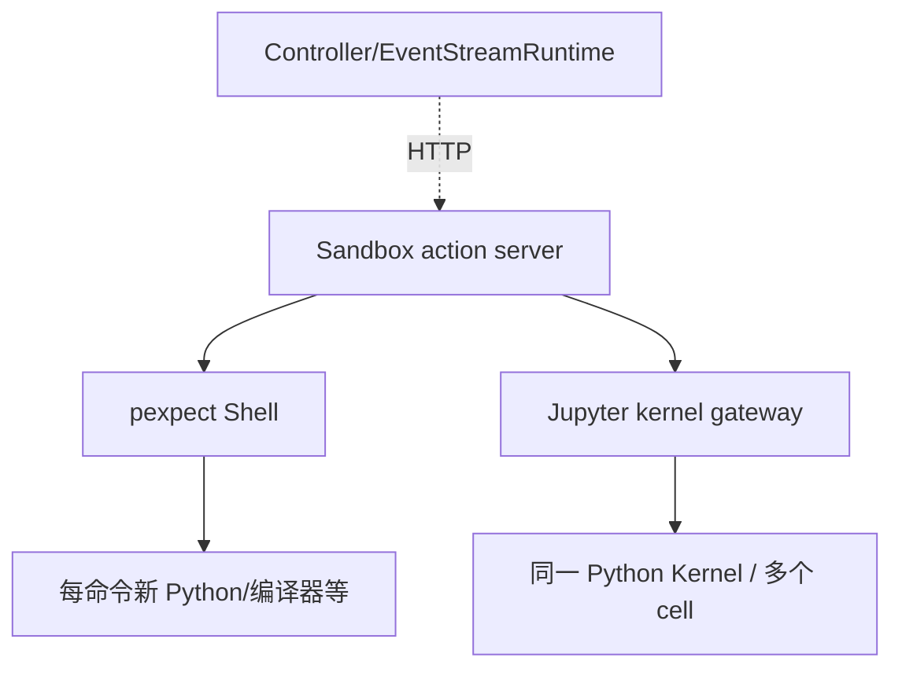
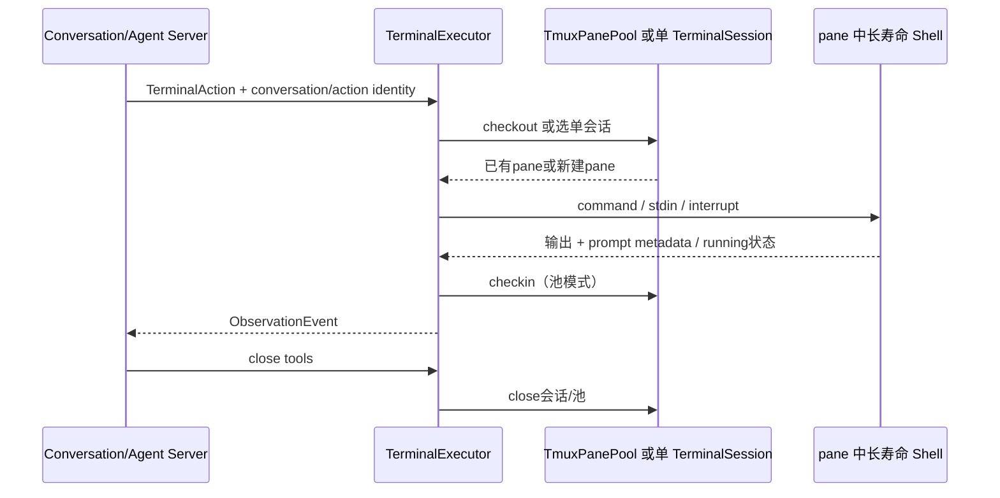
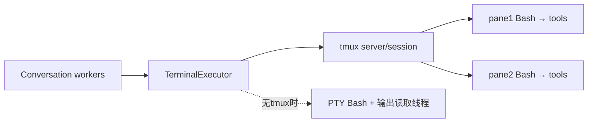

# Agent 工具执行架构：源码、版本与可观测边界

审查日期：2026-10-20。本文为本轮只读源码调查；不运行 Agent、模型、Docker 或工具命令。运行证据来自旧研究时明确标记为历史，本轮新运行见独立测量报告。

核心发现：**工具调用次数、容器数、Shell 数和 Python 解释器数并不是同一件事。** mini-SWE-agent 的常用 Docker 后端在一项任务中保留容器，却为每个动作新建 Shell；SWE-agent 通过 SWE-ReX 保留交互 Shell；旧 OpenHands 可以保留 Jupyter Kernel；当前 OpenHands SDK 又加入了可并发复用的 tmux pane pool。这些既有复用机制必须进入 ShimOS 的强基线，不能统一简化成“每次全部冷启动”。

## 1. 本次固定的实现身份

官方 GitHub API 的 default-branch commit 与递归树保存在 `sources/agent_architecture/*-metadata.json`、`*-tree.json`；已读取的文件与失败下载记录保存在三个 `*-files.json`。下载错误没有覆盖。这里只获取选定文件，未运行上游代码。完整逐文件 SHA 在 manifest (`sources/agent_architecture/source-file-manifest.json`, omitted from this source release)，44 条可机器核查的结论在 source-claims.csv (`agent_architecture/source-claims.csv`, omitted from this source release)。

| 实现 | 实际 commit | 包声明/用途 | 许可与运行前提 |
|---|---|---|---|
| mini-SWE-agent 当前 | `04d809ceab9df28f9adaed044884180159172930` | 2.4.6；2026-10-20 查询 HEAD | MIT；Python≥3.10 |
| mini-SWE-agent 历史 | `a2b0efee5fd9c1d3bc9fdfc6fe88036a2235d74d` | v1.0.0；旧公开轨迹与本项目旧 VM 使用 | MIT；官方 Python≥3.11，旧 VM 3.10.12 仅最小路径探针，不扩大支持范围 |
| SWE-agent 当前 | `3ea751c087f32b16e039a2233dd6eefecef325d5` | 包版本 1.1.0；HEAD 不等于历史运行版本 | MIT；Python≥3.11；依赖 SWE-ReX≥1.4.0 |
| SWE-ReX 当前 | `5c995c365dfb1fd5bc56fda688be5d8538f9931f` | 1.4.0；同时审两种调用接口 | MIT；Python≥3.10 |
| OpenHands 历史 runtime | `a86275e288087bc7833bc79b0b691ed2ec223205` | pyproject 声明 0.11.0；用于解释旧 CodeAct/runtime 语义 | MIT；不声称所有公开 OpenHands 轨迹均用此 commit |
| OpenHands SDK 当前 | `0996c33916c2a977ea9fe38deee660ff0e1389f2` | SDK 1.56.0；终端、workspace、conversation 实现 | MIT；Python≥3.12 |
| OpenHands/OpenHands 当前入口 | `61cd03c89ed7e5581d1f304f5791962612701b37` | Agent Canvas；README 自报 1.28.1 | MIT；当前执行核心分到 SDK，旧 `openhands/runtime` 路径已非当前入口 |

版本声明来自冻结 `__init__.py`/`pyproject.toml`，许可证来自本次读取的 LICENSE 文件。源码目录中的 README 是版本证据，不是运行正确性证据。当前 OpenHands 主仓库已明确区分 Canvas、SDK/Agent Server、automation 的职责；不能把旧 Python 单仓库结构延用到最新版本。

## 2. 四个层次先分开

- **Benchmark** 定义任务、初始代码、测试或评分标准。
- **Agent scaffold** 决定怎样提示模型、生成和解析动作、什么时候提交。
- **Tool executor** 决定一个动作进入哪个环境、创建哪些进程、保留哪些状态。
- **Evaluation harness** 在最终候选上运行官方测试。它可能另外创建容器、装依赖，不能未经标记算入 Agent 的每动作成本。

mini 的 SWE-bench runner 按 instance 选择镜像并创建 Environment，然后调用 Agent、写轨迹和 patch；这个循环并不是最终 SWE-bench test harness。相同 SWE-bench 任务可由不同后端执行，题目本身没有规定每动作新容器。[M09：get_sb_environment，79–94行](https://github.com/SWE-agent/mini-swe-agent/blob/04d809ceab9df28f9adaed044884180159172930/src/minisweagent/run/benchmarks/swebench.py#L79) [M10：process_instance，122–177行](https://github.com/SWE-agent/mini-swe-agent/blob/04d809ceab9df28f9adaed044884180159172930/src/minisweagent/run/benchmarks/swebench.py#L122)

## 3. mini-SWE-agent：持久容器中的独立命令

### 调用链与生命周期

当前 `DefaultAgent.step → query → execute_actions`：模型结果中的每个 action 依次进入 `env.execute(action)`。因此一个模型请求可产生多个 Tool Action；历史 v1 则要求恰好一个 bash fenced block，调用 `env.execute(str)`。两版轨迹解析、提交标记和错误协议不能混用。[M01：DefaultAgent.step/query/execute_actions，126–157行](https://github.com/SWE-agent/mini-swe-agent/blob/04d809ceab9df28f9adaed044884180159172930/src/minisweagent/agents/default.py#L126) [M11：DefaultAgent，70–127行](https://github.com/SWE-agent/mini-swe-agent/blob/a2b0efee5fd9c1d3bc9fdfc6fe88036a2235d74d/src/microsweagent/agents/default.py#L70)



`DockerEnvironment.__init__` 只建一次长寿命 sleep 容器；`execute` 每次调用 `docker exec`，容器 ID 不变、默认解释器为 `bash -lc`。普通文件、`/tmp`、容器里的其他存活进程可能跨动作存在；上一 Bash 的 `cd`/`export` 不会自动成为下一 Bash 的状态，下一次 cwd/env 由参数重新提供。`python script.py` 会启动新的 Python 映像，不能继承上一次 Python heap。[M02：DockerEnvironment._start_container，74–99行](https://github.com/SWE-agent/mini-swe-agent/blob/04d809ceab9df28f9adaed044884180159172930/src/minisweagent/environments/docker.py#L74) [M03：DockerEnvironment.execute，101–138行](https://github.com/SWE-agent/mini-swe-agent/blob/04d809ceab9df28f9adaed044884180159172930/src/minisweagent/environments/docker.py#L101)



图中 Docker daemon 到 exec 进程是**创建责任示意**，不是声称所有版本的真实 PPID 都是 daemon；containerd/shim/runc 的亲缘必须从运行时事件取得。

### 后端差异与故障边界

| 后端 | 域与进程组织 | 持续状态 | 结束/超时边界 |
|---|---|---|---|
| 当前 Docker | Environment 一容器，每 action 新 bash | 文件、容器内后台进程；非 Bash 本身/非 Python heap | Python `subprocess.run` timeout 作用于 docker CLI；源码不足以证明所有容器后代已清理；cleanup 是异步 Popen |
| 当前 Local | 无新增隔离域，每 action 新 shell | 宿主/guest 文件；非 shell env/cwd | new session + timeout killpg + communicate；脱离进程组的后代仍需域级观测，不能自动等同 H/cgroup 合同 |
| 当前 experimental Bubblewrap | 一 Environment 保留工作目录，每 action 新 bwrap/bash | bind 的文件目录，`/tmp` 是每 action tmpfs | 默认 wrapper 不是 ShimOS 六 namespace/cgroup/H 合同；不得混入同安全排名 |
| 当前 mini 的 SWE-ReX adapter | 一次启动 deployment，每 action `runtime.execute(Command)` | deployment 文件；非持久 BashSession | 独立 subprocess API；与 SWE-agent 的 `run_in_session` 不同 |

对应源码：[M04：DockerEnvironment.cleanup，153–161行](https://github.com/SWE-agent/mini-swe-agent/blob/04d809ceab9df28f9adaed044884180159172930/src/minisweagent/environments/docker.py#L153) [M05：_run，72–92行](https://github.com/SWE-agent/mini-swe-agent/blob/04d809ceab9df28f9adaed044884180159172930/src/minisweagent/environments/local.py#L72) [M06：BubblewrapEnvironmentConfig，29–65行](https://github.com/SWE-agent/mini-swe-agent/blob/04d809ceab9df28f9adaed044884180159172930/src/minisweagent/environments/extra/bubblewrap.py#L29) [M07：BubblewrapEnvironment.execute，78–103行](https://github.com/SWE-agent/mini-swe-agent/blob/04d809ceab9df28f9adaed044884180159172930/src/minisweagent/environments/extra/bubblewrap.py#L78) [M08：SwerexDockerEnvironment.execute，22–45行](https://github.com/SWE-agent/mini-swe-agent/blob/04d809ceab9df28f9adaed044884180159172930/src/minisweagent/environments/extra/swerex_docker.py#L22)。Bubblewrap 的默认 `--unshare-user-try` 还与强制 userns 成立不同；用户可自定义 wrapper，报告必须保存实际 argv。它是有价值的现实原生 bwrap 基线，但缺少默认 PID/net/cgroup 等不能称为完整等价隔离。

当前 Docker 返回 `exception_info/returncode=-1`；v1 抛 TimeoutExpired 由 Agent 转成观察。当前提交标记还要求 rc=0，v1 仅检查输出标记；无论哪种提交，都不证明最终测试通过。源码支持返回动作结束，不能因此省略 Sandbox teardown 完成检查。

## 4. SWE-agent + SWE-ReX：不能丢掉持续 Shell 的语义

`SWEEnv.start` 启动 deployment，创建一次 BashSession，并在该 Shell 设置环境。之后 `communicate` 发送 `BashAction` 到 `run_in_session`。`set_env_variables` 发送 export，因此 cwd、环境激活和 Shell 变量会跨调用保留。另有 `execute_command` 专门执行与会话无关的 subprocess；统计时必须按接口分开。[S01：SWEEnv._init_deployment/communicate，176–232行](https://github.com/SWE-agent/SWE-agent/blob/3ea751c087f32b16e039a2233dd6eefecef325d5/sweagent/environment/swe_env.py#L176) [S03：set_env_variables/execute_command，256–275行](https://github.com/SWE-agent/SWE-agent/blob/3ea751c087f32b16e039a2233dd6eefecef325d5/sweagent/environment/swe_env.py#L256)



`LocalRuntime.sessions` 保存会话，BashSession 只有 start 时 `pexpect.spawn`。一条命令可以使用 builtin、不派生业务进程，也可以 pipeline 派生多个；PTY Shell 的存在不证明 pytest/Python 解释器复用。普通 `python test.py` 仍由 Shell 新启动 Python。`run_batch.run_instance` 每 instance 创建/start 环境、运行、finally close，未发现这个入口自动跨不同任务共享同一有状态 Shell。`reset()` 可以复用 deployment 重置仓库，`hard_reset()` 才关闭再启动；不能把这个 API 能力当自然跨任务复用频率。[R01：BashSession.start，157–175行](https://github.com/SWE-agent/SWE-ReX/blob/5c995c365dfb1fd5bc56fda688be5d8538f9931f/src/swerex/runtime/local.py#L157) [R03：BashSession._run_normal/close，274–358行](https://github.com/SWE-agent/SWE-ReX/blob/5c995c365dfb1fd5bc56fda688be5d8538f9931f/src/swerex/runtime/local.py#L274) [R04：LocalRuntime sessions/execute，390–453行](https://github.com/SWE-agent/SWE-ReX/blob/5c995c365dfb1fd5bc56fda688be5d8538f9931f/src/swerex/runtime/local.py#L390) [S02：reset/hard_reset/close，128–171行](https://github.com/SWE-agent/SWE-agent/blob/3ea751c087f32b16e039a2233dd6eefecef325d5/sweagent/environment/swe_env.py#L128) [S05：run_instance，338–371行](https://github.com/SWE-agent/SWE-agent/blob/3ea751c087f32b16e039a2233dd6eefecef325d5/sweagent/run/run_batch.py#L338)

```mermaid
flowchart TD
    A[宿主/控制 VM 的 SWE-agent] -. HTTP .-> R[容器内 SWE-ReX server/LocalRuntime]
    R --> S[长期 Bash PTY]
    S --> P1[Python/pytest action 1]
    S --> P2[gcc/make action 2 的进程树]
    R --> X[execute(Command) 独立 subprocess]
```

超时从 pexpect 等待转为 `CommandTimeoutError`；Agent 捕获后调用 interrupt。实现先向 PTY 发 SIGINT并等待 prompt，再回退 CTRL-Z 和 `kill -9 %1`。这支持交互任务恢复，但单凭 prompt 或 job1 被 kill 不能推断域里所有后代消失。stop 关闭 Runtime、docker kill、wait 本地 docker 客户端；后者不能冒充每个工具进程的真实 wait。强故障保障须单独注入验证。[S04：action execution，959–992行](https://github.com/SWE-agent/SWE-agent/blob/3ea751c087f32b16e039a2233dd6eefecef325d5/sweagent/agent/agents.py#L959) [R02：BashSession.interrupt，186–216行](https://github.com/SWE-agent/SWE-ReX/blob/5c995c365dfb1fd5bc56fda688be5d8538f9931f/src/swerex/runtime/local.py#L186) [R06：DockerDeployment.stop，285–315行](https://github.com/SWE-agent/SWE-ReX/blob/5c995c365dfb1fd5bc56fda688be5d8538f9931f/src/swerex/deployment/docker.py#L285)

该路径已经支付一次环境/PTY初始化，源码还含一次性 0.3 秒 startup sleep。不得把它放大为每 action 固定开销。SWE-ReX 还可能构建或安装执行服务，它是环境 provisioning，与题目依赖安装和每请求 Python import 分开计费。[R01：BashSession.start，157–175行](https://github.com/SWE-agent/SWE-ReX/blob/5c995c365dfb1fd5bc56fda688be5d8538f9931f/src/swerex/runtime/local.py#L157) [R05：DockerDeployment.start，233–283行](https://github.com/SWE-agent/SWE-ReX/blob/5c995c365dfb1fd5bc56fda688be5d8538f9931f/src/swerex/deployment/docker.py#L233)

### 公开轨迹中的 execution_time 口径

当前冻结 SWE-agent 1.1.0 的 `handle_action` 在动作 hook 后开始计时，覆盖命令整理、`env.communicate` 和发生超时时的中断处理；在下一个 hook、`get_state` 和提交处理之前停止。它不包含模型 query，也不等于工具纯 CPU 或完整资源回收时间；`exit` 等提前结束分支不经过这段计时。新获取的 SWE-bench Pro 轨迹只声明 SWE-agent 1.1.0、未给 SWE-agent commit，因此上述代码为同版本语义线索，不能认定历史运行与当前 HEAD 每行一致。其 SWE-ReX 1.2.2 也不能被当前 1.4.0 替代。[S06：handle_action/execution_time，935–1007行](https://github.com/SWE-agent/SWE-agent/blob/3ea751c087f32b16e039a2233dd6eefecef325d5/sweagent/agent/agents.py#L935)

## 5. OpenHands：历史 Kernel 与当前终端池分别审查

### 历史 CodeAct/runtime 的确有两类长寿命状态

冻结的 legacy runtime 启动一个 action execution server。其 `ActionExecutor` 持有长期 BashSession、plugin 字典和串行 action 锁；BashSession 通过 pexpect 启动 `su username` 的 Shell。文件读写 action 在 server 内部直接读写文件，**不应假定每个 read/write action 都创建一个外部进程**。[O01：ActionExecutor，79–172行](https://github.com/OpenHands/OpenHands/blob/a86275e288087bc7833bc79b0b691ed2ec223205/openhands/runtime/action_execution_server.py#L79) [O06：BashSession.__init__/close，69–84行](https://github.com/OpenHands/OpenHands/blob/a86275e288087bc7833bc79b0b691ed2ec223205/openhands/runtime/utils/bash.py#L69)

JupyterPlugin 在没有 kernel 时创建 JupyterKernel；`_connect` 只在无 kernel_id 时 POST `/api/kernels`，后续通过同一 channels 发送 execute_request，按 msg_id 收输出。ActionExecutor 在必要时将 Jupyter cwd 对齐 Bash cwd。因此存在源码支持的 Python 对象/模块跨 cell 保留机制，与每次 `python script.py` 完全不同。是否某条公开轨迹实际启用该插件，仍需配置与运行证据。[O02：run_ipython，174–207行](https://github.com/OpenHands/OpenHands/blob/a86275e288087bc7833bc79b0b691ed2ec223205/openhands/runtime/action_execution_server.py#L174) [O03：JupyterPlugin._run，59–77行](https://github.com/OpenHands/OpenHands/blob/a86275e288087bc7833bc79b0b691ed2ec223205/openhands/runtime/plugins/jupyter/__init__.py#L59) [O04：JupyterKernel._connect，94–125行](https://github.com/OpenHands/OpenHands/blob/a86275e288087bc7833bc79b0b691ed2ec223205/openhands/runtime/plugins/jupyter/execute_server.py#L94) [O05：JupyterKernel.execute，141–220行](https://github.com/OpenHands/OpenHands/blob/a86275e288087bc7833bc79b0b691ed2ec223205/openhands/runtime/plugins/jupyter/execute_server.py#L141)





图是实现组件创建关系；Kernel 的具体 PID/PPID、重启代次及插件初始化子进程仍要运行追踪。Jupyter timeout 发送 interrupt而非每次销毁 interpreter；Bash timeout 的 interrupt/fallback也不能自动视为 cgroup空。容器销毁在 EventStreamRuntime.close，工作区 mount还可能在外部持续。[O07：_init_container，243–336行](https://github.com/OpenHands/OpenHands/blob/a86275e288087bc7833bc79b0b691ed2ec223205/openhands/runtime/impl/eventstream/eventstream_runtime.py#L243) [O08：close，397–437行](https://github.com/OpenHands/OpenHands/blob/a86275e288087bc7833bc79b0b691ed2ec223205/openhands/runtime/impl/eventstream/eventstream_runtime.py#L397)

### 当前 SDK 已有可复用终端池，不能套用旧版结论

当前 OpenHands/OpenHands 是 Canvas 入口，执行核心在 Software Agent SDK。SDK 的 DockerWorkspace 在构造时启动 Agent Server 容器；Conversation 的 run 循环生成 ActionEvent，工具执行器返回带 action_id/tool_call_id 的 ObservationEvent。当前 Agent 支持批量/并行 tool execution。[D09：DockerWorkspace.model_post_init，151–156行](https://github.com/OpenHands/software-agent-sdk/blob/0996c33916c2a977ea9fe38deee660ff0e1389f2/openhands-workspace/openhands/workspace/docker/workspace.py#L151) [D07：_execute_actions/_aexecute_actions，628–679行](https://github.com/OpenHands/software-agent-sdk/blob/0996c33916c2a977ea9fe38deee660ff0e1389f2/openhands-sdk/openhands/sdk/agent/agent.py#L628) [D08：_execute_action_event，1499–1561行](https://github.com/OpenHands/software-agent-sdk/blob/0996c33916c2a977ea9fe38deee660ff0e1389f2/openhands-sdk/openhands/sdk/agent/agent.py#L1499)

TerminalExecutor 检测到 tmux 时默认使用 `TmuxPanePool`，通过 semaphore 限制并发，checkout复用空闲pane，无空闲才创建；没有tmux则使用一个长期PTY Bash。Shell状态和Pythonheap仍不是一回事。[D01：TerminalExecutor.__init__，97–129行](https://github.com/OpenHands/software-agent-sdk/blob/0996c33916c2a977ea9fe38deee660ff0e1389f2/openhands-tools/openhands/tools/terminal/impl.py#L97) [D02：checkout/checkin，214–258行](https://github.com/OpenHands/software-agent-sdk/blob/0996c33916c2a977ea9fe38deee660ff0e1389f2/openhands-tools/openhands/tools/terminal/terminal/tmux_pane_pool.py#L214) [D04：SubprocessTerminal.initialize，144–190行](https://github.com/OpenHands/software-agent-sdk/blob/0996c33916c2a977ea9fe38deee660ff0e1389f2/openhands-tools/openhands/tools/terminal/terminal/subprocess_terminal.py#L144)





要特别保留两项边界：

1. pool 的 `_prepare_pooled_session` 清输出/状态，必要时 interrupt未完成命令，不等于完整清空Shell env/cwd或保证后续 action进入同一pane。单会话模式可以延续上下文；并行pool里同一逻辑会话是否稳定映射到同一pane，需要单独实测，不能只照描述文字推断。[D03：_prepare_pooled_session，238–271行](https://github.com/OpenHands/software-agent-sdk/blob/0996c33916c2a977ea9fe38deee660ff0e1389f2/openhands-tools/openhands/tools/terminal/impl.py#L238)
2. `HARD_TIMEOUT` 处理返回观察但不在该函数内杀进程；单会话后续 is_input 可继续读日志/输入/中断。池 checkout 对上次未完成请求另有处理，不能直接把旧 single-session软超时结论推广为当前并发pool合同。[D05：_handle_hard_timeout_command，390–428行](https://github.com/OpenHands/software-agent-sdk/blob/0996c33916c2a977ea9fe38deee660ff0e1389f2/openhands-tools/openhands/tools/terminal/terminal/terminal_session.py#L390) [D06：TerminalSession.execute，561–610行](https://github.com/OpenHands/software-agent-sdk/blob/0996c33916c2a977ea9fe38deee660ff0e1389f2/openhands-tools/openhands/tools/terminal/terminal/terminal_session.py#L561)

Conversation.close 负责关闭工具执行器，DockerWorkspace.cleanup另负责stop容器。workspace还提供pause/unpause，是保留进程状态的环境生命周期能力，不是已实现的跨任务可信Zygote模板。Canvas可选每conversation容器，但共享host workspace的conversation仍共享文件；本地默认配置还可以没有隔离容器。任务/会话/容器不能强制一一对应。[D10：cleanup/pause/resume，369–430行](https://github.com/OpenHands/software-agent-sdk/blob/0996c33916c2a977ea9fe38deee660ff0e1389f2/openhands-workspace/openhands/workspace/docker/workspace.py#L369) [D11：LocalConversation.close，2847–2896行](https://github.com/OpenHands/software-agent-sdk/blob/0996c33916c2a977ea9fe38deee660ff0e1389f2/openhands-sdk/openhands/sdk/conversation/impl/local_conversation.py#L2847) [D12：Multiple Docker Sandboxes，111–134行](https://github.com/OpenHands/OpenHands/blob/61cd03c89ed7e5581d1f304f5791962612701b37/README.md#L111)

当前选定 SDK tree 没有旧 `JupyterPlugin` 实现；这不证明整个 OpenHands生态不能通过插件/MCP提供Python工具，也不能把旧Kernel的使用频率归给当前SDK。各版本是否启用语言服务器、后台服务、Kernel、跨任务复用，均需实际 tool配置与追踪；此审查没有发现可直接归入 ShimOS可信NumPy模板资格的自动通用预热功能。

## 6. 统计与追踪入口：哪些能只读加观测

| 实现 | 可插入的动作边界（独立观测副本） | 域身份取得点 | 还必须有的内核证据 |
|---|---|---|---|
| mini v1 | DefaultAgent.execute_action / Environment.execute前后 | Docker构造后container_id，inspect init PID；bwrap每action launcher记录 | exec前后PID starttime、fork/exit、cgroup、namespace；CLI PID不是容器工具PID |
| mini当前 | execute_actions中逐个action；各Environment.execute | 同上；一个model message可能多action | 绑定独立action nonce，不能model_call直接当进程 |
| SWE-agent/ReX | 已有on_action_started/executed；server run_in_session、BashSession.run | deployment container名 + session ID + shell.pid | PTY启动与工具fork/exec、脱离会话后台进程；prompt完成不是所有后代EOF |
| OpenHands legacy | Runtime.run_action/ActionExecutor.run_action与Jupyter msg_id | runtime sandbox ID、shell.pid、kernel ID | kernel PID代次；同kernel是否真正存活；直接file action可能无外部进程 |
| 当前SDK | ActionEvent/ObservationEvent；_execute_action_event、TerminalExecutor调用与pane checkout | workspace container、conversation ID、pool/pane、实际shell PID | 并发action不能按时间窗粗归因；记录pane及父子链，后台进程可跨动作 |

优先记录 `task/session/action/domain` IDs，guest monotonic ns、PID+starttime、PPID、cgroup路径和namespace inode；进程身份需包含启动代次。只要拿到容器 ID 不能说每动作归属已全覆盖。开始/结束hook只定位框架边界；ftrace/tracepoints提供fork/exec/exit，`/proc`采样补资源与namespace，wait需独立事件或真实父进程回执。追踪丢失和短进程采样遗漏必须单列。

普通 `subprocess.run(shell=True)` 默认 `/bin/sh`，README说“Bash命令”不能覆盖源码。持久shell内部 `cd/export/activate` 与每次传cwd/env不可互换；PTY的stdout/stderr往往混合且含终端语义，不能无条件替换为同步pipe输出。

## 7. 当前 ShimOS T2 Adapter：已知可复用部分与阻碍

历史 Adapter 保留 mini v1核心，提供execute(str)，底层每action新Bubblewrap域及新Shell；普通工作区经过有界archive恢复/捕获。它是 **Native Exec，无Python heap复用**。源码 `03_e2e_integration/prototype/agent_controller.py:38–47` 已明确该声明；`73–96` 在wait/EOF/empty后保存工作区。源码拒绝 stdin/PTY/异步会话、symlink/hardlink/特殊文件及超限普通文件；仅有受限文件连续性，不支持完整持久容器状态。

历史 Flask4935固定决策回放已暴露具体反例：action6在Docker写`/tmp/fix.py`拒绝、T2成功；action7是原决策针对失败的补救，因前序状态不同出现反向退出码。12条命令有2条退出码不同。Docker从`/runtime`导入镜像，UID65534运行；T2原 `run.py:60` 每action `--tmpfs /tmp`，archive只保留workspace。**旧记录没有Docker初始/tmp mode读回，不能补写0755/1777为实测。** 来源：旧最终报告 (`../shimos_worker_pool/real_agent_workload/reports/real-agent-workload-final-report.md`, omitted from this source release)、旧性能报告 (`../shimos_worker_pool/real_agent_workload/reports/e2e-benchmark-results.md`, omitted from this source release)。

不改H/R/Z主协议仍可做的观测与对照：

- 先在原Docker后端记录`/tmp`、HOME、cwd、uid、umask、mount视图和同域临时文件跨action持续性；这属于原生事实，不需改ShimOS。
- 对只依赖受支持普通工作区、非交互无网络的真实动作，继续做语义资格后T2回放；不更改原命令。首次不兼容即保留失败，不拿最终相同patch掩盖动作差异。
- 对/tmp跨action、PTY、后台服务、symlink等要求，当前Adapter标BLOCKED；另建“共同受限输入合同”实验只能作为新的分组，不能声称恢复原Agent所有语义。
- 原生mini当前Bubblewrap后端可独立运行并观测，但其默认安全合同不同。修正持久/tmp或共享业务目录生命周期已超出只读调查，不在本次源码审查中实施。

## 8. E2E、回放与模型访问的实际运行约束

旧研究已经有四次真实模型驱动运行（两任务×两后端）；不能重新写成“从未有live”。Flask5014两份补丁通过独立测试；Flask4935两份失败且有上述语义冲突。旧对照没有可归因于ShimOS的整体加速，详见历史报告。本轮是否增加live由新测量记录决定，不能把旧次数计为本轮新增。

本次仅检查模型配置**存在性**：ANTHROPIC_API_KEY存在，但没有读取/保存其值；无Ollama目录，HuggingFace cache目录存在并不能证明有可用免费推理模型。未调用模型endpoint、未发任务。见 presence-only记录 (`agent_architecture/model-access-presence.json`, omitted from this source release)。旧模型请求成功不代表本轮免费、无限额度或新付费授权；付费条件未确认时，本轮仍可完成源码分析、真实公开决策回放和Oracle环境验证，但三者都不能冒充新的在线自主Agent。

可用入口以冻结版本为准：mini v1历史driver已提供guest DockerEnvironment+DeterministicModel回放；当前mini官方 `python -m minisweagent.run.benchmarks.swebench --help`（需私有VM准备其依赖）选择数据集与单任务过滤；SWE-agent `run-batch` 使用每instance环境；SDK以 `Conversation(agent, workspace=...)` 管理执行。**这些是复现入口说明，不是本次已执行命令。** 未固定模型、镜像digest、任务commit、依赖闭包和最终评分前，不登记为严格可比性能样本。

## 9. 对 ShimOS 的直接约束

1. mini Docker/SWE-agent 已经摊销了容器创建；不能再用同域工具数乘每次建域成本估算收益。
2. 长寿命Shell只证明Shell状态保留。pytest/Python exec的初始化可能重复，但可信依赖、版本、工作区修改与callbacks仍决定模板资格；`K_tool`不是`K_heap`或`K_template`。
3. 旧OpenHands Kernel是有源码依据的完整Worker复用竞争基线；若已有模块/数组持续存在，ShimOS不能再免费认领这次初始化节省。
4. 当前SDK的终端池提供了实际已有复用与并发组织机制。ShimOS若研究动态资源组织，须比较其资源/回收合同，不将其视为每命令从零启动。
5. 外部工具经exec会替换原Python映像；对Shell/编译器/测试，Native Exec是适配候选，但是否更快必须在同语义输入与真实回收边界下实测。
6. 在线推理间隔不是天然可用预热预算：后台服务、资源竞争、实际下一依赖是否可信与预测浪费都未知。只能从真实事件和模型请求时间得到可识别窗口，不能按空白时间直接算确定收益。

最终架构与研究路线由项目负责人决定。本审查只给源码事实、已知适配反例和需要运行验证的边界。
