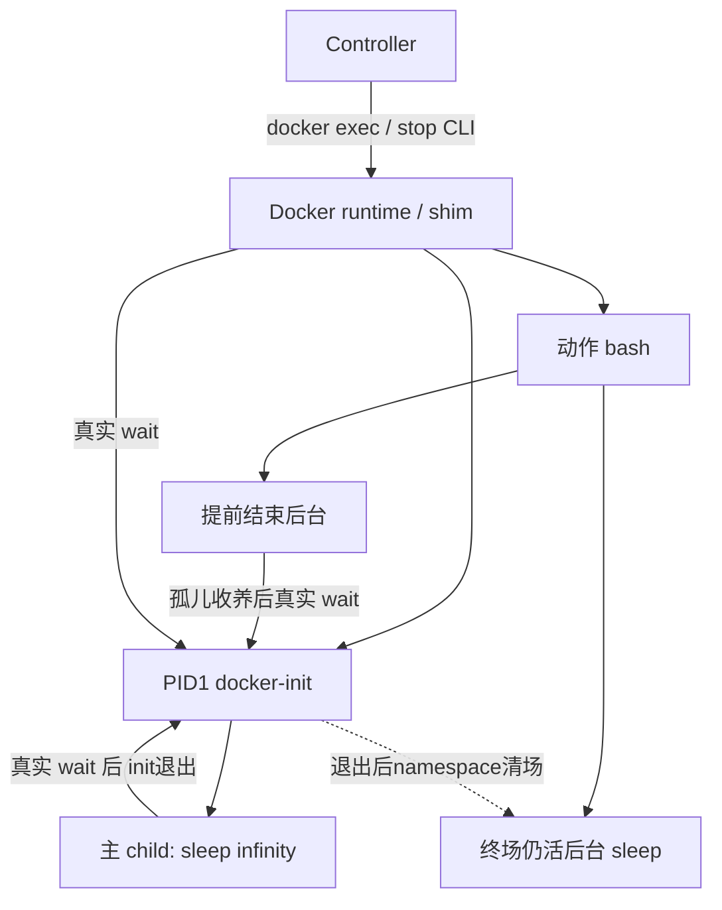

# 执行器资格与 Docker tiny-init 反事实：两个私有 VM 的结果

2026-10-20。范围为 `next-qual-01/02`，不是正式性能矩阵。**成熟 `--init` 反事实确实补上了正常运行期间的孤儿回收，并缩短了本配置的停止诊断时间；完整共同故障合同仍未通过。** 因此后续允许的多 Session 实验应保持独立负载/资源观测定位，不生成 B0/B1 严格全合同胜负。

原始 VM1 (`../runs/next-qual-01/result.json`, omitted from this source release)、VM2 (`../runs/next-qual-02/result.json`, omitted from this source release) 均完整退出、无外层超时，各有两次观察者补清。`guest_release=true` 只说明实验最终释放；两次均明确 `product_all_pass=false`。未修改冻结 Owner、native、policy、H/R/Z、glibc或内核。

## 1. 实际变更、样本与证据

新 B0 在原 mini `a2b0efee…` 的建容器参数中增加 `--init`，继续使用 `sleep infinity`、1秒 stop timeout、非root业务、离线网络、原执行/输出API及同步清理。实际镜像、预算和安全身份独立记录；B0默认userns/NNP/CapBnd仍与B1不同。**它是原mini上的成熟初始化配置变体，不冒称未经修改的全部上游执行器。**

每VM有10个B0_INIT/B1主资格Session、1个无init辅助语义Session、4个原始自然决策回放Session；合计 **30 Session尝试：22资格/反例、8自然回放**。动作日志共302条，其中自然回放164条。Controller死亡前已执行但没有最终动作回执的部分保留UNKNOWN，不把缺行视为没有执行。

两VM顺序翻转。VM2仅额外记录建域控制进程与导出前进程的PID/startticks/exe集合，不能把不同诊断修订拼成同一个字节版本。driver SHA分别为 `009064a6…42ebb9` 和 `a55263ab…15f978`；差异见 身份诊断补充 (`../sources/qual01-to-qual02-identity.patch`, omitted from this source release)。B1 adapter两VM均保持 `781dec06…34aff`。

冻结Tini版本由guest实际InitVersion `de40ad0`对应固定源码 `de40ad007797e0dcd8b7126f27bb87401d224240`；Docker-init二进制SHA `75f4e387…22f177d`。静态权限/协议边界见 contract-review.md (`../qualification/contract-review.md`, omitted from this source release)，具体假设见 counterfactual-design.md (`../qualification/counterfactual-design.md`, omitted from this source release)。

离线最终分析为 init-lifecycle-02 (`../analysis/init-lifecycle-02/execution-lifecycle-summary.json`, omitted from this source release)，用PID出生代次、实际cgroup、namespace内外PID和内核wait返回关联。独立原始行校验 (`../analysis/init-lifecycle-02/independent-raw-validation.json`, omitted from this source release)为 `AUDIT_CONSISTENT`：55项冻结源码、345项输入证据、429个业务wait原始行无冲突；另核对16个Tini正返回wait原始行。这是分析自洽结论，**不是全产品资格PASS**。

## 2. 资格矩阵：局部通过与阻碍分别保留

| 项目 | 实际结果 | 资格结论 |
|---|---|---|
| 普通fresh Bash、workspace/tmp、cwd/env、合流输出、非零与143/137信号API | 四个B0_INIT和四个B1正常语义Session均通过运行前门槛 | 受测接口子集通过；不是全部安全/故障等价 |
| 提前结束的脱离stdio后台，下一动作继续运行 | B0_INIT四次均有Tini真实wait；B0无init两次没有相应用户态wait | 成熟init对这个具体缺口有效 |
| Session结束时仍活的后台sleep | B0_INIT四次均先看到init退出，再看到该sleep退出，无可绑定后代wait；无init也未补齐 | 完整后台终场wait未通过 |
| B1后台终场 | 四会话共76个业务进程，73个可独立绑定wait；3个短生命周期sleep未取得NSpid，逐PID关联UNKNOWN；四会话52组协议均完整 | 协议保障与外部观察覆盖分开，不宣称76/76外部实证 |
| 单动作取消/超时 | B1两次取消/超时资格共4组有DONE/EOF，未见延迟文件；B0_INIT两次CLI超时后均产生延迟文件 | 两者取消合同不等价 |
| Controller SIGTERM | 两侧各两次进入finalizer，ERROR/未知业务结果与资源释放分开 | 普通可处理异常路径成立，不能推广SIGKILL |
| Controller SIGKILL | B0两次1秒后仍有3个业务域进程；B1两次业务域为0，但两侧workspace均残留且最终结果缺失；四次均观察者补清 | **完整独立恢复未通过** |
| 自然前台回放真实wait/EOF/最终释放 | 8 Session、164动作、240确认业务进程全部有wait；B1 82组全部完整 | 受测自然前台子集成立 |
| 自然任务正确性 | Flask5014四次60测试PASS；Flask4935四次59测试中1失败 | 保留任务失败；不能算8个成功修复 |

门槛脚本的 `normal_replay_allowed=true` 不等于独立全后代wait通过，也不等于完整故障资格。最终停止严格全合同排名，源于明确的超时、SIGKILL和安全拓扑差异，而不是依据某个方案快慢做项目方向判断。

## 3. Tiny-init 到底回收了谁

真实trace支持以下关系：



图中创建/收养不是永久PPID关系；每次实际映射均以原始事件为准。以下四个早退后台都用子进程及waiter的实际PID namespace快照关联，未用“PID正好相等”猜测：

| VM / Session后缀 | 后台guest PID | docker-init PID | wait返回的域内PID | qualification trace行 |
|---|---:|---:|---:|---:|
| 01 / B0-semantics-00 | 893 | 377 | 57 | 4825 |
| 01 / B0-semantics-01 | 896 | 408 | 57 | 4834 |
| 02 / B0-semantics-05 | 983 | 461 | 55 | 6579 |
| 02 / B0-semantics-06 | 981 | 494 | 57 | 6580 |

原动作是 `(sleep 1; echo detached > /testbed/detached-done) >/dev/null 2>&1 < /dev/null &`。它先返回、后续动作运行、后台自行退出，随后Tini wait；没有提前杀服务。

末端动作 `sleep 30 >/dev/null 2>&1 < /dev/null & echo $! > /testbed/end-service.pid` 不同。例如VM1：Tini377在L6588 wait主sleep的域内PID7，L6590返回0（尚无可收子进程），L6591自身退出，L6592才看到业务sleep1118退出。其余三个实例同类缺口。源码 `tini.c:541–603,665–678` 正好规定主child退出且当前可收子进程已扫完后结束，**不是等全部活后台结束**。原始trace (`../runs/next-qual-01/qualification-trace/process.trace`, omitted from this source release)、逐项init证据 (`../analysis/init-lifecycle-02/docker-init-details.json`, omitted from this source release)

B1三处未绑定的末端sleep分别是VM1 pid1787、VM2 pid376/375。它们有exec/exit，原创建者返回域内PID30，但没有独立NSpid快照；Guardian/Owner最终DONE和空组证据完整。不能从缺映射推断Owner没有wait，也不能从DONE反推外部已经逐PID验证。没有通过修改namespace或增加业务权限来消除缺口。

## 4. 停止时间诊断：已有改善，但不是正式加速成绩

| VM | init语义两Session的完整cleanup（秒） | 同VM无init辅助cleanup（秒） | init stop序列（秒） | 无init stop序列（秒） |
|---|---|---:|---|---:|
| 01 | 0.786 / 0.886 | 1.581 | 0.748 / 0.857 | 1.546 |
| 02 | 0.773 / 0.872 | 1.642 | 0.737 / 0.837 | 1.606 |

这些数字来自同guest单调钟的资格诊断。stop是cleanup内部区间，**不能相加**。init语义域有同时运行的同伴，无init是单独辅助样本，顺序、负载和采样并非严格配对；没有据此计算稳健加速比或端到端收益。原始表见 docker-cleanup-diagnostic.csv (`../analysis/init-qualification-summary-01/docker-cleanup-diagnostic.csv`, omitted from this source release)。

两个无init辅助容器在daemon日志均明确触发“1秒SIGTERM后仍未退出，转强制终止”；对应init语义容器没有该条超宽限记录。实际Tini会wait其主sleep，正常init最终又被runtime wait。信号转发机制有固定源码支持，但本次未启用signal_generate/deliver或解码全部sigaction；不把观察到的缩短全部归因成精确的纯内核/信号时间。**原来约秒级差额有相当部分取决于PID1配置，不能概括成Docker不可消除的固有成本。**

## 5. 自然任务与最终资源边界

每个架构、每个VM的Flask4935有12动作、22确认业务进程、5个Python映像；Flask5014有29动作、38业务进程、5个Python映像。两组原命令与API返回码全部相同，最终提交patch相同。

API解码后的输出并非逐字全部一致：每个4935对照为10/12，另两处pytest时间文本；每个5014为28/29，第一处`ls -la`包含父目录metadata/列对齐差别。原始diff未过滤，见 自然输出比较 (`../analysis/init-qualification-summary-01/natural-output-comparison.json`, omitted from this source release)。这是接口输出比较，B0本身使用UTF-8 replacement解码，不能称任意原始字节等价。独立评分见 评分索引 (`../analysis/init-qualification-summary-01/natural-scores.json`, omitted from this source release)。

B1的82个自然动作均在LEADER/EOF后返回，当时整组仍为PENDING；导出前82组全部DONE，真实Guardians和业务leader均已wait。四个monitor由Controller使用真实P_PIDFD waitid回执确认，内核trace同时有对应waitid成功；由于trace未解码siginfo内存，精确pid/退出状态来自可信实际回执，不从“返回0”猜测。

四个B0自然init及shim均有真实wait链，不用CLI返回码替代：

| VM / task | init PID | runtime waiter TID / trace行 | shim PID | guest PID1 wait行 |
|---|---:|---|---:|---:|
| 01 / 4935 | 2346 | 2330 / 3618 | 2322 | 3692 |
| 01 / 5014 | 3005 | 3063 / 12324 | 2981 | 12443 |
| 02 / 4935 | 2879 | 2859 / 9191 | 2854 | 9314 |
| 02 / 5014 | 3551 | 3535 / 18057 | 3526 | 18119 |

runtime部分waiter线程缺自身namespace快照时，关联明确使用采样shim leader与创建祖先，不冒称逐线程直接快照。B0输出完成是正常CLI `communicate` 管道结束，B1是直接read-zero EOF；失败/超时输出不因此获得完整EOF资格。

VM1正常导出检查曾仅判断剩余2个进程。本次离线trace进一步确认两自然域在business结束时的确只剩原init/sleep：2346/2358、3005/3017。VM2新增的启动/导出集合比较明确一致：2879/2891、3551/3563，startticks/exe也一致。VM1是事后证据补查，不倒写成它运行时已执行新门禁。

两VM自然路径没有观察者补清；工作区、HOME、业务/控制叶、容器和Controller收尾有证据。最终guest清理包含独立评分容器，评分时间不混入工具成本。任意未采样短进程FD、所有内核挂载引用、daemon内部资源都不在完整枚举范围内。

## 6. 取消、Controller死亡和完整合同缺口

B0_INIT两次短CLI超时后仍写出延迟文件；该case各4个确认业务进程中仅2个有可绑定wait。init并未把CLI超时变成逐动作后代取消。最后容器关闭后资源释放是另一件事，不能倒称动作超时时已经可靠取消。

Controller SIGKILL的一秒观察：B0_INIT两次business组均有3个进程（init、主sleep、已开始的工具）；B1两次business组为0，但workspace存在。四次均无最终Session结果，使用UNKNOWN，之后由研究观察者安全清场。已经在进程trace里发生的exec不能因动作日志缺行而写成“确定未执行”。

普通SIGTERM两侧均进入finalizer，标ERROR并完成各自资源释放；不是业务SUCCESS，也不覆盖SIGKILL、宿主OOM、文件系统故障。Tini和containerd是真实已有监督机制，但它们不自动负责ShimOS实验workspace/请求回执，B1 Owner EOF也不是完整H恢复。

因此，**不启动严格B0/B1多Session性能排名**。继续的B0_INIT多Session观测由新计划单独登记，只回答固定父预算下的真实进程、排队、依赖与资源行为；研究driver的超时/补清不能作为产品Supervisor。若要强化B0动作取消或加入独立清理责任者，需明示新合同与责任范围，不能把它藏在普通适配中。

## 7. 覆盖、限制与复核

四份trace事件数分别为16,482 / 19,685 / 16,542 / 19,884；所有CPU buffer `overrun=0`、`dropped events=0`、最终entries=0，解析无未知行。资格proc扫描440/436轮；自然阶段没有专用扫描，但全程有约100ms身份/资源采样。两B1 4935各有一个无exec、`group_dead=false`且无TGID快照的短kernel task，保留为2个线程/进程身份UNKNOWN，不混入240确认进程。

复核只读源码和原始日志：

```bash
PYTHONDONTWRITEBYTECODE=1 python3 research/shimos_next_architecture/analysis/audit_init_lifecycle.py \
  --run research/shimos_next_architecture/runs/next-qual-01 \
  --run research/shimos_next_architecture/runs/next-qual-02 \
  --out /tmp/shimos-next-init-audit
PYTHONDONTWRITEBYTECODE=1 python3 research/shimos_next_architecture/analysis/validate_init_audit.py \
  --analysis /tmp/shimos-next-init-audit --out /tmp/shimos-next-init-audit/validation.json
PYTHONDONTWRITEBYTECODE=1 python3 research/shimos_next_architecture/analysis/summarize_init_results.py \
  --analysis /tmp/shimos-next-init-audit --out /tmp/shimos-next-init-tables
```

输出目录须不存在。分析器只导入已冻结、无执行副作用的旧解析器；全部输入SHA随结果保存。`init-lifecycle-01`是单VM中间结果，精确脚本版本归档，最终引用02及`init-qualification-summary-01`。没有运行第三个资格VM、删除失败、放宽安全，或根据此次局部反事实决定ShimOS总体架构。

## 8. 正常前台子集的完整路径诊断：Flask5014

以下仅提取上述两个已完成资格 VM 的原始回执，**没有重跑资格或性能实验**。选取两侧均通过60项测试的5014，均29动作、38确认业务进程、38实际wait；4935的自然失败仍完整保存在同一机器可读表中。B1是持久 B-strict 域内逐动作创建进程的路径，不是跨域 NumPy heap，也不是另一次 T2 成绩。

| VM / 后端 | admit→父进程真实wait Controller（秒） | 域建立（秒） | 29动作累计（秒） | 证据复制（秒） | cleanup（秒） |
|---|---:|---:|---:|---:|---:|
| 01 / B0_INIT | 14.603 | 0.923 | 6.199 | 5.886 | 0.580 |
| 01 / B1 | 11.346 | 0.048 | 3.975 | 6.320 | 0.028 |
| 02 / B0_INIT | 15.154 | 1.033 | 6.353 | 6.056 | 0.682 |
| 02 / B1 | 11.446 | 0.049 | 3.989 | 6.372 | 0.029 |

完整已记录区间的同 VM 差额为3.256秒、3.708秒；这里只报告这两次观测，不据此给完整安全合同下的排名或稳定加速比。域建立包括调用及ready检查，不是纯namespace syscall成本；动作累计包含各自真实工具后端路径，不能把差额全部叫fork或Docker固有成本。

该资格版本的admit在工作区复制及控制组准备之后：另记workspace准备时间分别为84/67/60/77毫秒，但控制组准备没有独立完整区间，因此表中不是从fixture或新VM开始的全系统冷启动。admit后Controller自身模块加载/启动约0.637–0.667秒已计入；Controller结束到父进程wait返回约40–70毫秒也计入，不能误称业务仍在执行。另约0.30秒未细分逻辑含Agent控制和证据哈希；证据复制本身占近6秒，不能直接外推关闭诊断后的性能。

| VM / 后端 | Controller自身CPU（秒） | 业务组 ready→cleanup前CPU（秒） |
|---|---:|---:|
| 01 / B0_INIT | 0.740 | 4.600 |
| 01 / B1 | 0.890 | 3.793 |
| 02 / B0_INIT | 0.718 | 4.711 |
| 02 / B1 | 0.905 | 3.812 |

两列都是局部账本；后者不含建域前段及回收后段，前者不含daemon/shim/宿主，不相加冒充平台总CPU。Controller自身CPU在B1反而较高，也应保留。评分在表外；两侧patch、返回码相同，输出28/29逐字一致，首个`ls -la`的metadata/格式差别仍在原始diff内。

两个后端的userns/NNP/能力边界、超时取消和Controller强杀恢复仍不同。**这张表支持“正常、已接受前台子集存在值得解释的路径差额”，不支持“B1已在完整等价合同下胜出”。** 原始8个自然Session的JSON (`../analysis/normal-path-costs-01/normal-path-costs.json`, omitted from this source release)、CSV (`../analysis/normal-path-costs-01/normal-path-costs.csv`, omitted from this source release)、[只读提取脚本](../analysis/extract_normal_costs.py)保留全部来源SHA及时间口径。

## 9. 普通修复沿用与本轮复核

以下区分“v1.1 已有、本轮沿用再验”与本轮新反事实，避免把旧适配修复重新记作新成果。B1 adapter 与 v1.1 文件 **逐字同 SHA `781dec06…34aff`**；复制来源见 copied-v11-inputs.json (`../sources/copied-v11-inputs.json`, omitted from this source release)，本次只读核查及10个语义Session（含2个无init辅助）见 inherited-fixes-review.json (`../analysis/inherited-fixes-review.json`, omitted from this source release)。下表源码行号均指已保存版本。

|普通适配项|来源与本轮复核|证据及尚未覆盖的范围|
|---|---|---|
|`env.config` / 原 Agent 接口|v1.1 已有：Observed 为 B1 提供相同描述性 `DockerEnvironmentConfig`，不构造 Docker；本轮沿用。|v1.1 `runner/guest_session.py:96–100`；本轮冻结 `runs/next-qual-02/driver/guest_session.py:109–121`。8个自然回放完成原 DefaultAgent 循环；不是另写 Agent 决策逻辑。|
|Controller HOME/config 与目录归属|v1.1 已先创建并授权独立 Controller HOME/.config，降权前设置 HOME/XDG_CONFIG_HOME；业务 HOME 仍为 `/tmp`。|v1.1 `guest_main.py:48–52`、`guest_session.py:8–15`；本轮同路径。`control_config_writable` 全部语义样本通过，正常收尾有 home/workspace 删除回执；不覆盖 Controller SIGKILL 的独立清理。|
|locale、`/tmp` 与跨动作文件|v1.1 已使用 `LANG=LC_ALL=C`、`/tmp` 1777，以及持久域中的同一工作区/tmp；本轮不新增 locale 库。|两版 `guest_setup.py:33–34`、adapter `:31`。本轮冻结 `guest_session.py:133–139` 的首行marker、C/C、tmp可写、fresh Shell cwd/env和stdin探针通过；文件保留不代表 Shell变量或Python heap保留。|
|Owner 与正常关闭清理|v1.1 已使用现有 LEADER+EOF 返回前台结果、后台保持归属，close 等 DONE/BYE/monitor真实wait、空组、FD及目录删除。本轮 Owner/native/policy 与 adapter 均不改。|adapter `:126–127,335–371,390–449`；自然82组和4个monitor证据见§5。工作目录归属由既有 `guest_main.py:48–52` 准备。完整强杀恢复仍未解决。|
|异步 Docker helper 与 SIGTERM|v1.1 已将 cleanup 改为同步 stop/rm-f 并实际 wait CLI；v1.1 第二 VM 已将 SIGTERM 改成独立异常，避免 selectors 吞掉 EINTR。本轮继承。|两版 `guest_session.py:18–47`；实际 `cleanup_receipt.asynchronous_helper=false`、普通TERM进入finalizer。CLI wait 不能替代业务 wait，后者由本轮trace另查；不把两者合并成新Supervisor。|
|signal/API 与原输出|v1.1 已把 B1 信号结果映射为 Docker 的143/137，同时保留 raw wait status、POSIX返回值和原始bytes。两侧向Agent返回原有UTF-8 replacement合流字符串，未过滤输出。|adapter `:337–354`；本轮冻结 `guest_session.py:74–79,159–160`。正常语义7/143/137探针通过；自然输出仍有§5所列差异，不能宣称任意字节全等价。|
|本轮新增：成熟 `--init` 与诊断|只在 B0 容器参数新增可选 `--init`；VM2新增 PID/startticks/exe 基础集合及导出前集合比较。|本轮冻结 `guest_session.py:49–55,87,92–100,127–129`。Tini早退孤儿wait是新实证；末端仍活后台、CLI超时和强杀恢复的负结果不隐藏。身份诊断不是新执行协议或安全保证。|

普通修复、局部资格与完整故障合同仍分开。后续六批正常回放和pyc对照的真实wait、namespace、动作及实际源码一致性另见 最终执行证据审计 (`../analysis/final-execution-audit-01/audit.md`, omitted from this source release)；不以其正常通过覆盖本报告的失败边界。
