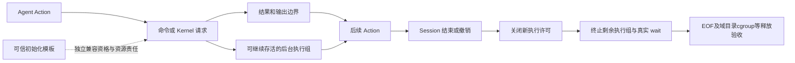

# 先例、机制边界与两条竞争研究路线

日期：2026-10-20。范围：本轮只读论文、冻结源码及历史资格证据；没有运行新 VM、部署所述系统、扩大依赖准入或实现调度器。本文不选择最终架构，也不作创新成立或项目 Go/No-Go 判断。

**现有工作已经解决了许多模板、缓存、放置和监督问题。当前需要识别的是：排除适配错误、保留真实 Agent 语义并使用强基线后，还剩下什么具体损失。** 下文提出两条可以竞争的路线，不预先假设联合调度或跨域模板必需。

机器资料：14 系统机制表 CSV (`../sources/prior_art/mechanism-table.csv`, omitted from this source release)、含逐项证据的 JSON (`../sources/prior_art/mechanism-table.json`, omitted from this source release)、82 项来源及 SHA 索引 (`../sources/prior_art/source-index.json`, omitted from this source release)。`PAPER` 是作者论文，`SOURCE` 是固定源码支持，`HISTORICAL_MEASURED` 仅指链接的旧受测子集，`UNKNOWN` 表示证据不足而非功能不存在。本轮其他报告的新结果不由本文静态审查授予 PASS。

## 1. 先把终态和复用对象分开



这是一张**责任图**，不是新协议或已实现方案。Action 的正常结果可以早于后台组结束；Session 结束才要求其拥有的资源彻底收尾。保持合法后台服务不等于泄漏，提前杀掉它也不能算适配成功。具体输出边界仍取决于原接口：有限命令可要求管道 EOF；长期 PTY/Jupyter 返回提示符或 cell 结果，不能伪称整个会话 EOF。

同样，以下资源不能用一个“warm”标签代替：只读依赖文件/页缓存、已初始化解释器、已加载依赖的干净模板、已经处理业务的 Worker、包含可变工作区的 Session。它们的兼容性、回收粒度和状态污染风险不同。`K_tool`、`K_proc`、`K_heap`、`K_template` 必须分别取得证据。

## 2. 服务器端先例：哪些能力已存在

| 系统与固定身份 | 已有机制 | 对 ShimOS 的约束及证据缺口 |
|---|---|---|
| **SAND，ATC 2018**；论文 §3–4、§9，冻结文本455–500行 | 每应用/宿主一个 Docker 域，多个 grain 父 Worker 预加载代码和依赖；每请求 fork；同应用局部通信 | 静态共域、多类型模板及请求子进程已有先例。fork 不回滚共享文件。未取得匹配实现 commit，任意后代 wait、FD、Controller 故障合同保持 UNKNOWN |
| **SOCK，ATC 2018**；§4.1–4.2/Fig.11 | 包缓存、依赖 Zygote、完整 handler 分层准备；跨环境两次 fork | 跨域预热不是新增机制。论文不为每容器建立独立 mount/network namespace，图示包含出生后 cgroup 迁移；不能视为 ShimOS 原子出生、独立 userns 与完整回收的等价实现 |
| **OpenLambda** `5a1a912f0791a04394f4d6e565e6e4673e273d90`，Apache-2.0 | 函数队列、warm handler、静态 import tree、工作量扩缩、内存压力驱逐 | 已是“实例数 + 兼容模板 + 驱逐”的直接竞争者；此后来版本不能倒填为 SOCK 2018 artifact |
| **Forklift**，2024论文；`1dc723d506fa3cda2f1f412c9b7261d0c67bac13`，Apache-2.0 | 按包版本/依赖闭包、调用权重与导入成本构造预热树，使用 OpenLambda runtime | 静态成本感知模板树应先作为基线。论文性能配置关闭 unsharing、复用 cgroup，不能搬用其成绩证明本项目同合同收益 |
| **FaasCache，ASPLOS 2021**；论文指定 OpenWhisk `38ff898d45da57726da38c00f735cb449e7f8595` | 先按 action/租户/容量匹配，再按成本、频率、内存和 aging 保留/驱逐 | 缓存分数不能提供可信 import、状态 reset、wait 或故障接管。仅取得论文版10个关键源文件；后来 fork 与离线模拟器另列 |
| **Archipelago，2019预印本** | 半全局机器池、预热、请求调度、负载均衡 | 是直接先例；不与2021正式 Atoll 的版本和成绩混合。匹配代码 commit 未取得 |
| **Atoll，SoCC 2021**，DOI `10.1145/3472883.3486981` | 预热数量、分散放置、soft/hard eviction、deadline调度、sandbox-aware路由与应用扩缩 | “联合考虑预热、位置、预算、路由”本身已有先例。机器池不是一个 Bubblewrap 域；精确退出/故障合同没有代码验证 |

原文：[SAND](https://www.usenix.org/conference/atc18/presentation/akkus)、[SOCK](https://www.usenix.org/conference/atc18/presentation/oakes)、[Forklift](https://pages.cs.wisc.edu/~yuanzhuo/assets/pdf/forklift.pdf)、[FaasCache](https://afuerst.github.io/assets/FaasCache.pdf)、[Archipelago](https://arxiv.org/abs/1911.09849)、[Atoll](https://pages.cs.wisc.edu/~asinghvi/papers/atoll.pdf)。冻结 PDF/text SHA 均在来源索引，未重新抓取整套项目。

### 2.1 OpenLambda：真正可用于挑战新设计的简单组合

固定版本调用链是 `lambdaServer → LambdaManager → LambdaFunction → LambdaInstance → ImportCache/sandbox`。关键位置如下（相对冻结仓库）：

| 文件与函数/行号 | 源码支持的事实 |
|---|---|
| `go/worker/event/lambdaServer.go:42–63`；`lambda/lambdaManager.go:126–153` | 请求进入函数对象及队列 |
| `lambdaFunction.go:279–427`；`lambdaInstance.go:38–249` | 依据未完成工作量调整实例；复用已有实例，空闲时 pause，缺少则通过模板/冷启动创建 |
| `zygote/importCache.go:284–365`，`Lookup` | 安装/预导入依赖；按请求 packages 的子集查静态树，递归优先匹配，不是全局成本最优搜索 |
| `min-image/runtimes/python/server.py:27–115` | 接收 root/cgroup FD，两次完整 `os.fork`；此版本在孩子内 unshare PID/IPC/UTS，而非直接加入已有目标 PIDns |
| `server_common.py:181–247` | 先装入 handler 模块，再循环处理 HTTP；没有在每请求循环中重新导入项目或执行通用 reset |
| `sandbox/evictors.go:136–168,215–255`；`sock.go:266–334` | 优先 paused 叶实例；保护仍有活动子孙的模板；共享 cgroup 责任由引用保留至最终清理 |

因此，**简单扩缩 + 静态依赖树 + 独立缓存**已经是必须考虑的对手。其内存引用责任也说明“模板进程退出”不等于其共享页责任结束。另一方面，`sock.go:337–415` 的出生后 PID 迁移、并发 TODO，以及 `docs/worker/manual-cleanup.md:3–13` 的失效后手动清理说明，不能被描述为已验证的 ShimOS 完整合同。源码未在本轮运行。[模板匹配源码](https://github.com/open-lambda/open-lambda/blob/5a1a912f0791a04394f4d6e565e6e4673e273d90/go/worker/lambda/zygote/importCache.go#L338)

### 2.2 FaasCache 与 Forklift：匹配和保留是两道不同的门

FaasCache 的 `ContainerPool.scala:188–240,652–672` 先检查 action、invocation namespace 与可用 capacity；之后才决定如何分配。论文版 `UpdatablePriorityQueue.scala:6–16` 使用调用次数、冷/热耗时差及配置内存等更新优先级；配置内存不等于实际 PSS。源码还存在频率更新细节与纸面描述的差别，复现必须说明，不能把本地近似策略称作作者原系统。[论文版匹配路径](https://github.com/aFuerst/openwhisk-caching/blob/38ff898d45da57726da38c00f735cb449e7f8595/core/invoker/src/main/scala/org/apache/openwhisk/core/containerpool/ContainerPool.scala#L652)

Forklift `tree_constructor/bench.py:69–147,222–316` 使用依赖/成本来构树；这解决“准备哪些共同依赖”，没有替研究者证明这些初始化代码可以进入本项目有管理能力的 Z。其论文 §5（冻结文本547–551行）的隔离配置削减必须保留在比较中。**共同底座上重写其规则、离线模拟、运行作者系统是三类结果，不能混称。**

### 2.3 Atoll：最直接的联合组织先例与可用反例

Atoll 的 SGS 管一组机器；请求排队按剩余 slack，预热分配独立运行，LBS 利用 sandbox 状态导流。预热数量来自需求估计，同函数状态倾向分散到不同机器；soft eviction 只撤销可调度标记，仍占内存，hard eviction 才在压力下释放。它已经研究了“保持多少、放在哪里、请求去哪里”的相互影响。冻结文本444–602、640–745行与论文 §4–5给出机制。

它不能直接回答本轮单宿主 Agent 工作区和模板可信性问题：函数身份不等于可变项目模块身份，机器/SGS 数也不等于域数。论文 §7.4 的1/10/50/100ms创建成本是 goroutine 模拟；低成本时队列争用可以主导尾延迟。这是值得验证的假设来源，不是 Bubblewrap 的同合同实测。作者[项目页](https://arjunbala.github.io/projects/)仍提供联系获取代码的说明，本轮未取得 matching commit、未联系作者，精确故障处理为 UNKNOWN。

强对照应学习它的逐项消融：先反应式/FIFO，再调度信息、预热、立即/延迟驱逐、路由视野；不能只比较“全部冷启动”与“全部预热”。当前源码缺口也意味着不能承诺直接部署一份原版 Atoll 基线。

## 3. Agent 执行器：很多 Session 和状态复用已经存在

下表均为固定源码事实；与历史运行版本不同的当前分支只作机制参考。

| 系统/版本 | Action 与 Session 边界、实际可复用状态 | 关键源码 |
|---|---|---|
| mini Pilot `a2b0efee5fd9c1d3bc9fdfc6fe88036a2235d74d` | 一个持久 Docker 域；每动作 fresh `docker exec bash -lc`。磁盘状态保留，前一个 Bash 的任意 cwd/env 与 Python heap 不自动保留。原 cleanup 后台启动 stop/rm，不 wait 完整辅助树 | `src/microsweagent/environments/docker.py:38–98` |
| mini 较新 `04d809ceab9df28f9adaed044884180159172930` | 同类 Docker 生命周期仍分建域/execute/cleanup；ReX Environment 使用独立 `Command`，不能因用了ReX就断言持久 Shell | `src/minisweagent/environments/docker.py:74–161`；`extra/swerex_docker.py:22–45` |
| SWE-ReX `5c995c365dfb1fd5bc56fda688be5d8538f9931f`，1.4.0 | 支持命名持久 pexpect Bash，也有独立 command。prompt/exitcode是动作观察；interrupt 的 SIGINT/任务控制路径不是整组全部资源释放证明 | `src/swerex/runtime/local.py:157–216,274–358,390–453`；`deployment/docker.py:285–315` |
| OpenHands legacy `a86275e288087bc7833bc79b0b691ed2ec223205` | Jupyter 首次建 kernel 后复用同一 kernel ID；代码/变量可能跨动作存活，项目修改后的旧模块可能仍在内存；这是不同于每请求新进程的合同 | `runtime/plugins/jupyter/__init__.py:59–77`；`execute_server.py:94–125`；`action_execution_server.py:174–207` |
| OpenHands SDK `0996c33916c2a977ea9fe38deee660ff0e1389f2`，1.56.0 | bounded tmux pane pool；清输出/interrupt不等于完整业务状态 reset；terminal timeout观察与workspace清理分离；pause仍保留资源 | `tmux_pane_pool.py:214–258`；`terminal/impl.py:238–271`；`terminal_session.py:390–428`；`workspace/docker/workspace.py:369–430` |

完整路径、函数、URL和逐文件SHA见机制表 `agent_*` 来源，不用旧 OpenHands kernel 推断新 SDK 默认具有相同接口。任务级持久容器、持久 Shell、Kernel、pane pool均应作为现实强基线；只有原任务允许的状态复用可以纳入共同合同。

**历史实际边界。** v1.1 的 B1 客户端已能利用冻结 Owner 的 `LEADER + EOF` 先返回动作，稍后收齐 `DONE`、Guardian wait及cgroup删除；不改核心就能消除原先“每动作必须等整组结束”的适配限制。旧自然记录82个B1组支持这一区分，但受控后台仍有逐PID wait观察缺口，四次 Controller SIGKILL 都需要外部兜底，不能说完整故障合同已通过。历史资格与例外 (`../../shimos_architecture_challenge/pilot_v1_1/analysis/final-qualification-01/final-qualification.md`, omitted from this source release)

这个修复已经反驳了“旧 Adapter 不支持后台，因此 Linux/Bubblewrap 无法表达后台”的推断。Owner 的256次START等固定原型限制、控制端死亡后的外部目录责任，仍要分开记录，不能用另一套A+B协议资格直接覆盖。本文没有将旧v1.1结论转移给本轮新副本。

## 4. 成熟监督机制：不能因为原 Adapter 少做一步就宣称缺新抽象

| 机制与版本 | 已有能力 | 不能自动提供的证明 |
|---|---|---|
| Linux 6.18.49 `1c732c6b94f0faee1526bd375add2fe10cba2e26` | `cgroup.kill`覆盖执行时并发fork；`populated`观察活进程；真实父子wait、subreaper/pidfd分别管理关系与身份 | `populated=0`、甚至删除cgroup仍可存在待wait的zombie；kill不是永久关闭外部未来派生许可，也不是EOF/业务成功 |
| containerd `193637f7ee8ae5f5aa5248f49e7baa3e6164966e` | 独立shim；按container/exec ID的Wait；reaper真实`wait4`；init退出发布与剩余exec退出分序 | `Init.delete()`在I/O drain超时后记录错误并继续，普通Delete成功不能自动等于严格EOF。源码PID重复使用关联TODO仍在；未在本轮做故障资格 |
| systemd v257 `70bae7648f2c18010187c9cf20093155eaa26029` | transient service父进程、cgroup预算、`ExitType=cgroup`、`KillMode=control-group`等 | scope不自动成为业务父进程；`--scope --wait`不支持；包住Docker CLI不自动包含daemon新建的业务树；workspace与业务结果责任仍需映射 |
| Docker runtime + 合理PID1/同步关闭 | 原生长期容器与exec已有；tiny init、stop/wait可构成更强的生命周期对照 | 原mini超时只约束CLI并非Docker能力上限；容器级停止与某一action执行组取消粒度不同；不同状态不得合成一个“完成” |

源码位置：Linux `Documentation/admin-guide/cgroup-v2.rst:280–290,417–427,1053–1066`；containerd `task/service.go:578–595,661–752`、`process/init.go:300–329`、`reaper_unix.go:254–289`；systemd `systemd-run.xml:63–74,461–469`、`systemd.scope.xml:49–56`、`systemd.service.xml:305–325`、`systemd.kill.xml:63–101`。本轮已保存固定 containerd 三文件与SHA。[containerd Wait](https://github.com/containerd/containerd/blob/193637f7ee8ae5f5aa5248f49e7baa3e6164966e/cmd/containerd-shim-runc-v2/task/service.go#L578)、[systemd service与scope](https://github.com/systemd/systemd/blob/70bae7648f2c18010187c9cf20093155eaa26029/man/systemd-run.xml#L63)

这里没有证明“成熟监督器已经满足 ShimOS 全合同”，也没有证明其不能满足。应先逐项映射进程身份、后台所有权、关闭准入、真实wait、输出和外部对象；只在正确配置的对手仍留下实测缺口时，再讨论新机制。

旧Pilot B0使用`sleep infinity`做PID1、显式1秒stop宽限；daemon记录发生超时强杀。约2秒关闭差额不能整体写成Docker固有成本。tiny init/同步收尾是强反事实，不应把它们遗漏后将差额归功于新架构。本轮若实际验证这些反事实，必须引用独立报告；本文不推算其可能省几秒。历史归因及完整成本边界 (`../../shimos_architecture_challenge/pilot_v1_1/reports/platform-cost-boundaries.md`, omitted from this source release)

## 5. 稳定依赖与可变项目：当前证据应如何判定

| 观察或标签 | 能支持什么 | 尚不能支持什么 |
|---|---|---|
| 相同wheel名/version或requirements集合 | 值得检查重复安装/导入的候选 | 实际加载的是同一字节；native闭包相同；初始化无管理副作用 |
| module真实路径、文件SHA、解释器/DSO身份一致 | 更强的代码身份；可划分稳定依赖与项目文件 | 同一代码在不同cwd/env/config/hooks下生成相同状态；fork安全 |
| import耗时、加载DSO、线程/FD变化 | 初始化重复和可疑副作用的观测 | 观测不到线程并非证明全部callbacks/锁/设备状态安全 |
| Python进程跨动作存活 | 存在实际状态连续性 | 其状态适合不同项目、信任主体或新隔离域共享 |
| 多域中相同合法配方与安全准入均成立 | 才能统计相应`K_template`候选命中 | 模板保活必定划算；必须计初始化、保活、COW、失效与回收 |

一个可审计的**候选兼容描述**至少要涉及权限/信任、runtime和ABI、依赖实际内容、初始化配方、native/callback准入、与cwd/env/配置有关的输入、项目可变性以及资源责任。它不是本轮已定接口。只读文件一致但初始化会加载项目插件，仍不能放进共享Z；修改项目不一定污染纯稳定依赖，但必须有分离证据，不能默认每次全失效或永不失效。

目前固定NumPy的旧资格只能用于其固定配方，不能覆盖Discovery中的Flask/SymPy或任意包。新增模块诊断提供候选事实，不自动准入未知依赖，也不能把全部import时间都视作可消除预算。page cache的收益应先与heap继承分开。

## 6. 两条竞争路线：先比较需求，不替负责人选定

### 路线 L：以 Session 为中心，明确 Action 与资源终态

**核心问题。** 对真实Shell/测试/编译任务，是否主要需要低成本持久工作区、清楚的后台/取消归属和可靠Session释放，而非更多预热heap？

**成熟部分。** 原生exec、任务级持久域、SWE-ReX/terminal会话、containerd/systemd监督都可借用。Bubblewrap/B-strict可作为另一执行底座；保留已有LEADER/EOF/DONE区别，不能为了返回更快删除真实wait或提前停止合法后台。这里没有要求更改现有Owner/H/R/Z。

**必须挑战它的基线。** 原Agent持久Docker + 正确PID1 + 同步最终清理；已具备独立责任者的runtime/service；原框架持久Shell/Kernel对应语义。对比全平台预算和相同故障lane，不从business memcg单列峰值宣布资源胜负。

**可能的机制价值。** 如果多个合法Session争用时，Action状态与Session资源责任仍无法由现有接口低成本、一致地表达，才研究更明确的执行组/终态抽象。当前已经解决的客户端早返回、TERM异常类型、HOME/locale/tmp等不计作这种新增机制。原型slot上限也不自动构成研究贡献。

**最小判别证据。** 本轮前两资格VM核对修复及成熟反事实；共同合同通过才把原13任务、原arrival/seed、C=1/2/4作为严格比较。否则只保留负载与资源诊断。关注持久域和业务/控制/daemon的完整账本、后台跨动作存活、Controller失效后责任、低干扰条件下的剩余成本。若成熟基线消除主要损失，说明此路线当前更多是工程集成，不据此否定整个ShimOS。

### 路线 T：保留可信稳定准备态，将可变项目放到执行阶段

**核心问题。** 不同真实Session是否反复初始化相同且可合法共享的稳定依赖，而项目代码又需要独立、可更新的执行状态？

**成熟部分。** SOCK/OpenLambda的分层准备与兼容树、Forklift静态导入成本树、FaasCache保留规则、Atoll放置/路由都应直接成为竞争者。现有G2/G3/G4只是合法机制选项，不能强迫普通`python script.py`变成新函数接口，也不能把exec后的进程称作继承heap。

**必须挑战它的基线。** 相同只读依赖文件及页缓存、同域冷exec、已有持久Kernel、域内模板、固定常用模板 + 简单TTL/LRU/成本缓存，以及固定布局下的空闲warm优先/排队感知路由。全部使用同一准入集合、同预算、同失效规则；原系统复现与规则移植分别命名。

**可能的机制价值。** 真正新增的问题可能是可变项目与稳定初始化的可证明分离，或共享模板资源责任与多Session生命周期的冲突。仅有依赖重叠、模板树、warm-aware路由或“联合考虑”不足以成立。未知callbacks、native线程状态、管理权限窗口、跨域共享页记账仍是成本和资格约束。

**最小判别证据。** 先使用本轮独立诊断中的真实模块/DSO字节、线程副作用、重复导入与项目变更记录，标Observed/Candidate/Unknown；证明稳定初始化确实重复、占有意义时间，并排除文件缓存解释。合法模板命中尚未证实就停止性能宣称，后续是否扩大准入由负责人选择。本报告不实现新模板策略。

两路线不是严格互斥：L先满足普通工具和Session责任，T可能只对少量合格Python动作增加一层。也可能数据只支持其中之一。应比较真实适用比例、完整资源成本与验证负担，不以“拥有更多机制”为选择标准。

## 7. 什么证据足以讨论新机制，而不是普通修复

| 门槛 | 当前可引用的事实 | 本轮需要或仍缺的证据 |
|---|---|---|
| 真实需求 | 旧轨迹/固定真实决策显示多动作持久任务；不等于heap复用 | 自然域边界、后台所有权、实际模块重复、合法`K_heap/K_template`；受控arrival不是生产流量 |
| 排除Adapter/fixture | v1.1已用旧Owner事件实现前台早返回；其他fixture/TERM错误有记录 | 本轮修复与强PID1/监督对照实际资格；不能从预期结果填写PASS |
| 可归因成本 | 旧诊断包含创建、CLI、stop宽限和约6秒证据导出 | 同合同、同版、低扰动完整账本；不能简单减去导出时间生成“产品成绩” |
| 强成熟基线 | 先例表明确已有持久域、模板树、缓存、路由、监督 | 在当前真实合同上直接部署或明确规则移植；模拟不算系统性能 |
| 核心抽象限制 | 已知Owner资源/slot范围与Controller失效责任不完整 | 证明普通适配/成熟组合仍不能解决，指出具体冲突、失败窗口或稳定成本 |
| 新机制增量 | 目前未据先例审查确立 | 限定场景的新能力/成本收益、反例、完整代价；由后续授权实验判断 |

此次审查支持继续用真实负载挑战两条路线；它不支持预先把跨域单fork、动态树、联合调度或新监督器认定为必选。内核不是这里的前提。架构调整、扩大资格与论文贡献由项目负责人决定。

## 8. 来源维护与复核

`sources/prior_art/build_mechanism_table.py`只读取冻结输入并生成本目录索引/CSV/JSON，不运行保存的业务命令，不读取密钥。它核对既有SHA并拒绝源变化。完整commit记录在机器表；论文无实现commit时写UNKNOWN，未用主分支代替。容器/Agent源码及许可证身份分别来自对应冻结文件，未把论文PDF的可读性当作代码可部署许可。

```bash
python3 research/shimos_next_architecture/sources/prior_art/build_mechanism_table.py
```

本次结果为14个系统条目、82项来源SHA核对通过、0次新增系统执行。Atoll作者页与固定containerd源码的有限获取回执另见新增来源记录 (`../sources/prior_art/new-primary-fetch-receipts.json`, omitted from this source release)。不存在未获批准的作者联系、完整平台部署、VM或内核操作。
