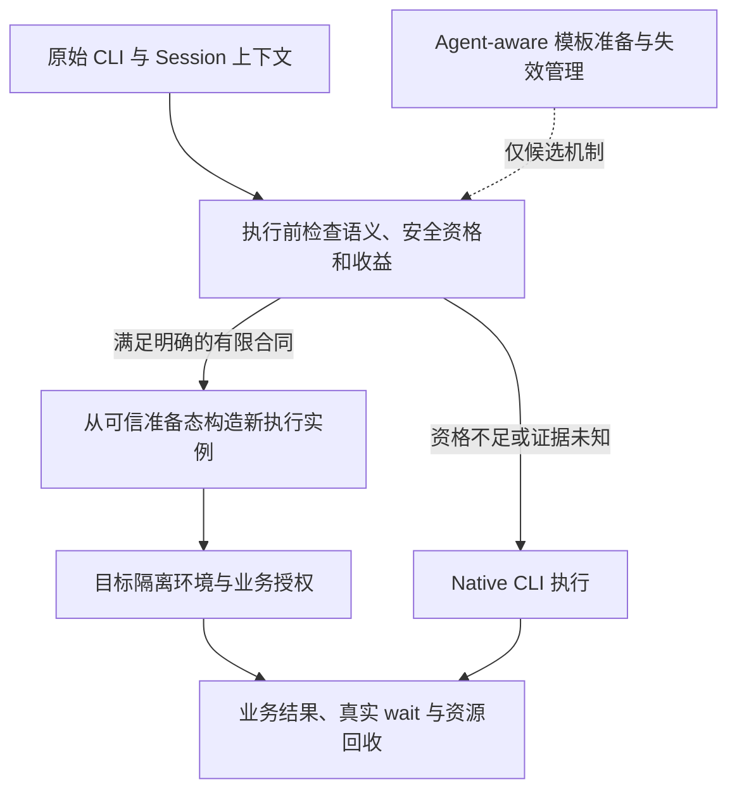

# Transparent CLI Warm Execution：方向探索与暂停决策

**日期：2026-10-21。状态：PAUSED / NOT SELECTED AS PRIMARY RESEARCH DIRECTION。**

本文归档 ShimOS 对 **Transparent CLI Warm Execution for AI Agents** 的概念探索、直接先例核验及项目负责人的阶段性决定。负责人决定暂时停止将其作为优先研究主线，不继续投入新的核心实现；这不是技术不可能性证明，也不是对 ShimOS 整体的失败判断。本文不选择替代研究方向。

**该方向尚未完成新的透明执行系统原型，没有取得原始 CLI 的普遍语义等价资格，也没有证明最终性能收益。** 以前的 Zygote、NumPy、G0–G4、权限拓扑和 Agent 回放实验仍是独立的历史成果，不能合并为本方向已经实现的证据。

本次只阅读历史资料、获取必要的公开源码和论文、编写归档及索引；没有运行 VM、安装或执行所核验的外部系统，没有修改正式代码、H/R/Z、glibc、内核或依赖准入，也没有更新飞书、推送或发布资料。

## 1. 背景：为什么从模板复用转向原始 CLI

### 1.1 原有机制的价值与先例重合

ShimOS 原主线是利用 Bubblewrap 的低成本隔离，组织隔离域、Worker 与可复用初始化状态。早期工作建立了跨域 Z→S→W、完整 fork runtime、资源出生归属、执行门禁、真实 wait 和异常回收的受限实验基础，并比较了冷启动、跨域模板、域内模板与持久 Worker。

但是，“预热后 fork”“分层准备态”“依赖树”“按成本保留实例”“结合需求调整预热和位置”本身已有直接先例。SOCK/OpenLambda、SAND、Forklift、FaasCache，以及 Archipelago/Atoll 分别覆盖了这些机制的重要部分。把相似机制换到 Bubblewrap 上，或者将它们组合起来，并不自动产生新的系统贡献。不同系统的安全与故障合同仍须具体比较，不能因为合同不同就直接认定创新成立。[历史机制审查](05_prior_art_and_novelty.md)

### 1.2 真实 Agent 带来的问题

真实 Coding Agent 多以 Shell、脚本、测试和编译命令操作持续工作区，而不是调用预先注册的纯函数。此前公开轨迹与私有 VM 观测说明：一个 Session 可以长期保留容器和文件状态，但其中仍反复创建业务进程。旧 13 任务观测包含 414 次动作和 102 次 Python exec；这些数字不能直接解释为 102 次可安全继承的 Python heap 请求。[真实负载报告](../../real_agent_workload/reports/real_agent_workload_and_benchmark_final.md)

因此产生了一个候选问题：**能否保留 Agent 原始命令和工具接口，在执行器内部识别少量合法的预热请求，其余命令继续走原生执行？** 这样才可能把固定函数式复用延伸到已有 Agent 工作流，而不要求 Agent 将 `python script.py` 改写为自定义函数服务。

这仍只是动机。CLI 重复、依赖重叠或一个容器中动作很多，都不能证明透明热执行有足够大的安全覆盖率和净收益。

### 1.3 本文的证据口径

| 标记 | 含义 | 不能据此声称什么 |
|---|---|---|
| **实测事实** | 引用旧实验、原始结果及其受测条件 | 不能扩展成新的 CLI 或任意依赖资格 |
| **源码支持** | 固定 commit 的具体代码路径支持 | 静态阅读不是本项目运行验证或完整安全审计 |
| **论文／文档** | 作者论文或项目自述 | 不能假定与后来代码完全一致；自报性能不作 ShimOS 成绩 |
| **分析／推断** | 从已知机制推导的限制或风险 | 不是实验结果，也不是所有实现的不可能性定理 |
| **研究假设** | 尚未证明的新机制或收益 | 不能写作已实现能力或论文贡献 |
| **负责人决定** | 本次明确授权的暂停和归档 | 不由技术助手扩展为新路线或整体 Go/No-Go |

**UNKNOWN** 表示证据不足，不表示对方不支持。以下直接竞争者仅做有界源码核验，没有运行其测试；也没有穷尽所有同名项目和历史分支。

## 2. 候选方向：透明准入与预热资源组织

### 2.1 两条执行路径

下面是未实现的概念关系，不能当作正式 ShimOS 架构图：

“透明”预期指 Agent 不改原始命令及其必要可观察行为，并非隐藏不兼容之处。“预热”也不是让已经执行过任意业务的 Worker 自动变干净。

### 2.2 两个曾考虑的配合机制

| 候选机制 | 设想 | 当前状态 |
|---|---|---|
| **Transparent Execution Admission** | 根据真实解释器、入口、参数、cwd、环境、依赖身份、项目状态、权限和运行时资格，保守决定能否构造语义兼容的预热实例；再判断是否值得保活 | 概念与条件分析；没有通用识别器、语义证明或真实命中率 |
| **Agent-Aware Zygote Provisioning** | 利用已经观察到的任务阶段、重复依赖和资源需求，选择少量可信模板，按域、信任和版本约束组织；必要时利用等待窗口准备 | 候选组织方式；没有新的预测算法、动态树实现或 Agent 端到端收益验证 |

可考虑的组织方式包括固定兼容 profile、分层依赖模板、按信任与版本隔离的模板组、域内模板和跨域模板。它们是备选形式，不是已经决定的动态 Zygote 树，更不是对原项目主线的替换。

### 2.3 状态边界与回退原则

- **可复用准备态候选：** 固定解释器、稳定依赖、获准初始化配方，以及经验证可继承的只读数据。相同 package 名称或 wheel 只能提供身份线索。
- **Session 私有状态：** 可变项目代码、配置、工作区、凭据、cwd/env、临时文件、后台服务和业务结果。将这些提前载入跨 Session 模板可能扩大信任范围或产生过期行为。
- **动态失效：** 项目、依赖、插件、配置或运行条件变化时，先撤销相应资格，再选择重新准备或原生执行。现阶段没有完整的状态依赖表示和失效协议。
- **可靠原生回退：** 在业务尚未产生副作用、资格检查失败时选择 Native；执行后故障则按照结果已知或 UNKNOWN 处理。没有幂等或可验证回滚合同，不能再次运行原命令来“补成功”。

这里的安全资格、语义资格和收益判断是三道独立条件：技术上能够 fork，不代表语义兼容；兼容不代表可信；可信且兼容也不代表节省完整成本。

## 3. 技术困难：哪些是工程，哪些可能需要新抽象

### 3.1 `fork + execve` 不等于继承 Python 初始化状态

`fork` 可以继承当前解释器的地址空间；随后的操作系统 `execve` 会替换进程映像。因而“从 Python Zygote fork，再 exec 原脚本”不能保留原 Python heap。Python 的 `exec()`、`runpy` 或函数调用留在解释器内，但也不能仅凭入口替换就声称具有新 Python CLI 的全部语义。CPython 对 exec 系列替换当前进程的说明见固定 [3.10.12 os 文档](https://github.com/python/cpython/blob/b4e48a444ea02921ce4b701fe165e6cfd4cf5845/Doc/library/os.rst)；项目也已在 [真实工作负载报告](../../real_agent_workload/reports/real_agent_workload_and_benchmark_final.md) 中区分这两类执行。

即使操作系统层是新进程，从预热模板继承的语言状态仍可能不是 fresh Python。必须先定义某个受限 CLI profile 要保留的可观察行为，不能用“PID 不同”代替语义证明。

### 3.2 fresh CLI 的兼容面

| 兼容面 | 可能的差异与需要证明的内容 |
|---|---|
| 入口与解释器启动 | 脚本、`-m`、`-c`、console entry point、解释器选项、`__main__`、`argv`、`site` 与启动配置不能任意互换 |
| 导入状态 | `sys.modules` 已缓存模块；`sys.path`、import hooks、导入顺序、插件发现、项目 shadowing、环境和配置可能改变初始化结果 |
| 可变状态 | 模块全局量、注册表、随机源、日志配置、已有对象引用可能保留模板状态；删除模块缓存不等于清除所有引用和 native 状态 |
| 原生运行时 | 线程、线程池、锁、TLS、TID、robust list、设备及 native/Python atfork callbacks；单线程端点观察不能排除初始化中的瞬时行为 |
| 操作系统状态 | cwd/root、umask、环境变量、信号处理和 mask、FD/管道/套接字、资源限制、权限及 namespace 身份 |
| 完成与外部效果 | stdout/stderr、退出码/信号、`atexit`、超时、后台进程、文件和网络副作用；“有结果”与“已经全部回收”不同 |

这是兼容性审查清单，不是本轮发现所有列举风险都已发生。必要的差分测试也只能支持已覆盖 profile，不能证明任意 CLI。

### 3.3 快速保守准入、失效与副作用

常规工程可以完成固定白名单、版本指纹、内容哈希、缓存查找和无资格时走 Native。真正未解决的假设是：能否以足够低的成本，得到覆盖真实动作的可靠资格，而不是每次重新执行昂贵初始化来判断是否可复用。

文件版本检查同样不是完整状态证明。相同代码可能读取不同环境、配置或插件；检查与执行之间还有变更窗口。不可变版本快照可以帮助绑定身份，但仍不能自动证明其初始化副作用和跨域合法性。重新构造模板通常比对现有解释器做任意原地 reload 更容易界定，是否划算仍需测量。

不能把 import 当作无害的资格探针：第三方初始化本身就会执行代码。若在有跨域管理资格的 Z 中试运行，再因为失败切到 Native，权限与外部副作用可能已经发生。对于写文件、提交事务、发网络请求等不可重复效果，快路径执行失败后的再次运行可能重复业务。因此需要区分**执行前选择路径**与**执行后故障恢复**；后者允许 UNKNOWN，不能用回退掩盖不确定性。

### 3.4 跨域权限与 fork 回调不是单纯的缓存问题

旧 A/B/C 审查提供两项不同的实测事实：

1. **原冻结 Z 身份：** 对两个 Bubblewrap 目标 PID namespace 的直接 `setns` 均为 `-1/EPERM`，能力集及 namespace 未变化，目标已回收。当前 U0 缺少 `CAP_SYS_ADMIN` 是固定内核路径和凭据支持的充分拒绝条件；没有声称动态追踪了全部拒绝分支。
2. **另建共同管理 userns 拓扑：** 六个子进程经一次完整 glibc D/Python fork 继承内存，两目标、恢复 `pid_for_children`、pidfd 取消、PID1 退出及真实 wait 有机制证据。但它是 **PASS_DIAGNOSTIC_ONLY**，未取得原独立 Base/Inner、完整文件系统与其他 namespace、H/R 生命周期合同。

来源：[检查点 B](../../shimos_worker_pool/single_spawn_feasibility/reports/checkpoint-b.md)，第 55–68、94–128 行；[检查点 C](../../shimos_worker_pool/single_spawn_feasibility/reports/checkpoint-c.md)，第 25–34、100–155 行。两个实验不能合并成“原合同下单次派生已经通过”。

native/Python child callbacks 发生在 fork 返回及项目最终降权、业务门禁之前。完整 fork wrapper 修复的是运行时契约，不会让未知 callback 自动变可信；另一套 userns 中继承的管理能力也不能套用原第二次派生较窄的资格。一个独立 helper 可以 fork 自己的 heap，不能自动让其孩子继承另一个 Python Z 的内存。

当前没有同原长期 Z 权限、同完整合同的已验证 Z→W 方案；这不是所有用户态设计的不可能性结论。即使减少 S，namespace/root/cwd 转换、降权、FD 处理、业务授权、真实 wait、UNKNOWN 和清理责任仍须保留或转移。本方向没有完成相同合同的单次派生收益对照。[检查点 C 成本与责任审查](../../shimos_worker_pool/single_spawn_feasibility/reports/checkpoint-c.md)

### 3.5 可能需要研究的抽象，尚未成立

若普通缓存、forkserver、明确白名单已经满足主要需求，则剩余工作主要是适配和工程。只有发现以下具体缺口并取得真实成本证据，才可能进一步研究：可证明的 CLI 初态构造、语义身份与权限身份共同约束的准备态、或者能够扩大合法复用范围的新状态表示。现阶段没有证明这些抽象优于已有机制，也不因问题复杂就自动具有研究创新性。

## 4. 最接近的已有工作：固定身份、实际能力与边界

### 4.1 Serverless、模板树和缓存先例

下表复用历史固定论文及源码审查，不重新部署系统。完整来源、SHA 和细分行号见 14 系统机制表 (`../sources/prior_art/mechanism-table.json`, omitted from this source release) 及 [先例报告](05_prior_art_and_novelty.md)。

| 工作与版本 | 论文或源码支持的机制 | 与候选方向重合 | 区别及证据边界 |
|---|---|---|---|
| **SOCK，USENIX ATC 2018**，§4.1–4.2、Fig.11 | 包缓存、依赖 Zygote、完整 handler 分层准备；跨环境两次 fork | 跨域初始化状态共享、分层复用已有直接先例 | 论文不是通用 CLI；其 namespace 与出生后 cgroup 迁移不能充当 ShimOS 同合同证明。没有匹配 artifact 的部分保持 UNKNOWN。[论文](https://www.usenix.org/conference/atc18/presentation/oakes) |
| **SAND，USENIX ATC 2018**，§3–4、§9 | 每应用／宿主的容器、多个预加载 grain 父进程、请求子进程和局部通信 | 域内多种预热状态与 fork 执行 | 应用级组织不等于自动 CLI 准入。未取得匹配实现 commit；精确 FD、后代 wait、控制端故障合同 UNKNOWN。[论文](https://www.usenix.org/conference/atc18/presentation/akkus) |
| **OpenLambda**，`5a1a912f0791a04394f4d6e565e6e4673e273d90` | 函数队列、实例复用与扩缩、静态 import tree、压力驱逐；Python runtime 两次 `os.fork` | 模板选择、实例管理与初始化复用已有组合 | 后来源码不能倒填为 SOCK 2018 artifact；该版派生时 unshare PID/IPC/UTS，与进入已有目标域不同。handler 服务不是任意 CLI 透明执行。[runtime:27–115](https://github.com/open-lambda/open-lambda/blob/5a1a912f0791a04394f4d6e565e6e4673e273d90/min-image/runtimes/python/server.py#L27)、[Lookup:284–365](https://github.com/open-lambda/open-lambda/blob/5a1a912f0791a04394f4d6e565e6e4673e273d90/go/worker/lambda/zygote/importCache.go#L284) |
| **FaasCache，ASPLOS 2021**，论文版 OpenWhisk `38ff898d45da57726da38c00f735cb449e7f8595` | 先匹配 action／租户／容量，再依据成本、频率、内存和 aging 保留实例 | “哪些 Worker 值得保活”已有直接成本策略 | 缓存策略不授予 fork、安全或 CLI reset 资格；未运行该系统的等合同对照。[论文](https://afuerst.github.io/assets/FaasCache.pdf)、[匹配源码:652](https://github.com/aFuerst/openwhisk-caching/blob/38ff898d45da57726da38c00f735cb449e7f8595/core/invoker/src/main/scala/org/apache/openwhisk/core/containerpool/ContainerPool.scala#L652) |
| **Forklift，2024 论文**，`1dc723d506fa3cda2f1f412c9b7261d0c67bac13` | 结合版本、依赖闭包、调用权重和导入成本构造预热树，使用 OpenLambda runtime | 依赖感知 Zygote 树及成本优化已有先例 | 不是自然 CLI 的透明准入证明。论文性能配置关闭 unsharing、复用 cgroup，不能直接移用为严格隔离成绩。[论文](https://pages.cs.wisc.edu/~yuanzhuo/assets/pdf/forklift.pdf)、[构树源码:69–147、222–316](https://github.com/open-lambda/forklift/blob/1dc723d506fa3cda2f1f412c9b7261d0c67bac13/tree_constructor/bench.py#L69) |

Agent-awareness 本身也不足以区分：Archipelago/Atoll 已研究预热、放置、路由、驱逐与需求变化。Agent 的阶段或等待窗口可能提供不同输入，但必须证明信息可获得、预测有效且净收益超过简单策略。原 [Atoll／Archipelago 审查](05_prior_art_and_novelty.md) 保留了版本、源码缺口和模拟成本边界，本次没有开展新的预测研究。

### 4.2 三个直接工程先例的身份

| 名称 | 本次实际核验对象 | 固定版本、日期与许可 | 核验范围 |
|---|---|---|---|
| pyforkexec | `cykerway/pyforkexec` | `576dfc9b550086428002b7336eaa116b0d5f82eb`；2018-08-07；GPLv3 或以后版本 | client/server 与 README、许可、仓库元数据 |
| pytest-fast | `prostomarkeloff/pytest-fast` | `34954a8958442af23f2d0aa8edd583ff67beba74`；0.16.0；2026-07-19；许可 **UNKNOWN** | 主实现、入口、配置与相关测试源码；冻结树无 LICENSE/COPYING，包配置无许可字段，API 为 null，不推定授权 |
| Zygo | 高度相关的同名候选 `mhmtskrc2/zygo` | `667509322f60f0f012d82ee82f1127ef82249b36`；2026-10-08；Apache-2.0 | Python agent、WarmFn/WarmExec、namespace/cgroup 请求路径及安全文档的选读 |

此前“Zygo”没有给出 URL，**是否就是上述仓库仍为 UNKNOWN**；不能用同名替代身份确认。没有将光学设备公司 ZYGO、Julia Zygote，或 `pytest-fast-first`、`pytest-fastcollect` 混入比较。表中日期是固定提交日期，不是本项目运行日期。源码及 SHA 见 Python CLI 来源索引 (`../sources/transparent_cli_archive_20261021/python-cli-source-index.json`, omitted from this source release) 和 Zygo／Containerless 来源索引 (`../sources/transparent_cli_archive_20261021/zygo-containerless-source-index.json`, omitted from this source release)。

#### pyforkexec：预初始化解释器后 fork 并执行代码

**源码支持。** `server.py:9–16` 先执行用户提供的初始化代码并保留 globals/locals；`:92–100` 使用 `os.fork()`，孩子中执行请求代码。名称中的 exec 在这里是 Python `exec()`，不是 Linux `execve()`；客户端发送代码字符串，服务器返回 stdout/stderr 文本。[初始化与执行源码](https://github.com/cykerway/pyforkexec/blob/576dfc9b550086428002b7336eaa116b0d5f82eb/server.py#L9)、[请求路径:69–119](https://github.com/cykerway/pyforkexec/blob/576dfc9b550086428002b7336eaa116b0d5f82eb/server.py#L69)

**重合与边界。** “预热 Python 后派生执行脚本代码”已有直接实现。该固定 client/server 没有业务退出状态协议、真实 wait、取消／超时、namespace/cgroup 降权与完整后代回收，也没有源码失效和自动冷启动回退。因此不能视为任意现有 CLI 的透明替代，更不能授予 ShimOS 合同；这些缺项也不自动构成 ShimOS 的新贡献。

#### pytest-fast：面向 pytest 的预收集、forkserver 与失效重建

**源码支持。** 项目提供独立 `pytest-fast` 和 `pytest --fast` 插件，要求 Python ≥3.11、pytest ≥8。预收集状态进入 multiprocessing forkserver，通常每轮创建一组 Worker，而非每个测试单独 fork；另有显式启用的持久 Worker 模式。插件在 `pytest_runtestloop` 接管时，控制进程仍已完成本轮 collection/import，不能把独立入口与插件的节省合并。[配置](https://github.com/prostomarkeloff/pytest-fast/blob/34954a8958442af23f2d0aa8edd583ff67beba74/pyproject.toml#L1)、[forkserver:1514–1537](https://github.com/prostomarkeloff/pytest-fast/blob/34954a8958442af23f2d0aa8edd583ff67beba74/src/pytest_fast/__init__.py#L1514)、[插件:3777–3842](https://github.com/prostomarkeloff/pytest-fast/blob/34954a8958442af23f2d0aa8edd583ff67beba74/src/pytest_fast/__init__.py#L3777)

源码包含 mtime、选定环境变量指纹与失效重建，watcher 可先准备新 daemon 再替换旧 daemon。默认分别观察 `src/`、`tests/` 下的 Python 文件和指定配置，不等于完整依赖内容闭包；不能据此保证所有删除、保留时间戳的变更或未观察文件都被识别。它重建准备态，不是任意模块原地热更新。[失效判断:3116–3231](https://github.com/prostomarkeloff/pytest-fast/blob/34954a8958442af23f2d0aa8edd583ff67beba74/src/pytest_fast/__init__.py#L3116)

**重合与边界。** 预热测试、代码／环境失效和后台重建已经实现；没有在已读路径发现不兼容后自动按原始冷 pytest 完整重执行的通用回退。存在直接 Worker 的 join/kill 和结果检查，但 `os._exit` 跳过普通退出处理；完整后代、跨域权限、未知插件/native callbacks 的合同未获本次运行验证。其自带测试没有运行，性能宣称不作为 ShimOS 测量。[daemon 路径:3495](https://github.com/prostomarkeloff/pytest-fast/blob/34954a8958442af23f2d0aa8edd583ff67beba74/src/pytest_fast/__init__.py#L3495)、[Worker 回收:2224–2274](https://github.com/prostomarkeloff/pytest-fast/blob/34954a8958442af23f2d0aa8edd583ff67beba74/src/pytest_fast/__init__.py#L2224)

#### Zygo：预热函数、冷启动退路与环境复用，不能合并成透明 CLI

**源码支持。** 相关候选的 Python WarmFn 固定函数模式预加载模块，要求 `handler(event)`，请求通过 `os.fork()` 继承模板。实现线程检查及不能 fork 时重新启动 Python 的路径；`mode=stdin` 则用 `subprocess.run([sys.executable, path])` 重新启动脚本。另一条 WarmExec 保留 sandbox、进入目标环境后 exec，复用环境而非原 Python heap。这些是不同接口，不能拼成任意 CLI 自动继承 heap。[Python 入口:202](https://github.com/mhmtskrc2/zygo/blob/667509322f60f0f012d82ee82f1127ef82249b36/agents/python/zygo_agent.py#L202)、[fork:1259](https://github.com/mhmtskrc2/zygo/blob/667509322f60f0f012d82ee82f1127ef82249b36/agents/python/zygo_agent.py#L1259)、[WarmExec](https://github.com/mhmtskrc2/zygo/blob/667509322f60f0f012d82ee82f1127ef82249b36/crates/zygo-core/src/backend/ns/enter.rs#L182)

另有 **runtime-pool/script** 入口：Z 不预载租户脚本，在 fork 子进程通过 GO 和配置的 child filter 后，读取请求源码；提供 digest 时检查实际读入的字节，再 compile/exec，并查找 `entry_point(event)`，默认仍为 `handler`。这已覆盖“共享解释器与请求私有代码分开加载”的具体工程形式，不能把此思路本身称作 ShimOS 新机制；但函数事件协议仍不等于原始 CLI。[请求代码加载:267–341](https://github.com/mhmtskrc2/zygo/blob/667509322f60f0f012d82ee82f1127ef82249b36/agents/python/zygo_agent.py#L267)、[门禁后加载:525–575](https://github.com/mhmtskrc2/zygo/blob/667509322f60f0f012d82ee82f1127ef82249b36/agents/python/zygo_agent.py#L525)

**合同差异。** Python 请求先 fork，再通过 FORKED／admit／GO 移入请求 cgroup；部分 attach/apply 错误被忽略并退回租户总预算。共享 sandbox 及工作目录不是每请求独立 namespace；成功 DONE 可先返回，随后以 `waitpid(WNOHANG)` 尝试回收，故 DONE 不证明孩子已被真实 wait 回收。因此它不是 ShimOS 原子出生、独立域、完整 RELEASED 的同合同基线。线程检查也不等于锁、回调、FD 与任意依赖的完整准入。[request.rs:379](https://github.com/mhmtskrc2/zygo/blob/667509322f60f0f012d82ee82f1127ef82249b36/crates/zygo-core/src/pool/request.rs#L379)、[结果与 wait:1150](https://github.com/mhmtskrc2/zygo/blob/667509322f60f0f012d82ee82f1127ef82249b36/agents/python/zygo_agent.py#L1150)

这些是静态差异，不是本项目实测漏洞。作者安全文档也列出共享 PID namespace/UID 和未测试项。本次没有完整审计全部 profile。它已构成“干净模板＋请求子进程＋有限准入＋冷路径”的近邻，但原始 argv/cwd/env/信号/副作用透明性和自动 CLI 准入仍无核实依据。详细核验与固定行号 (`../sources/transparent_cli_archive_20261021/zygo/static-audit.md`, omitted from this source release)

### 4.3 Containerless：受限快路径与回退已有先例，但有不同前提

身份为 Emily Herbert、Arjun Guha 的 *A Language-based Serverless Function Accelerator*，论文固定 [arXiv:1911.02178v4](https://arxiv.org/pdf/1911.02178v4)（2020-08-03）；作者仓库为 [emilyaherbert/containerless](https://github.com/emilyaherbert/containerless)，固定 `1adf83d2de5b72692e734ad70218a1a62781078d`（2021-03-17，BSD-3-Clause）。没有把论文与后来 commit 当作同一实验产物。

**论文机制。** 特定 JavaScript serverless API 的请求被跟踪并编译为受限制 Rust 快路径；不支持的路径可回容器。透明重执行建立在幂等、允许重试和瞬态内存等前提上，不是 Python heap fork，也不是任意有副作用 CLI 的安全回退。[论文 §1–2、§5](https://arxiv.org/pdf/1911.02178v4)

**代码核验。** `containerless.listen/respond` 是 HTTP 函数接口。源码有 Tracing／Vanilla／Decontainerized 三模式，tracing 忙时走 Vanilla；但该 commit 的 `invoke_decontainerized` 错误分支返回 HTTP 500，没有在此重新调用 Vanilla。不能把论文的未知路径重执行描述直接写成这份代码已完整实现；也不能反过来断言论文或所有历史版本没有实现。[state.rs:281](https://github.com/emilyaherbert/containerless/blob/1adf83d2de5b72692e734ad70218a1a62781078d/containerless/rust/dispatcher-agent-lib/src/dispatcher/state.rs#L281)、[模式选择:424](https://github.com/emilyaherbert/containerless/blob/1adf83d2de5b72692e734ad70218a1a62781078d/containerless/rust/dispatcher-agent-lib/src/dispatcher/state.rs#L424)

**对本方向的约束。** “受限快路径＋通用慢路径”不是新的总体思想。可能的区别须落到具体 CLI 语义、合法复用范围与执行保障，不能照搬其幂等前提。未检查的 Kubernetes/cgroup/LSM 细节为 UNKNOWN，没有据此认定具备或缺少所有 ShimOS 保证。论文／源码差异笔记 (`../sources/transparent_cli_archive_20261021/containerless/static-audit.md`, omitted from this source release)

### 4.4 Python forkserver 与进程快照／恢复

| 机制与固定来源 | 能确认的能力 | 对候选 ShimOS 的意义与限制 |
|---|---|---|
| **CPython 3.10.12 forkserver**，`b4e48a444ea02921ce4b701fe165e6cfd4cf5845` | `forkserver.py` 支持预加载、`os.fork`、父侧 waitpid、子侧信号／FD 整理；`popen_forkserver.py` 通过序列化的 Process 对象启动 | 已有稳定模块预加载和新子进程机制。入口是 multiprocessing Process 协议，不是任意 CLI 自动转换，也没有因此证明未知依赖安全。[preload:62](https://github.com/python/cpython/blob/b4e48a444ea02921ce4b701fe165e6cfd4cf5845/Lib/multiprocessing/forkserver.py#L62)、[派生:265](https://github.com/python/cpython/blob/b4e48a444ea02921ce4b701fe165e6cfd4cf5845/Lib/multiprocessing/forkserver.py#L265)、[Process 序列化:36](https://github.com/python/cpython/blob/b4e48a444ea02921ce4b701fe165e6cfd4cf5845/Lib/multiprocessing/popen_forkserver.py#L36) |
| **CRIU**，`2d22d367a08aeece6653f3941a3d18fb6c931587` | 官方说明支持将运行状态保存到磁盘并恢复 | 是保留／恢复已有状态的先例。本次只核验官方说明，不做实现级能力审计；具体跨域权限与 CLI 初态等价为 UNKNOWN。[固定 README](https://github.com/checkpoint-restore/criu/blob/2d22d367a08aeece6653f3941a3d18fb6c931587/README.md) |
| **DMTCP**，`07e0ee52a63b55286c87e91e1217a4053b63fd0c` | 官方说明支持用户态多进程／线程透明 checkpoint，无需修改 Linux 内核 | 恢复执行状态不自动等于清除旧业务状态并构造 fresh CLI。特定插件、外部资源及 ShimOS 合同本次未核验。[固定 README](https://github.com/dmtcp/dmtcp/blob/07e0ee52a63b55286c87e91e1217a4053b63fd0c/README.md) |

后两项“恢复状态不自动提供 fresh CLI 等价”是本项目的语义分析，不是对它们所有能力的否定。本次没有做快照性能对照。来源版本及 SHA 见 运行时资料清单 (`../sources/transparent_cli_archive_20261021/runtime_reference/manifest.json`, omitted from this source release)。

## 5. 创新性审查：不能仅靠组合命名

| 想法 | 为什么单独不足以形成强创新 | 若再研究还缺什么 |
|---|---|---|
| CLI＋Warm Worker 双路径 | 特化快路径与通用途径已有先例；接口适配本身是工程 | 原始 CLI 可观察语义、无副作用重复的分流，以及现有方法无法提供的能力 |
| 静态白名单＋Native fallback | 是保守支持子集的常用实现方法，Zygo 等也有有限检查／冷路径 | 真实安全覆盖率、检查成本和故障时准确语义，不能只展示白名单命中 |
| 预热 Python 加速脚本 | pyforkexec、forkserver、pytest-fast 已有明确相关实现 | 超出固定入口或测试框架的新能力及必要性 |
| 版本检测与自动失效 | pytest-fast 等已有代码／环境检测和重建；内容身份管理本身不新 | 能解释初始化状态依赖、失效窗口与可变项目边界的新机制，而非仅再做哈希 |
| 依赖树与缓存策略 | SOCK/OpenLambda、Forklift、FaasCache 已覆盖分层准备和成本保留 | 简单树／TTL／LRU／成本策略不能以相近成本解决的实际反例 |
| Agent-aware 预测预热 | 使用工作负载信息调节准备态与放置已有先例；“来自 Agent”不是机制差异 | 可靠可观测信号、与简单策略对照的净收益及计入误预热和保活的完整成本 |

仍可保留三个**未证实的研究假设**：

1. 不改变原始 CLI，在限定但有价值的语言／依赖范围内，构造具有明确 fresh-process 语义保证的预热执行实例。
2. 将语义资格、代码与配置身份、跨域权限以及失败后资源责任绑定起来，扩大现有机制不能安全提供的复用范围。
3. 用新的状态表示或执行构造方法，把可信稳定初始化与可变项目状态更有效地分离，并证明它优于现有 forkserver、应用适配和快照方法。

它们尚未通过新颖性证明、实现资格或系统收益验证。“尚未找到完全相同的论文”不能写成“首次提出”；某项目没有满足全部 ShimOS 合同，也不能单独证明组合这些合同值得新系统。

## 6. 为什么在此时暂停

**以下为负责人基于当前证据作出的阶段性研究决策。**

1. **重合度高。** 从预加载后 fork，到测试框架预热、失效重建、受限快路径、缓存与放置，已有论文及工程实现覆盖了相当多的设想。可主张的新增能力比最初估计窄。
2. **透明语义门槛高。** 通用 CLI 涉及启动、插件、可变项目、native 状态和外部副作用；覆盖这些内容需要大量实现与验证，不能靠入口替换或白名单宣称完成。
3. **简单方案可能已经足够。** 持久执行域、普通文件／pyc 缓存、现有 forkserver、框架专用预热和明确版本重建，应先成为强基线。还没有证明它们无法以相近成本满足目标需求。
4. **真实可复用预算仍未确证。** 旧 13 任务的重复 Python exec 没有得到合法 `K_heap/K_template`。后续依赖诊断确认两项 SymPy 任务的 26 个解释器观察中存在 50 个相同 mpmath 模块文件身份，但读取文件身份、端点单线程／FD 稳定并不授予共享 Z 资格；新增真实 CLI 模板准入仍为 0。
5. **普通缓存已解释一部分初始化成本。** 单 VM 的独立 fresh-Python 导入探针中，每格 3 个进程样本，mpmath 导入中位数由约 231–233ms 降到约 70ms；同批另行执行的四次自然回放均通过定向评分。完整准备成本另计，剩余约 70ms 也没有证明全部可由 heap 继承消除。不能把重复 import 总时间直接当成透明热执行收益。[依赖诊断与缓存限制](03_dependency_and_state_reuse.md)
6. **缺少清楚的机制性缺口。** 当前尚未获得一个成熟强基线不能解决、真实需求足够重要、且预期系统收益显著的具体问题。继续大量实现可能重演“先搭建复杂系统、再寻找创新点”的投入方式。

因此暂停的是**本方向作为优先主线的新核心实现投入**。没有证明它技术不可行，没有否定旧跨域机制的受限有效性，也没有宣布项目失败。文档中的合同差异和未验证假设是保留的问题，不是启动内核、权限拓扑或另一条架构路线的授权。

## 7. 保留的技术与研究资产

| 资产 | 历史位置及可复用价值 | 保留的边界 |
|---|---|---|
| Bubblewrap／B-strict 与 Native Exec | [执行器资格与源码导航](01_executor_qualification.md)、[exec_support](../../shimos_worker_pool/exec_support/)、[followup](../../shimos_worker_pool/exec_support_followup/) | 继续作为隔离及工具执行基础；不同原型资格不能互相覆盖 |
| Z→S→W、Worker 与完整 fork runtime | [cross_domain_zygote](../../shimos_worker_pool/cross_domain_zygote/)、[fork_runtime_compat](../../shimos_worker_pool/fork_runtime_compat/)、[integration_ab](../../shimos_worker_pool/integration_ab/) | 保留 candidate D 的固定版本、兼容测试和维护限制 |
| 生命周期与失败处理 | [reliability_fix](../../shimos_worker_pool/reliability_fix/)、现有 H、门禁、UNKNOWN、真实 wait／EOF 与回收证据 | 不将受限资格扩展为生产级保证；历史 FAIL／BLOCKED 保留 |
| G0/G1/G2/G3/G4 及成本模型 | [round1](../../shimos_worker_pool/architecture_comparison_round1/)、[full](../../shimos_worker_pool/architecture_comparison_full/)、[architecture_cost](../../shimos_worker_pool/architecture_cost/) | 固定可信 NumPy 和受测合同下的结果，不是透明 CLI 成绩 |
| 固定 NumPy 模板准入 | [numpy_admission](../../shimos_worker_pool/numpy_admission/) | 只覆盖固定 CPU 配方，不扩大到任意依赖 |
| 跨域权限与单次派生 A/B/C | [single_spawn_feasibility](../../shimos_worker_pool/single_spawn_feasibility/) | 原身份 EPERM 与替代拓扑诊断分开；未实施内核方案 |
| 真实 Agent 轨迹、Benchmark 与进程观测 | [real_agent_workload](../../real_agent_workload/)、Architecture Challenge (`../../shimos_architecture_challenge/`, omitted from this source release)、[本轮多 Session 记录](02_multisession_benchmark.md) | 自然内容、受控到达、固定回放与 live E2E 分开；缺少严格 Holdout 等限制保留 |
| cgroup、CPU／PSS、失败与数据审计 | 数据边界 (`data-quality-and-scope.md`, omitted from this source release)、执行审计 (`../analysis/final-execution-audit-01/audit.md`, omitted from this source release)、旧交付审计 (`../analysis/delivery-audit-final-01/`, omitted from this source release) | 部分资源账本不冒充完整物理内存；资源空不冒充真实 wait |
| 依赖身份、import 与普通缓存反事实 | [依赖报告](03_dependency_and_state_reuse.md)、pyc 对照 (`../counterfactuals/pyc/results.md`, omitted from this source release) | 身份一致、导入重复与安全准入分别判断 |
| 论文与源码审查 | [历史先例](05_prior_art_and_novelty.md)、本次固定来源 (`../sources/transparent_cli_archive_20261021/`, omitted from this source release) | 原始证据、版本、失败及 UNKNOWN 全部保留 |

本次不删除资产，不改写旧实验结论或既有综合报告。以前提出的路线和建议作为历史记录保留；本次暂停记录提供更新的负责人决定。

## 8. 未来重新启动的条件

重新启动需要新的证据和负责人决策，而不是因为又找到一个支持预热的命令。至少应同时满足：

1. 找到具体、真实、重要且可复现的 CLI 需求，并明确必须保留的原始语义、信任边界和隔离要求。
2. 在相同合同下证明持久域、文件／pyc 缓存、forkserver、专用预热工具、简单版本失效和 Native fallback 等强基线不能以相近成本满足需求。
3. 提出清楚、非平凡且可证伪的新执行机制，说明新增能力来自何处，以及状态、权限、回调和失败责任如何保持正确。
4. 取得足够的合法复用覆盖率及潜在端到端收益；计入一次性初始化、检查、失效、模板保活、COW、回退与清理，不把 LLM 等待时间当免费收益。
5. 针对这里的直接先例完成更深入、版本一致的机制对照，补齐 Zygo 身份和其他 UNKNOWN，能够说明差别不只是接口包装或组合实现。

这些是将来重新讨论的门槛，不是本轮待实施计划。当前不运行新的资格、Benchmark、调度器或内核实验。

## 9. 归档导航与核验范围

- 历史成果总览：[项目负责人决策报告](shimos_next_architecture_final.md)、上一轮完整合并文档 (`shimos_next_architecture_complete.md`, omitted from this source release)。本次不覆盖二者。
- 历史先例的论文、固定代码与 SHA：prior_art 来源索引 (`../sources/prior_art/source-index.json`, omitted from this source release)。
- 本次 pyforkexec／pytest-fast 身份与逐文件 SHA：python-cli-source-index.json (`../sources/transparent_cli_archive_20261021/python-cli-source-index.json`, omitted from this source release)。
- Zygo／Containerless 论文、源码、许可与核验笔记：专属来源索引 (`../sources/transparent_cli_archive_20261021/zygo-containerless-source-index.json`, omitted from this source release)。
- CPython／CRIU／DMTCP 固定参考：runtime manifest (`../sources/transparent_cli_archive_20261021/runtime_reference/manifest.json`, omitted from this source release)。
- 本次文档变更前身份：archive-inputs-before.json (`../sources/transparent_cli_archive_20261021/archive-inputs-before.json`, omitted from this source release)；写入后文档及链接核验：archive-verification.json (`../sources/transparent_cli_archive_20261021/archive-verification.json`, omitted from this source release)。

外部资料获取与核验日期为 2026-10-21。直接项目只做已列文件和分支的静态阅读；CRIU/DMTCP 仅到官方说明层，不冒充完整实现审计。外部项目测试未运行、性能未复现；没有新 VM 或新的透明 CLI 资格。未确认的能力、身份和完整语义保持 UNKNOWN。
