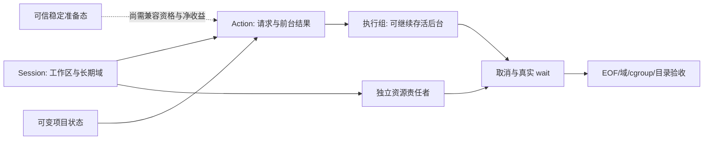

# ShimOS 下一阶段架构研究：项目负责人决策报告

**本轮已完成授权内的 12 次私有 VM 尝试，形成实际运行、失败、源码身份和独立进程审计证据。正常前台执行子集已可复现，但 B0/B1 尚未获得共同完整的取消、故障恢复与安全合同，因此没有进行严格双执行器性能排名。** 后续改为已授权的独立负载观测、真实依赖诊断和普通缓存反事实，没有放宽资格条件。

当前最有依据的下一项工作，是核验 **Session 生命周期与取消责任层** 能否由成熟监督机制补齐。另一条竞争路线是 **稳定初始化与可变项目状态的分离**，但它还缺少合法 heap 复用密度和净收益证据。本报告比较这两条路线；不选定 ShimOS 的最终架构，不实施核心协议、内核或调度器修改。

## 一、本轮究竟做了什么

这是固定真实 Agent 决策的执行回放与受控故障/机制诊断，**没有新的在线自主 Agent 运行**。任务、动作与原 Discovery 选择规则保持不变；同刻 burst、C=1/2/4 和两块顺序来自登记的受控到达。没有严格未见 Holdout、生产多 Agent 到达流或新的第三方 Zygote 准入。

|工作|实际规模|结果与边界|
|---|---|---|
|B0/B1 资格及成熟 init 反事实|2 VM；30 Session，302 动作记录，其中 8 个自然回放、164 个自然动作|正常前台子集有证据；完整共同故障合同未通过；4 次 Controller 强杀需观察者补清|
|真实依赖身份与导入|1 次 fixture 准备失败；另 2 VM、12 Session、296 个原动作|12 次定向评分 PASS；失败 VM 中 6 个预定 Session 未启动，单列 BLOCKED，不伪计实际尝试|
|多 Session 独立观测|6 VM；C=1/2/4 各 2 块；78 Session、2,484 动作|全部执行完成并释放，0 补清；每块独立评分始终为 6 PASS、4 TEST_FAILURE、3 BLOCKED|
|普通 mpmath 字节码缓存反事实|1 VM；4 Session、90 原动作，另有独立导入探针|4 次定向评分 PASS；同源缓存减少部分导入成本，不涉及 heap 继承|
|总计|**12 VM、124 个实际 Session 尝试、3,172 条动作记录**|其中 **3,034 条自然回放动作、138 条资格探针动作**；import 微探针另计，不混入自然动作|

12 次 VM wall 合计约 **77.7 分钟**，包括引导、fixture、追踪、评分、证据导出和关闭，不是纯业务成本。失败占用 VM 额度，没有追加 VM。全部运行已结束；私有磁盘保留为证据，不代表仍有存活业务域。

每次运行有不可复用 ID、计划和源码快照 SHA、QEMU argv、资源记录与最终回执。完整列表见 Run Ledger (`../runs/run-ledger.jsonl`, omitted from this source release)，总表见 最终统计 (`../analysis/workload-final-01/runs.csv`, omitted from this source release)。旧 v1.1 修复被继承并重新验证，没有把已有修复重新包装成新成果；本轮独立副本的变更和历史输入复核见 交付审计目录 (`../analysis/delivery-audit-final-01/`, omitted from this source release)。

## Q1：当前 ShimOS 已经解决了什么真实问题？

### 已经有真实任务支持的能力

1. **持久隔离域能承载连续工作区和多个独立工具进程。** B1 使用原 B-strict Owner/Guardian、LEADER/EOF/DONE，未修改核心协议。前台结果与整个执行组终结可以分别记录，不必每动作复制或重建工作区。Flask5014 的两个同 VM B0/B1 配对均执行原 29 动作、通过 60 项定向测试，最终补丁和返回码相同。
2. **严格区分结果知识和资源终态是必要的。** 有结果、执行组已结束、Session 已释放并非一件事。原 A+B 的授权、真实 wait、UNKNOWN 思路可保留；但本轮 B1 并未接入那套 H 协议，不能借历史 H 资格宣称自然 Agent Adapter 已完整恢复。
3. **普通工具需要原生进程执行和会话连续性。** 一批 13 任务实际产生 414 动作、13,612 个业务进程、102 个执行 Python 映像的进程。大多数进程是两个真实 find-heavy 任务产生的短 grep；这支持直接工具执行的适用性，但进程次数不是 CPU 或时间占比。

### 已有能力，但真实需求和收益仍受限

历史 G2/G3/G4、固定 NumPy、candidate D、跨域内存继承仍是可复用的受控研究资产。本轮没有推翻它们的历史结果，也没有扩大其适用范围。当前 Flask/SymPy CLI、项目修改和未知回调不因此获得模板资格；`K_heap/K_template` 仍是 **UNKNOWN**，不是动作数、Python exec 数，也不是已经证明为零。

因此，已经解决的现实问题首先是可审计的隔离执行和部分会话连续性。**跨域共享预热状态在自然多 Session 任务中的合法命中率、净平台收益尚未确立。** 单次跨域派生没有在本轮新增系统收益证据，不需要把它设为后续工作的前置条件。

## 二、执行器资格：普通问题已缩小，故障合同没有被掩盖

|合同/问题|本轮事实|判断|
|---|---|---|
|`env.config`、HOME/config、locale、`/tmp`、工作区 owner、输出首行|沿用 v1.1 独立适配修复；新正常语义探针和自然回放确认可用|受测普通接口子集通过，不是新架构机制|
|前台返回后合法后台继续运行|B1 使用已有 LEADER+EOF 返回，DONE 后续验收；没有提前杀后台来伪造完成|原适配边界可以修，不证明底层必须重构|
|早退孤儿真实 wait|B0 增加成熟 `--init` 后 4/4 有 Tini 正返回 wait；无 init 两例没有对应证据|成熟机制确实补上局部缺口|
|Session 结束时仍活跃后台|B0_INIT 四例缺少逐后代 wait 链；B1 76 个确认业务进程中 73 个可绑定，3 个短进程缺 NSpid 映射|缺口与观测不足分别保留，不推断内核泄漏或全通过|
|Action 超时/取消|B0_INIT 两次 CLI 超时后仍出现迟到文件；B1 4 个相应组有 DONE/EOF、未见迟到文件|取消合同不等价，CLI 超时不等于业务树终止|
|Controller SIGTERM|两侧普通 finalizer 可运行，业务结果与释放分栏|不推广为 SIGKILL 恢复|
|Controller SIGKILL|四例均需要观察者补清；B0 留业务进程，B1 业务组已空但两侧均有工作区残留和缺结果|完整外部清理责任未建立；UNKNOWN 不能写成 SUCCESS|
|安全身份|B0 使用 guest 初始 userns、NNP=0、非零 CapBnd；B1 独立 userns、NNP=1、能力集清零|seccomp 都显示 2 也不表示相同过滤规则；不能作无条件安全等价排名|

正常自然路径的 8 个 Session、240 个确认业务进程均有实际 wait，B1 82 个执行组最终完整；其中 Flask4935 的四次评分均保留 1 项失败。因此“资源释放”没有被当作“任务修复正确”。[完整资格与原始行](01_executor_qualification.md)

Flask5014 的正常子集，admit→父进程实际 wait Controller 的两对观测为 B0_INIT **14.603/15.154 秒**、B1 **11.346/11.446 秒**；域建立分别 **0.923/1.033 秒** 与 **0.048/0.049 秒**。这提示正常路径存在值得解释的差额，**不是共同完整合同下的加速结论**。该旧资格采集路径约 6 秒为证据复制，admit 还在工作区准备之后；不能将差额全部归为隔离系统调用或推算无诊断产品成绩。

## Q2：多 Agent 系统最昂贵、最难管理的资源是什么？

本轮没有一个适用于所有负载的单一答案。正常批次首先显示工具执行、控制与观察成本、排队和资源竞争；故障路径最明确的问题则是生命周期责任。

### 六个独立负载批次

仅运行 B0_INIT。run ID 中 `next-b0-b1-c*` 的第二个 `b1` 是 **block 1**，不是 B1 后端。每批保留全部 13 任务，没有因失败删样本。

|C|两块完整 batch 秒|两块 Session 服务中位秒|两块业务 CPU 秒|两块 guest root CPU 秒|
|---|---|---|---|---|
|1|261.07 / 252.84|17.89 / 16.82|141.93 / 138.64|230.46 / 222.34|
|2|156.60 / 150.57|19.09 / 18.41|141.34 / 139.89|213.29 / 210.95|
|4|116.28 / 119.35|26.41 / 27.34|141.05 / 142.33|204.58 / 206.70|

提高 C 缩短了排队和整批时间，却增加单 Session 的服务时间。C4 的域准备中位 **3.99–4.33 秒**，C1 为 **1.76–1.88 秒**；工具累计中位也从 **9.09–9.26 秒**增加到 **13.41–15.55 秒**。域准备包含执行器控制与观察，不是纯 namespace 成本。并行阶段不能相加为 batch 时间。

业务 CPU 总量基本不变。root CPU 残差下降与更短的观察持续时间同时出现：driver/observer 可见 CPU 下界从约 35–38 秒降到约 21 秒；不能将这些变化全部解释为更有效的执行资源组织。本轮没有无 trace 批次来精确扣除观察开销。

业务父组 peak **355–529 MiB**，低于 2 GiB 配额；没有 OOM、memory max 或 PID 拒绝事件。C4 的父 CPU 节流为 **0.255/2.286 秒**，C1/2 为零。**这里测到了并发竞争，没有测到足以检验模板淘汰的内存压力。** 业务内存时间随 batch 缩短而下降，但它是 memcg charge 的采样积分，不是全平台净物理内存。

!六个负载批次的时间与资源 (`../analysis/workload-final-01/multisession-costs.png`, omitted from this source release)

### 进程、域和任务正确性

- 六批共 **81,672 个确认业务进程，81,672 个实际正返回 wait**；13 域/批、414 动作/批。每域动作中位 29、范围 12–61；每域业务进程中位 43、范围 21–7,379。
- 两个 find-heavy 任务贡献每批 13,149 个进程，其余 11 任务只有 463 个。不能由进程数推导“Python 初始化占主导”或“Native Exec 消耗最多 CPU”。
- 并存域的 pid/mount/net/ipc/uts 身份不同，userns 共享 guest 初始身份；串行销毁后 inode 重用不视为域复用。
- 六批都执行完成并释放、无补清、无工具级超时/取消/UNKNOWN；原动作中的普通非零退出每批 20 次，作为自然失败/修复过程保留。独立评分每批仍为 **6 PASS、4 TEST_FAILURE、3 BLOCKED**，只有 6/13 同时满足正常执行和定向验收。不是官方完整 SWE-bench resolution rate。
- 跨批 2,070 条动作的命令和返回结构全部相同；解码输出只有 1,926 条逐字相同，其余 144 个差异原文保留。同一任务的源码及新增代码跨六批一致，合计核查 78 个 Session；评分前后候选不变已核 72 个，Requests1921 六例缺清单，保持 UNKNOWN。

[批次 CSV/分解](02_multisession_benchmark.md)、独立实际 wait、源码和 namespace 审计 (`../analysis/final-execution-audit-01/audit.md`, omitted from this source release)。

### 完整平台账本的边界

VM 固定 4vCPU/4GiB；业务父组 3CPU/2GiB/512PID，每 Session 1CPU/512MiB/128PID。Controller、Docker daemon 和观察者不都在业务硬预算内；所以不能把这个父组当作全平台硬限制。guest root CPU 包含业务和管理层，但不含宿主 QEMU CPU，不能再加子组造成重复记账。

六批 `/proc` 首见身份仅覆盖 **1,626/81,672，约 1.99%**，主要遗漏短 grep。trace 无丢事件不代表 PSS/FD/namespace 快照无缺失。角色 PSS 峰值不能相加，全平台净物理内存仍 UNKNOWN。预置 fixture 每批约 111–119 秒；独立评分和研究归档在 batch 外、完整 VM 内，均单列，没有免费归给某种架构。

## Q3：持久容器和成熟机制已经解决了多少？

四个简单反事实显著收窄了需要“新架构”的解释。

1. **持久域已经解决正常文件连续性。** 每 Session 准备一次工作区，后续动作直接使用。此前每动作 archive/copy 的成本属于 Adapter，不能作为跨域 Worker 的系统优势。
2. **成熟 PID1 已解决一部分孤儿 wait 和停止问题。** `--init` 有真实反例支持；但它不自动提供 Action 树取消、Controller 死后工作区删除或任意活后台的严格终态。不能把“init 有用”写成“全部恢复已解决”。
3. **静态 FIFO 与并发准入已明显改变受控 batch 时间。** 本轮没有新 Scheduler，也没有比较相同信息条件下的独立缓存/路由与联合策略；不能因存在多个变量就声称联合优化必需。
4. **普通字节码缓存已减少一部分真实依赖导入成本。** 这部分不能算作 heap 复用独有收益。

### 实际依赖身份与普通缓存反事实

旧 13 fixture 的 78 对 wheel 交集只是安装证据。本轮在 Flask5014、SymPy19954/20154 中补到 **36/38 次 identity-on Python exec 的起止记录**；两个 SymPy 任务的 50 个实际 mpmath 模块文件，在 26 个解释器观察中身份一致，同时项目源码发生实际修改。新增共享 Z 准入仍为 **0**。

固定 CPython3.10.12/glibc2.35/mpmath1.2.1 的独立反事实，只增加有效 CHECKED_HASH pyc，不修改源文件、业务 UID 或原命令。两个任务各新增 86 个 pyc、1,653,295 字节；独立 `-v` 进程确认各 50 个模块由源码读取变为实际 pyc code object 读取。

|任务|mpmath import 中位 ms：无→有 pyc|完整 SymPy import 中位 ms|原任务工具累计秒|
|---|---|---|---|
|19954|230.75 → 70.32|1116.06 → 934.40|27.767 → 26.399|
|20154|232.72 → 70.34|1128.04 → 928.48|8.319 → 7.499|

每格只有同一 VM 中 3 个 fresh 进程样本，保留超过 2 秒的慢样本；两个任务反转顺序，但不能消除镜像/page-cache/随机输出混杂。mpmath 已包含在 SymPy 时间内，差额不能相加。4 个原任务回放、90 动作、定向评分全部通过，144 个业务进程全部实际 wait；仍不是新的完整故障资格。

纯编译约 0.259/0.258 秒；本次完整复制、编译和额外镜像准备为 **7.075/5.848 秒**。不能免费提供这些准备，当前工具层差额不足以覆盖本次每任务额外镜像账本；也不能说生产 pyc 必须每次付出实验复制/镜像成本。普通缓存之后剩余约 70ms mpmath import 尚未分解为可安全继承的对象初始化，不能直接作为模板可消除预算。[依赖报告](03_dependency_and_state_reuse.md)、缓存原始对照 (`../counterfactuals/pyc/results.md`, omitted from this source release)

前后单线程、3 FD、可观察信号/环境不变，只是端点事实，不排除瞬时线程、native callbacks、锁或权限风险。atexit 读取文件 SHA 也不等于精确捕获 import 瞬间已加载字节。未知依赖未进入有管理权限的 Z。

## Q4：哪些架构抽象最需要重新审视？

目前有证据需要审视两处边界，但尚不足以认定都必须发明新机制。

这是责任与兼容边界示意，**不是已实现的新协议**。

**第一处：Action 结果、Session 生命周期与资源责任。** 原 LEADER/DONE 已表达一部分；当前具体缺口是超时到底撤销哪个执行组、控制端死亡后谁持有清理责任、结果未知时何时可以释放容量。不能靠 Controller 自己的 finally 处理 SIGKILL，也不能以 kill/空组替代全部 wait/EOF/目录验收。成熟 runtime/service 是否足够，仍需实际强基线验证。

**第二处：稳定初始化与可变项目代码的兼容身份。** 相同 wheel 与实际相同模块已经观察到，但 cwd/env/import hooks、项目修改、ABI、权限和生命周期仍可能使共享 Worker 不合法。当前最缺的不是更复杂的缓存分数，而是一个真实任务中合法、值得复用的状态集合及其净成本。

不建议根据这轮数据直接改变权限拓扑、改内核或设计全局联合 Scheduler。没有测到模板缓存压力，也没有测到“缓存和路由分开决策”造成的独立损失。

## Q5：两条竞争系统路线及最强反驳

|问题|路线 L：Session 执行结果与资源责任分离|路线 T：稳定准备态与可变项目状态分离|
|---|---|---|
|现实依据|Action timeout 后迟到副作用、Controller 强杀后资源责任缺口、后台跨动作存活|实际外部模块身份重复、项目变化、重复导入和普通缓存后的剩余成本|
|可能的新抽象|不可复用 Session/Action/执行组身份及独立资源责任；结果、存活、取消、释放分别表达|具备运行时/内容/权限/配方与失效边界的准备态目录，先判合法位置，再选冷执行或复用|
|可保留代码|Bubblewrap/B-strict、Native Exec、真实 wait/UNKNOWN 方法与既有故障证据|固定已准入模板、G0/G2/G3/G4 机制、成本与生命周期证据|
|可能需要重设|工具后端 Session 生命周期、取消与外部清理接口；未必重写 Owner/H/R/Z|状态身份、项目加载边界、模板资格/共享页责任；不等于增加动态 Zygote 树|
|最强已有方法|成熟 containerd/shim/systemd + 正确 init + 同步收尾 + 正确组取消|普通文件/pyc缓存、持久 Kernel、SOCK/OpenLambda、Forklift 静态树、FaasCache 成本保留、Atoll 放置/路由|
|最小证伪实验|只补成熟独立监督和执行组取消，保留同样后台语义，重跑 timeout、TERM/KILL、EOF及全资源验收|先在有普通缓存的真实任务上识别剩余成本；再经另行准入，只比较一个固定合法配方的静态成熟复用与冷执行|
|何时不能称新贡献|成熟组合即可满足合同，且管理成本无显著损失：属于工程整合|普通缓存/静态模板/独立策略已解释收益，或没有足够合法命中：不需要新联合机制|
|当前证据等级|缺口已实测；新抽象优于成熟监督 **未证实**|重复字节/导入已实测；安全 heap 密度、净收益及联合价值 **未证实**|

SOCK/SAND 已有跨域或同域预热派生；OpenLambda 已有静态依赖树、实例队列和驱逐；Forklift 已有成本树；FaasCache 已有兼容匹配与成本保留；Archipelago/Atoll 已研究预热、放置、路由与资源竞争。**“把这些一起考虑”本身不是新贡献。** Atoll 与 Archipelago 的版本、模拟创建成本与实际执行证据已分开，无法取得匹配实现的故障语义保持 UNKNOWN。[14 系统机制表、82 项来源和固定源码行号](05_prior_art_and_novelty.md)

路线 L 更接近当前确认的正确性问题，路线 T 更接近原有状态复用主线，但证据链更长。两者可能互补，也可能最终只需要成熟持久域与 Native Exec；本轮没有证明论文机制已成立。两条路线的详细证伪条件与风险 (`06_new_architecture_candidates.md`, omitted from this source release)

## Q6：下一轮若只允许修改一个核心组件，建议修改什么？

**建议先验证工具后端的 Session 生命周期与取消责任层，优先接入成熟监督。** 这是技术建议，需要负责人另行授权，本轮没有实施。

理由是具体错误已复现，而且涉及普通 Shell/测试等自然操作；不是因为已证明它占最多性能成本。验证必须同时保留合法后台跨动作存活、正确执行组取消、Controller 强杀后的独立责任、UNKNOWN/INCOMPLETE、真实 wait/EOF 和最终资源验收。不能只把整个 Session 提前杀掉来获得“取消成功”。

如果成熟 runtime/service 与现有接口即可补齐，应记录为工程修复，不升级为新系统贡献。若它们在同样合同下仍有实质成本或不能表达的资源归属，再把具体缺口交给负责人判断是否值得新抽象。现有证据不足以优先投入新 Kernel、单次派生、未知依赖预热或自动 Scheduler。

## 三、失败、覆盖和仍未完成的要求

|项目|最终状态与原因|
|---|---|
|共同完整资格下 B0/B1 多 Session 排名|**BLOCKED**：取消、Controller 强杀与安全身份不同；没有把旧 B1 串行数拼入 B0 六批|
|独立 B0 多 Session 真实负载观测|完成 6 VM/78 Session；有实际竞争、排队与回收，业务评分失败和 BLOCKED 全部保留|
|依赖第一次准备|`next-dependency-01` 的隔离 runtime 缺全局 git 准备接口，3 fixture BLOCKED；修订副本和失败均保存，未覆盖重跑|
|13 任务独立评分|每批 6P/4TF/3B；Requests6028 旧 fixture 评分提前失败，本轮真正运行后为 TEST_FAILURE，不能说架构导致退化或修复成功|
|任意后台与 Controller 故障完整保证|未完成；本轮资格已有具体反例/观察缺口，观察者补清不计产品通过|
|全平台净物理内存/精准诊断税|UNKNOWN：短进程采样低、PSS非同步、daemon/观察者预算不同、无无trace批次|
|真实跨域 heap 准入/命中|UNKNOWN；新增准入为0，未把 CLI 改为函数请求|
|内存压力、TTL/LRU 与联合路由收益|未验证；本批无内存压力、无合法模板池，不用模型或模拟补成绩|
|在线 Agent 总任务加速|未运行新的在线 Agent；这里只是固定真实决策回放和机制诊断|
|正式架构、内核/glibc/H/R/Z、新 Scheduler、飞书/远端发布|均未实施；历史输入与新副本身份由最终审计核验|

两个 VM block 在同一宿主，每块多个动作/Session不是独立机器重复。部分早期宿主离线分析与 VM 重叠，记录已保存，后续重型审计均在全部 VM 结束后执行；不能精确扣掉背景噪声或宣称生产 p99。自然动作可能失败，输出并非逐字全部相同；非零退出、工具异常、评分失败和资源未知分别统计。完整数据边界 (`data-quality-and-scope.md`, omitted from this source release)

## 四、复核入口与本轮停止点

- [执行器资格](01_executor_qualification.md)：两 VM 完整正常/故障矩阵、补清、版本和实际 wait。
- [多 Session 成本](02_multisession_benchmark.md)：六批、全部13任务、CPU/内存/时间口径与图表。
- [依赖与合法复用](03_dependency_and_state_reuse.md)：实际路径/SHA/DSO、on/off 扰动、缓存反事实。
- 瓶颈及反事实 (`04_architecture_bottleneck_analysis.md`, omitted from this source release)、[先例](05_prior_art_and_novelty.md)、两条路线 (`06_new_architecture_candidates.md`, omitted from this source release)。
- 实际进程与源码最终审计 (`../analysis/final-execution-audit-01/audit.md`, omitted from this source release)、离线统计 JSON (`../analysis/workload-final-01/summary.json`, omitted from this source release)、交付与历史 SHA 审计 (`../analysis/delivery-audit-final-01/`, omitted from this source release)、复现 README (`../README.md`, omitted from this source release)。

本轮已用完授权的 12 次 VM 尝试并停止运行实验。没有自动进入新的阶段。负责人接下来需要决定的是：是否先授权成熟监督的有限集成资格，或先授权一个真实依赖的额外准入与净收益验证；也可以暂时保留现有执行底座与研究资产，不做核心修改。架构选择、研究路线及贡献定位由负责人决定。
