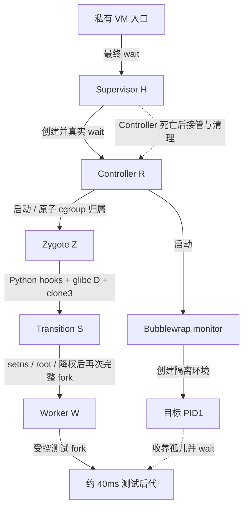

# ShimOS 架构组件级成本归因与低干扰执行基线

日期：2026-10-19。范围：固定私有 VM、可信单线程自有 Python 模板、串行请求、Bubblewrap 先建域、Z→S→W、完整 glibc D、Supervisor H 正常存活。

**本轮完成了独立原型、两模式正确性回归和实际组件测量。最明确的发现是：此前较大的“派生和监督开销”中，包含相当多资格诊断、证据序列化及输出成本；不能直接归因于 fork、setns 或 Supervisor。**

完整诊断 full 与低干扰 low 分别通过 8 个 VM 会话、29 次受限资格。正式无 tracing 测量使用另 3 个同宿主 VM，每个 VM 内交换 full/low 会话顺序，每模式每会话 5 次热身后测 20 次。每模式共 60 个正式请求，全部结果及资源验收通过。另有两 VM 的计时开关对照和少量独立 syscall 诊断。

主要结果如下；这些是当前受控程序的成本，不是实际 Agent 或任意第三方依赖的成绩。

|问题|本轮得到的证据|仍不能推出什么|
|---|---|---|
|完整请求多长？|full/low 合并样本 response-ready 中位数 157.38 / 140.69 ms；三个 VM 的会话中位数差为 19.87、8.04、15.81 ms|不能把同宿主 VM 当独立硬件；不能推广为真实 Agent 加速|
|建域多长？|请求开始→域就绪约 30.58 / 31.18 ms；bwrap spawn→PID1 C main 约 26.89 / 27.66 ms|其中约 20 ms 的装载/启动区间尚未细分，不能全称为 namespace 创建|
|两次 fork wrapper 多长？|low 的 Z、S 父侧 libc wrapper 中位数分别 0.415、0.327 ms；外层 Python hooks 另外计时|wrapper 不等于 Worker ready，也不等于纯 clone3 内核 CPU|
|进入目标域贵吗？|S 的实际 setns/root/cwd 区间并集约 0.017 ms；capability/NNP/seccomp 约 0.105 ms|不能把整个首次派生至 ENTERED 的 11.23 ms 都叫 setns 开销|
|诊断影响多大？|S 的 RP 诊断区间约 18.49→2.28 ms；R 证据写入区间并集约 73.24→42.29 ms|这些是嵌套/重叠观测，不能相加为净收益；low 仍保留必要记录和部分资格探针|
|H 为什么有长尾？|每会话 10 请求的开关对照中，计时开启时 H 等 R 退出尾段约 43–49 ms；关闭后约 1.0–1.7 ms|主要被最终 COST 刷新放大，不能作为删除 H 的性能论据|

## 1. 输入冻结、环境与实际变更

本轮从 `cost_breakdown/baseline_instrumented/` 复制完整 A+B 路径到 prototype/ (`prototype/`, omitted from this source release)，**仍保留独立 PING/PONG**。已验证的 PING 合并版本只作为冻结的历史证据，本轮没有再次删除消息、合并门禁或运行另一轮 PING 排名。

两种诊断模式使用同一份 21 个原型文件和 5 个编译产物；模式由 `ARCH_DIAGNOSTICS=full|low` 选择。新增工作仅限本目录：组件计时、诊断开关、独立验收、VM 驱动和离线分析。旧 A/B/A+B、cost_breakdown、B-strict、glibc D 补丁和内核均不修改。

|项目|实际配置|
|---|---|
|宿主|Intel Xeon Platinum 8468V；共享宿主，没有独占 CPU 或第二种硬件验证|
|VM|KVM，4 vCPU、4 GiB；固定 kernel/initramfs，无网络；私有 3 GiB Btrfs 状态盘|
|内核|`6.18.49-agentic-runtime-opt-v1`，SHA `bd303a80ab8fe396ac83d18e2dcd0936143eb0778fbcf6acaf47ea3fba11dd4f`|
|Bubblewrap|0.13.1，SHA `b4a951a519c1d32e9a47400755366eac8c206118e1fc6897f63041e043f6dca3`；使用其冻结 loader/依赖|
|Python / glibc D|CPython 3.10.12，Ubuntu `3.10.12-1~22.04.18`；glibc `2.35-0ubuntu3.15` candidate-04，GCC 11.4|
|候选 libc / loader SHA|`a03b51fe69f36b630ecf7997af05cd36885b1f2f0b52e278391fa6e17047eff4` / `0682f493d0434391d4ec027d0bcb54dd5f9e46d044dc7810f69abea58fe1398e`|
|文件路径|项目/assets 只读 9p，证据目录写入 9p；运行时按原驱动安装，workspace 在私有状态盘。没有把 9p 下的成本当成本地磁盘普遍值|
|权限/隔离|原 user/mount/PID/network/IPC/UTS 合同、只读 runtime/src、私有 work、最终 capabilities=0、NNP=1、seccomp=2；W 不允许 exec，业务 FD 0/1/2|
|资源预算|task：512 MiB、256 PID、`cpu.max=400000 100000`；子域：256 MiB、128 PID、`200000 100000`。预算拒绝用例按既有故障注入执行|
|业务|自有 64 KiB 内存模板、继承检查、19 项业务边界断言；正常业务还创建约 40 ms 等待的测试后代|

精确来源和每次构建见 输入清单 (`frozen/source-inputs.json`, omitted from this source release)、历史证据与运行时清单 (`frozen/evidence-runtime-inputs.json`, omitted from this source release)、实际源码准入 (`docs/variant-source-review.json`, omitted from this source release)。每个 run 保存 `command.json`、`source-sha.json`、`build.json`、运行时映射和 guest 环境；项目不是 Git 仓库，因此不虚构 commit。

全部 VM 结束后复核原冻结清单：689 条记录、680 个不同文件 SHA 全匹配，0 缺失、0 变化。只证明清单覆盖的输入，不对未列文件作扩大承诺。复核记录 (`analysis/historical-input-recheck.json`, omitted from this source release)及独立源码补丁 (`frozen/patches/prototype-source.patch`, omitted from this source release)保留了本轮修改边界。

## 2. 真实进程关系与调用边界

下面实线表示创建关系。Bubblewrap **不是 Z 的父进程**；namespace 归属也不等于父子关系。

正常执行的必要顺序是：

1. R 建 cgroup/workspace，启动 Bubblewrap；PID1 导出 namespace/root FD 并发出 DOMAIN_READY。R 收到后检查身份和引用。
2. R 向 H REGISTER；收到 REGISTERED 后，向 Z 发 SPAWN，Z 返回 PREPARED，R 发 COMMIT。
3. Z 经过完整 CPython/glibc 路径创建 S；S 出生于 transition cgroup，进入目标环境、关闭构造 FD 并提前降权，再报告 ENTERED。
4. R 发 START_WORKER；S 第二次完整派生 W，W 出生于 business cgroup，完成最终设置并等待业务门禁。WORKER_GATED 后 R 才发 RUN_BUSINESS。
5. W 执行并退出，S 真正 wait W，Z 真正 wait S。R 同时收集输出及状态。测试后代可在 W 退出后继续持有 stdout，由 PID1 收养并等待。
6. R seal/CANCEL，停止未来派生；确认 CANCEL_ACK、PID1 DRAINED、monitor wait、EOF 和 cgroup 空，再 FORGET、关闭引用、删除目录和 cgroup、PING 校验模板、RETIRE、构造 response-ready。
7. 会话结束另有 Z 停止、R 退出、H 真实 wait 和最终资源验收；这一尾段单独计费。

Z 的父侧 fork 返回与 S 的子侧恢复会重叠；S 等待 W 时 R/Z/PID1 仍在运行。父子分支、RPC handler 与内部写日志、多个角色的 wall 区间都不能直接求和。完整时序与源码行号 (`docs/component-call-graph.md`, omitted from this source release)包含所有消息及责任人。

## 3. 低干扰模式具体省掉什么

|类别|本轮处理|
|---|---|
|安全及正确性必需|namespace/root 身份检查、实际 FD allowlist 关闭、权限与 seccomp、全部门禁/撤销、真实 wait、EOF、cgroup 空、DRAINED、模板指纹与 FD 校验全部保留|
|恢复及产品状态必需|H 账本和接管、R 内存状态、请求身份、错误/UNKNOWN、关键日志和最终结果保留；H 最终 fsync 保留|
|资格专用诊断|low 关闭逐阶段完整 FD 枚举（含原 S 的 0–4095 fallback 扫描）；实际回调保留，只减少逐条同步格式化输出；R 完整 journal 改为关键点写入，其他状态仍更新|
|新增性能探针|同 guest 单调时钟、thread CPU、固定 C buffer、资源采样；可用独立开关关闭，并另测其扰动|

**没有关闭真实 FD 清理，也没有用旧 full 的 PASS 替代 low 验证。** low 仍实际检查两次派生的 native/Python callbacks、权限、TID/TLS/robust 行为和 W 的 19 项断言。未采样的 S 中间 FD 对象列表明确标为 `not_observed`；业务额外普通 fork 之后没有新的 RP snapshot，其逐回调明细也为 N/A。不能据此宣称每个中间时刻都获得同样观测。

H 不依赖 R 的整份 journal 来恢复或授权。low 保留初始、COMMIT/START_WORKER/RUN_BUSINESS 前、取消、故障、超时和最终验收记录；R 死亡后仍允许 UNKNOWN，不把最后一份旧文件解释成“确定没有执行”。完整分类及源码依据见 diagnostic-classification.md (`docs/diagnostic-classification.md`, omitted from this source release)。

## 4. 资格、样本与失败账本

|样本集|实际数量|结果及用途|
|---|---:|---|
|full 正式资格|8 VM、29 尝试|生命周期与 runtime 均 PASS|
|low 独立资格|8 VM、29 尝试|生命周期与 runtime 均 PASS；未观测边界明确保留|
|正式无 tracing full/low|3 VM、6 会话、每模式 60 正式 + 15 热身|全部结果/释放检查通过，120 个正式请求无计时缺失|
|新增计时开关对照|2 VM、8 会话、64 正式 + 16 热身|全部通过；只作扰动敏感度，不混入主分布|
|独立 syscall 诊断|full/low 各 1 VM、各 3 请求|有 tracing，分开报告；每组 86 项归因检查通过|

14 个性能会话共 230 次请求（含热身）通过独立运行准入，22,740 条检查、0 FAIL、0 BLOCKED。性能准入矩阵 (`analysis/performance-admission-final-matrix.md`, omitted from this source release)绑定同版本 full/low 资格、源码/二进制/运行时 SHA。故障资格的 PASS 表示预期错误或 UNKNOWN 与清理正确，不表示每次业务成功。

保留的异常不能隐藏：

- `pilot-full-01` 确实在 DOMAIN_READY 等待超时；H 最终以 UNKNOWN 清理。宿主 I/O PSI avg10 峰值 68.56%，同段 bwrap 装载后到 PID1 出生约 4.84 s。只能说与干扰同时发生，不能证明唯一原因。没有放宽 5 s 超时或 observer 补杀。
- full 首轮离线核验因新来源说明缺少两个 legacy 元数据字段报 FAIL，原记录保留。统一 v2 从实验前冻结的旧 review 逐 SHA 验证来源；未改变实际原型、二进制或安全验收。两模式最终统一复核，详见 核验修订 (`docs/provenance-verifier-revision.md`, omitted from this source release)。
- low 的 control/cancels 资格日志各有一条 COST 控制台片段不完整。生命周期证据仍通过，但这两个会话的成本不准入；未用插值补齐。
- syscall 首版分析的 INCOMPLETE 保留。v2 将 seccomp 拒绝的 exit-only 事件明确列为无入口、时长 N/A，而非删除；全文见 trace 说明 (`docs/namespace-and-fork-diagnostic.md`, omitted from this source release)。

正式测量没有删除慢样本。full 出现 512.30、646.95 ms 请求，low 出现 213.09 ms 请求，全部保留。每会话仅 20 个正式样本；p90 是样本分位，不声称生产尾延迟。正式三 VM 的宿主 CPU/memory PSI avg10 为 0，I/O PSI 峰值分别 5.22%、5.75%、2.55%；这并不消除调度或文件系统噪声。

## 5. 正常请求总时间及关键路径

单位 ms。每格 n=20。顺序为 full→low、low→full、full→low，没有随机挑选有利窗口。

|VM|full median / p90 / 范围|low median / p90 / 范围|会话中位数差 full−low|同 repeat 配对差中位数 / 范围|
|---|---|---|---:|---|
|1|154.18 / 177.57 / 141.49–512.30|134.30 / 144.99 / 114.06–213.09|19.87|21.50 / −54.93–379.74|
|2|161.91 / 193.53 / 151.85–646.95|153.87 / 168.91 / 138.67–169.53|8.04|14.29 / −7.43–503.26|
|3|155.47 / 161.85 / 141.41–170.34|139.66 / 146.63 / 123.70–148.18|15.81|16.19 / −1.14–34.19|

三个 VM 的中位数方向一致，但请求级存在反向样本，且同 repeat 只是串行配对，不是同时运行。不能据此给出独立硬件的置信度。本轮说明减少诊断有实际收益，没有测得可以直接用于生产的固定加速比例。

以下是**同一请求时间轴的相邻、不重叠分区**，每个请求的区间之和等于该请求 response-ready。各行中位数不具可加性，也不是某组件可删除的因果贡献。单位 ms，n=60/模式。

|区间|full median / p90|low median / p90|
|---|---:|---:|
|请求开始→域 ready（含起始记录）|30.58 / 32.96|31.18 / 38.53|
|域 ready→H 登记完成|1.56 / 1.95|1.68 / 2.08|
|登记完成→Z PREPARED|3.94 / 5.06|1.99 / 2.61|
|PREPARED→S ENTERED|19.20 / 23.54|11.23 / 13.70|
|ENTERED→W 门禁 ready|18.23 / 19.58|8.59 / 10.69|
|门禁 ready→业务进入|3.51 / 4.25|2.96 / 3.91|
|W 业务父进程部分|3.43 / 4.76|3.17 / 4.01|
|业务结束→后代/输出/域静止|60.39 / 63.44|63.59 / 66.05|
|域静止→FORGET 完成|1.03 / 2.00|1.62 / 2.34|
|关闭引用、目录/cgroup 释放区间|1.92 / 2.34|2.59 / 3.29|
|结果验证和模板检查区间|4.78 / 5.52|5.83 / 7.05|
|RETIRE 与响应构造区间|7.87 / 9.75|8.27 / 10.30|
|完整 response-ready|157.38 / 166.98|140.69 / 161.63|

这里的“零未分区时间”只表示时间轴覆盖完整，不表示所有成本都已因果解释。low 的若干回收/检查区间反而更慢，不能只挑有利阶段。后代区间含人为 40 ms 等待及与它重叠的其他工作，不能直接从总时间减 40 ms 就宣称获得等价无后代请求时间。逐请求 CSV (`analysis/formal-requests.csv`, omitted from this source release)、完整分析 (`analysis/formal-cost-results.json`, omitted from this source release)。

## 6. Bubblewrap、PID1 和域引用导出

无 tracing，n=60/模式，单位 ms：

|实际操作|full median / p90|low median / p90|
|---|---:|---:|
|cgroup/workspace 准备|0.675 / 1.663|0.687 / 1.023|
|R launcher 调用|0.644 / 1.443|0.636 / 1.081|
|bwrap spawn→PID1 C main|26.894 / 28.689|27.662 / 34.322|
|PID1 C main→本地 ready|0.155 / 0.284|0.151 / 0.276|
|R 收到 FD 后验证身份|0.278 / 0.607|0.366 / 0.623|

launcher 调用返回可以早于子进程装载完成，不能与 spawn→main 相加。主分布不能继续拆出原版 bwrap 内部时间，因此另做各 3 请求的 syscall 诊断，**不混入上述分布**。

诊断中，显式 loader exec→PID1 出生的中位数为 full 19.60、low 21.65 ms；PID1 出生→exec domain_init 为 2.58、3.74 ms；exec→C main 为 0.161、0.203 ms。每域 26 次 mount 的累计区间仅约 0.191–0.381 ms，17 次 mount_setattr 共 0.008–0.023 ms，两次 unshare 共 0.014–0.027 ms；monitor clone 约 0.446–0.647 ms。部分调用发生在 PID1 出生之后，不能用它们解释出生之前的全部时间。

因此，**较大的预算目前位于装载、文件访问、配置或调度的未细分区间，尚未证实是 Linux namespace 本身昂贵**。assets/loader 来自固定实验文件布局，9p 与 page cache 也是后续需区分的条件。本轮没有修改 bwrap，也没有删除安全检查来试图兑现这段预算。逐 syscall 归因 (`docs/namespace-and-fork-diagnostic.md`, omitted from this source release)。

## 7. 完整派生机制：Python、glibc、native callbacks、clone3

以下无 tracing 数据 n=60/格，单位 ms。`libc wrapper` 是 bridge 调用固定 D 入口到父侧返回，含 native handlers 与 clone3，不含外层 CPython before/after。child-return 跨度含子进程调度，不与父分支相加。

|派生|机制|full median / p90|low median / p90|
|---|---|---:|---:|
|Z→S|CPython before hooks|0.403 / 0.556|0.079 / 0.120|
||完整 libc wrapper，父侧|0.918 / 1.312|0.415 / 0.610|
||CPython after-parent|1.138 / 1.431|0.581 / 0.827|
||wrapper 入口→子侧返回|1.164 / 1.435|0.477 / 0.662|
||CPython after-child（S）|2.552 / 4.210|1.997 / 3.024|
|S→W|CPython before hooks|0.333 / 0.368|0.053 / 0.078|
||完整 libc wrapper，父侧|0.741 / 0.859|0.327 / 0.453|
||CPython after-parent|0.842 / 0.947|0.443 / 0.611|
||wrapper 入口→子侧返回|0.999 / 1.152|0.395 / 0.538|
||CPython after-child（W）|2.149 / 2.433|0.995 / 1.587|

native 自有回调组的中位数：Z prepare/parent 为 full 0.231/0.275、low 0.0047/0.0144 ms；S 第二次 prepare/parent 为 0.203/0.220、0.0037/0.0102 ms；S/W child 组由约 0.450/0.404 降为 0.0107/0.0110 ms。**回调实际执行、顺序与权限采样均保留，减少的是研究回调的同步日志，不是跳过运行时维护。** CPython 区间同样含自有探针，不能等同于纯解释器内部成本。

为区分 syscall，使用同调用对齐的独立 tracing 样本；每格 n=3：

|派生 / 模式|libc wrapper 中位 ms|clone3 wall 中位 ms|自有 native prepare / parent ms|wrapper 未归因残余 ms|
|---|---:|---:|---:|---:|
|Z→S full|1.110|0.400|0.258 / 0.306|0.008|
|S→W full|0.747|0.308|0.213 / 0.221|0.005|
|Z→S low|0.332|0.312|0.003 / 0.012|0.005|
|S→W low|0.331|0.300|0.004 / 0.011|0.016|

残余来自每次调用的区间扣除，不是对各列中位数相减；也不是纯 libc CPU。clone3 的入口至返回是 wall，含抢占/调度，不能称为纯内核开销。从内核 birth 到首个自有 native callback，诊断中 S/W 约 0.071–0.114 ms，仍含子侧调度、内核返回和 libc child 修复，不单独命名为“调度器成本”。

完整 fork 契约、TID/robust 与权限均按新运行验证；已知错误的 raw clone 路径没有参加性能比较。以上小模板数据尚不足以支持为性能替换 glibc 或开发单次跨 PID namespace 内核接口。运行时机制与源码 (`docs/runtime-mechanisms.md`, omitted from this source release)。

## 8. S 安全转换、W 准备与业务门禁

下表为 low 的无 tracing 数据，n=60；单位 **µs**，只为描述微小操作的量级，不宣称纳秒级准确。所有操作仍真实执行。

|S 操作|median / p90 µs|
|---|---:|
|进入 base userns|4.71 / 7.73|
|进入 mount namespace|2.78 / 4.76|
|进入 network / IPC / UTS|0.83 / 1.49；0.93 / 1.48；0.78 / 1.25|
|设置子进程 PID namespace|0.85 / 1.34|
|进入 inner userns|1.67 / 2.53|
|root fchdir / chroot / work chdir|0.78 / 1.20；1.75 / 3.23；1.92 / 2.90|
|清 bounding set|35.62 / 62.01|
|capset / ambient / dumpable|1.50 / 2.29；0.76 / 1.25；0.51 / 0.92|
|no_new_privs|0.52 / 0.94|
|seccomp policy|65.58 / 111.62|

S 的 namespace/root/cwd 区间并集中位 0.017 ms；安全设置并集 0.105 ms。真实 FD 关闭并集约 0.186 ms，与 low 已停止的 RP FD 枚举不是同一操作。

W 子分支→业务门禁约 1.757 ms（p90 2.718）；W 内实际阻塞 gate wait 约 4.169 ms（p90 5.620），thread CPU 仅 0.026 ms。R 收到 WORKER_GATED→业务进入约 2.961 ms；二者起点不同，不能视为冲突或相加。R 先做状态记录与授权，S 再写 gate，W 才能运行。

请求开始→W 实际业务进入中位数 full 76.70、low 57.45 ms。这个数包含建域、控制、两次完整派生、诊断和必要许可；不能把 wrapper 的亚毫秒结果替代它。

## 9. H/R 控制、IPC 与证据记录

R 边界正常固定骨架为 25 条控制消息，其中 4 个显式阻塞 RPC 是 REGISTER、FORGET、PING、RETIRE。本轮未删消息。定时 QUERY/SNAPSHOT 会增加消息：正式 full 样本实际总数 25–29，low 为 25；固定非 QUERY 部分两模式均为 25。这个口径不包含所有内部 ready/gate pipe 字节、日志、会话 Z_READY/STOP/DONE，不能叫作全系统 IPC 总数。完整逐消息 send/recv、编码、处理、等待分布见 mechanism-spans.csv (`analysis/formal-components/mechanism-spans.csv`, omitted from this source release)。

|机制，n=60|full median / p90 ms|low median / p90 ms|CPU 解释|
|---|---:|---:|---|
|R REGISTER RPC|1.497 / 1.904|1.610 / 1.991|含 H 服务与双向调度|
|H REGISTER handler|1.186 / 1.500|1.223 / 1.525|thread CPU 中位 0.341 / 0.359 ms|
|R FORGET RPC|0.340 / 0.486|0.436 / 0.581|含 Z 处理与等待|
|R PING RPC|1.417 / 1.742|1.863 / 2.153|包含真实模板指纹及 FD 校验准备|
|R RETIRE RPC|1.527 / 1.910|1.695 / 2.066|含 H 验收，不是全部 CPU|
|H RETIRE handler|1.268 / 1.583|1.429 / 1.779|thread CPU 中位 0.487 / 0.511 ms|

Z 的 low handler 中位数：SPAWN 0.095、COMMIT 3.262、CANCEL 0.176、FORGET 0.138、PING 1.619 ms。COMMIT 嵌套完整首次派生和其诊断。R 处理 PREPARED/ENTERED/WORKER_GATED 中位 3.67/4.22/3.77 ms，含关键 journal、发送下一条许可及其他本地操作，不能当作纯 IPC 服务时间。

R 每请求证据/恢复记录区间并集 full 73.24、low 42.29 ms；其中同线程 CPU 中位 23.53、12.85 ms。保留记录仍是明显预算，但它与 RPC 和其他角色重叠，不能说删除全部记录即可缩短 42 ms。低模式 journal 仍每次约 3.12 ms，事件输出约 1.11 ms；文件布局与序列化也参与这些数值。

H 每请求已测组件并集 wall 约 126.67/108.38 ms，主要在等待；对应已测 thread CPU 约 1.22/1.26 ms。这不代表 H 的全部 per-request CPU，也不是“比无 H 多付的成本”。本轮没有同合同无 H 基线，不能给出 H 可删除的因果收益。

## 10. 真实 wait、输出 EOF 与资源释放

正常请求，n=60/模式，单位 ms：

|实际边界/操作|full median / p90|low median / p90|含义|
|---|---:|---:|---|
|S 阻塞 wait W|4.961 / 6.834|4.744 / 5.803|thread CPU 仅 0.039/0.049 ms，主要等待|
|W 业务结束→S wait 返回|1.523 / 1.997|1.533 / 1.841|包含 W 收尾/诊断/退出及调度|
|S wait W→Z wait S|10.004 / 13.992|9.206 / 13.668|S 收尾、Z 事件循环/轮询/调度均可能参与|
|W 业务结束→输出 EOF|42.607 / 43.228|42.598 / 43.216|大部分受约 40 ms 测试后代持有 pipe 影响|
|R 删除 cgroup|0.172 / 0.286|0.302 / 0.468|此前必须已确认空域|
|R 删除 workspace|0.115 / 0.192|0.201 / 0.303|不是撤销已发生外部副作用|

Z/R/H 的实际正返回 wait 保留逐调用事件；返回 0/ECHILD 的大量空轮询仅聚合记录次数、累计 wall/CPU、首末点，不改变真实 wait 调用。聚合不是连续时间区间，不能加入关键路径 union。

PID1 的 STOP→DRAINED 本地处理在独立 trace 中约 1–2 µs，但这个起点通常已经晚于后代退出。它不包括此前等待、R 读消息、monitor 退出或 EOF，不能解释整个清理成本。monitor 的真实 wait 和 fork/exit 对应在原始日志中单独核查。

本轮 per-request response-ready 已包含域空、输出 EOF、引用关闭、目录/cgroup 删除、模板检查、H RETIRE 和结果构造。H/R/Z 会话本身仍存活；最终会话 RELEASED 另行报告，不能把它藏在响应后不计费。

## 11. 冷会话、CPU、内存和最终尾段

冷启动只测 H/R/Z，不混入热请求；排除 VM 开机、编译、运行时复制安装和离线 SHA 核验。每模式仅 3 次冷会话，不估稳定尾分位。

|VM|full 冷 H/R/Z ready ms|low 冷 H/R/Z ready ms|其中创建 Z→R 验明 ready（含映射检查，full / low）ms|
|---|---:|---:|---:|
|1|185.66|183.75|154.50 / 157.92|
|2|197.49|184.25|169.21 / 157.55|
|3|194.05|183.92|157.87 / 159.15|

Z 模块首个埋点→本地 ready 只有约 2.10–2.58 ms；创建→ready 的其余部分含 loader、解释器、支持模块、探针初始化和映射校验，尚未细分。ready 前 Z 累计 self CPU 约 145–157 ms，不把它全部叫业务初始化。

CPU 分账如下，单位 ms。请求列为各 VM 正式中位数；会话列包含 5 热身+20正式。部分进程最终 COST flush 位于 self usage 终点之后，未伪装成已覆盖。

|VM / 模式|R 请求 self CPU|task cgroup CPU|H 会话 self CPU|R 会话 self CPU|Z ready 后 self CPU|
|---|---:|---:|---:|---:|---:|
|1 full / low|32.10 / 23.67|47.94 / 32.12|169.98 / 155.99|802.91 / 602.45|174.13 / 147.16|
|2 full / low|34.37 / 25.62|51.79 / 36.06|182.62 / 182.21|893.07 / 675.48|185.70 / 173.08|
|3 full / low|32.85 / 25.66|49.52 / 33.64|161.16 / 159.30|850.52 / 648.82|174.67 / 160.53|

task CPU 已包括 control(bwrap/PID1)、transition(S)、business(W/后代)，不再与子域或 waited-child CPU 相加。它不包括外部 H/R/Z。在采集到的 task/子 cgroup 统计中没有观测到正式样本 CPU throttling；这不表示宿主没有调度干扰。task charged memory.peak 中位 full 8.91–9.06 MiB、low 8.60–8.82 MiB；不是 PSS，不能推导总物理内存收益。

PSS 为边界采样：H 初始约 9.5 MiB、最终约 11.5 MiB；R 初始约 6.8–6.9 MiB，最终 full 约 13.8 MiB、low 约 13.4–13.5 MiB；Z ready PSS 约 14.0–14.1 MiB，RSS 约 18.6–18.8 MiB。没有最终 Z PSS、连续内存时间积分或全系统实际峰值，不能相加 RSS。运行时 bundle 的约 35.29 MiB 文件体积也不是 RSS/PSS。

H/R/Z 会累积 COST 缓冲，R 保留完整证据；Z fork 后子进程才清空继承的诊断缓冲。这会影响内存与 COW，因此上述增长不能全归于必要执行状态。low 尚未显示明确常驻内存优势。

会话收尾中，H 在已完成 R 的控制通道 EOF 后仍用 WNOHANG 轮询；R 此时可能正在刷新 COST。25 请求正式会话里，EOF→真实 wait R 为 97–116 ms，H 整个会话累计空 wait 约 2.3–2.7 万次，调用段累计 thread CPU 43–52 ms（不含整个 Python 轮询与诊断聚合的全部 CPU）。但下节计时开关对照证明，**这段长尾主要受研究证据刷新放大**。所有空 wait 聚合跨越的边界仍标 unresolved，不能将其全部 CPU 强行归给该尾段。完整资源账本 (`docs/resources-and-supervisor-tail.md`, omitted from this source release)。

## 12. 新增计时探针本身的成本

同 guest 的 CLOCK_MONOTONIC 贯穿各角色，thread CPU 单列；原始事件绑定 session、nonce、角色和 PID。ftrace 使用回读确认的 mono 时钟，丢失计数为 0。宿主 PSI 只描述环境，绝不与 guest 时间戳直接相减。时钟成对读取约百纳秒的校准不包含 JSON、buffer、输出、COW，不是整套探针开销。

两 VM 分别反转 full/low 和 timing-on/off 顺序，每格 2 热身+8正式。单位 ms，on/off 都保留原资格及生命周期检查和最外层端点。

|VM / 模式|timing-on median|timing-off median|同 repeat on−off 中位 / 范围|
|---|---:|---:|---|
|1 full|166.51|155.98|12.16 / −34.75–22.97|
|1 low|132.74|130.63|0.29 / −24.63–16.04|
|2 full|155.39|153.07|0.95 / −8.64–21.51|
|2 low|142.01|138.08|5.28 / −7.60–14.18|

新增计时并非零扰动，单请求差接近噪声且变异较大，不能从正式成绩统一扣一个“校正值”。timing-off 原生回调时间戳未采集；它验证实际回调计数/权限和资源结果，不代替正式回调顺序资格。

更清楚的证据来自会话尾段：

|VM / 模式|详细计时开：H EOF→wait R ms|详细计时关：同边界 ms|
|---|---:|---:|
|1 full|45.79|1.70|
|1 low|42.59|1.00|
|2 full|44.75|1.57|
|2 low|48.74|1.30|

H 在 wait R 后写最终释放证据仍有约 7.77–52.04 ms 波动，不随开关单调变化。它含文件操作、fsync 和调度；不能把差值再全部归为纯 I/O。raw/CSV、开关 p90 和所有反向样本见 扰动分析 (`analysis/measurement-overhead/README.md`, omitted from this source release)、资源开关账本 (`analysis/resources-overhead-01/README.md`, omitted from this source release)。

## 13. 失败、取消及 Controller 死亡路径

这些来自资格 tracing 会话，是少量正确性/成本诊断，**不与正常无 tracing 样本混排**。完整 40 个非 normal 尝试，包括缺失计时，都在 failure-costs.csv (`analysis/failure-components/failure-costs.csv`, omitted from this source release)。

- full 取消记录→域静止的若干用例约 15.36–19.23 ms；撤销回执丢失用例为 519.26 ms，反映原有约 0.5 s 的保守兜底等待，不是常规取消成本。
- 首次/第二次 PID 预算拒绝的故障记录→域静止，full 约 23.90/22.27 ms，low 约 23.97/8.39 ms，各是小样本，不作优劣排名。
- Controller 运行中/进入中死亡后，故障→H 域静止四例约 14.98–21.48 ms；故障→H RELEASED 分别约 42.58、46.87、55.68、231.92 ms。最慢值保留。H 自身恢复入口→释放与故障入口不同，不能混用。
- R 已死亡的请求没有 response-ready，填 N/A。H 返回 UNKNOWN/RELEASED，真实收养 wait、EOF 和回收证据齐全，observer 未补杀。
- low-control/cancels 两会话计时日志不完整，相关成本标 BLOCKED；不是把缺失时间当零，也不改变独立生命周期 PASS。

目前仍不包含 H 自身死亡、宿主 OOM、文件系统故障、并发请求和任意第三方依赖的生产保证。

## 14. 可使用的成本模型与尚不能归因的部分

本轮形成三本账，不能合为一个简单相加的表：

1. **请求关键路径账**：request_begin→response-ready，按第 5 节相邻边界分区。代表该受控请求实际等待时间。
2. **角色与机制账**：wrapper、setns、handler、日志、真实 wait 的 elapsed 和可观测 thread CPU；同进程嵌套用 union，跨角色保留重叠。只能定位成本来源，不能直接相加。
3. **会话与资源账**：冷 H/R/Z、ready 后驻留、CPU/cgroup/PSS、最终 H 释放及诊断 flush。不能把会话收尾免费摊销，也不能全部算作每请求固定成本。

明确的 Unknown：

- bwrap loader exec→PID1 出生约 20 ms 内，装载、文件访问、配置和调度各占多少。
- Z 冷启动约 155–169 ms 中各模块/运行时准备的独立份额。
- R 写记录 wall 中，9p、序列化、调度的各自因果贡献；保留恢复合同后能减少多少。
- S wait W→Z wait S 的约 9–10 ms 中，退出刷新、事件循环间隔和调度分别占多少。
- 不带研究 callback/诊断 buffer 的纯 glibc D 成本，以及更大模板下页表/COW 成本。
- 关闭详细计时后的 H 空 wait CPU（没有采集）与长期内存增长；没有用估计填补。

## 15. 下一轮值得研究的候选，尚未实施

|候选|本轮依据|最小下一步与约束|
|---|---|---|
|证据与执行状态的分离|low 有实际净收益，R 仍有约 42 ms 记录区间；但含必要记录且与其他角色重叠|明确最小恢复/结果合同，单独控制日志落点和序列化；保留门禁、错误、wait、EOF、资源事实。不要把日志全部关闭后称为安全等价|
|冻结 bwrap/运行时的启动与装载归因|约 20 ms bwrap 启动和约 155–169 ms Z 冷启动未解释，比当前小模板 setns/wrapper 大|少量文件访问/装载/调度诊断，对比同一二进制的文件部署条件；完整计入准备成本。不先开发 mount 缓存或换隔离方案|
|H 的 EOF 后等待方式|WNOHANG 忙轮询真实存在，但大尾段被 COST flush 放大|独立比较现有 Controller pidfd 等待后真实 wait，保留收养/故障接管；主要观察 CPU。不得宣称删 H 能节省 100 ms|

优先建议先继续**降低并量化证据路径的测量污染，同时定位 bwrap/运行时装载区间**。H 等待可做小型工程候选；没有本轮成本证据支持优先删除 H、合并授权门禁、替换 glibc D 或修改 Kernel。定制 glibc 的维护负担仍是独立问题，不能用本轮亚毫秒 wrapper 数字证明其维护价值或无价值。

本轮没有直接实施任何上述重构。已通过的低干扰模式可保留为下一轮受限测量基线，不能命名为生产级“零诊断执行器”。

## 16. 复核入口

|需要复核什么|入口|
|---|---|
|原型、运行命令和新目录使用方法|README (`README.md`, omitted from this source release)、prototype (`prototype/`, omitted from this source release)、runner (`runner/`, omitted from this source release)|
|源、运行时和历史输入冻结|frozen (`frozen/`, omitted from this source release)、源准入 review (`docs/variant-source-review.json`, omitted from this source release)|
|两模式完整 29 次资格|full (`analysis/qualification-full-final.json`, omitted from this source release)、low (`analysis/qualification-low-final.json`, omitted from this source release)、说明 (`docs/qualification-results.md`, omitted from this source release)|
|14 个性能会话独立准入|矩阵 (`analysis/performance-admission-final-matrix.md`, omitted from this source release)|
|正式请求全分布/相邻阶段|JSON (`analysis/formal-cost-results.json`, omitted from this source release)、CSV (`analysis/formal-requests.csv`, omitted from this source release)|
|每个机制和进程边界|机制跨度 CSV (`analysis/formal-components/mechanism-spans.csv`, omitted from this source release)、派生边界 CSV (`analysis/formal-components/derived-boundaries.csv`, omitted from this source release)、原始分析 JSON (`analysis/formal-components/component-results.json`, omitted from this source release)|
|CPU/PSS/cgroup/冷启动/尾段|资源账本 (`analysis/resources-formal-01/README.md`, omitted from this source release)|
|独立 syscall 与 clone3|诊断说明 (`docs/namespace-and-fork-diagnostic.md`, omitted from this source release)、汇总 JSON (`analysis/namespace-trace-summary.json`, omitted from this source release)|
|失败与缺失计时|故障表 (`analysis/failure-components/failure-costs.md`, omitted from this source release)、原始 runs (`runs/`, omitted from this source release)|
|计时开关与宿主干扰|开销对照 (`analysis/measurement-overhead/README.md`, omitted from this source release)、宿主 PSI 汇总 (`analysis/measurement-overhead/host-pressure-summary.json`, omitted from this source release)|

所有时间结论均限制在实际采集范围内。SOURCE 支持但未运行观测的过程、未匹配 syscall、缺失日志、失败样本均保留，不用最终程序退出码代替正确性或性能资格。
