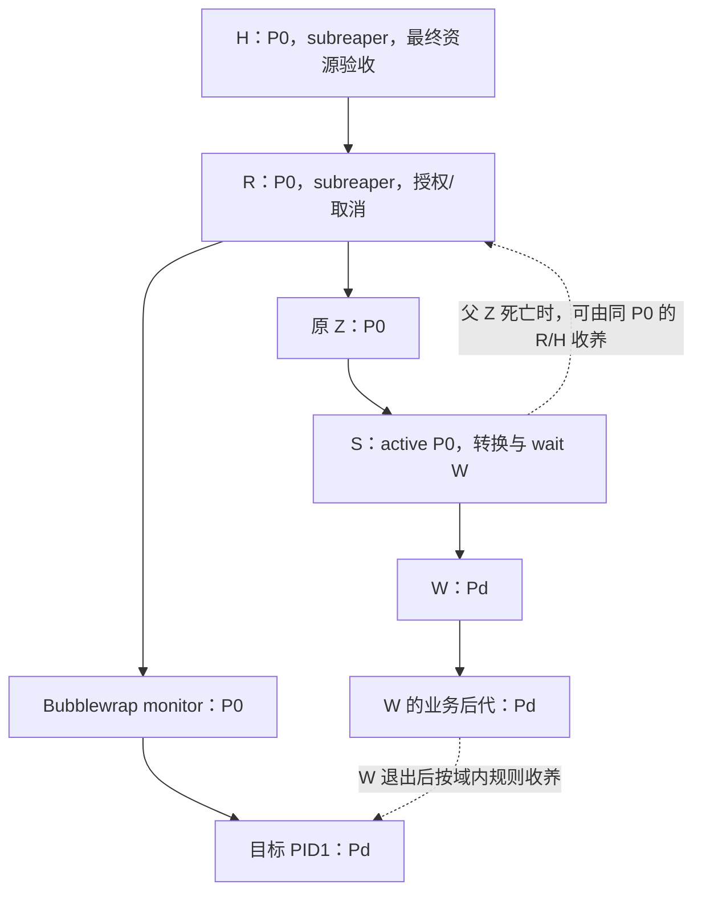
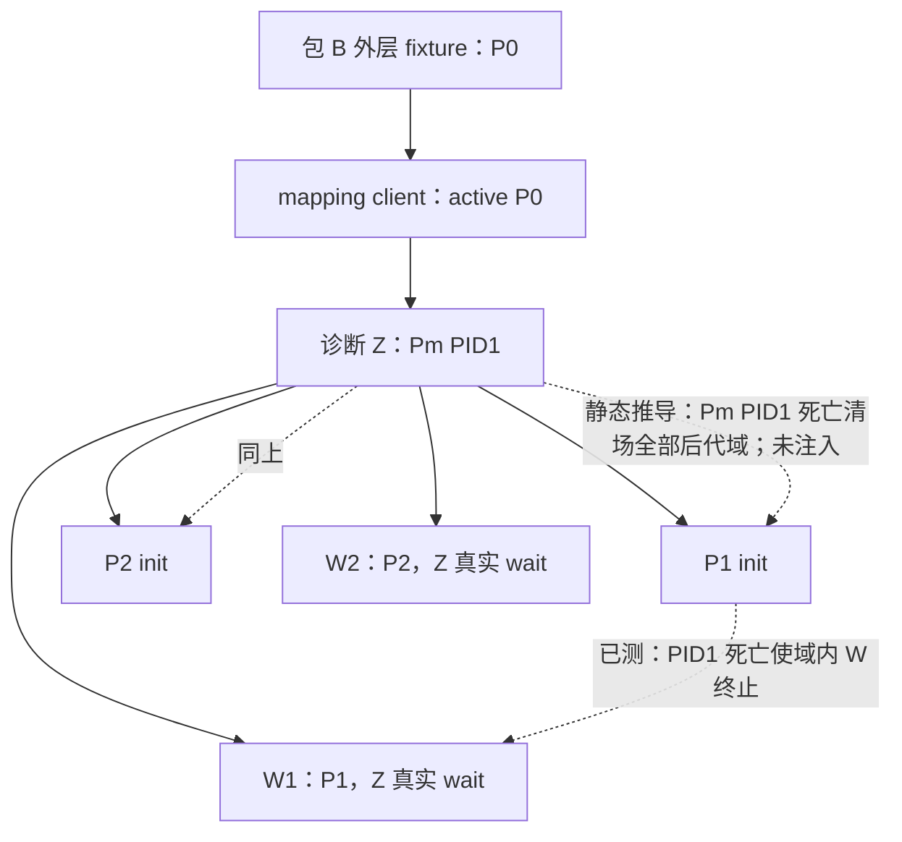

# 检查点 C：跨隔离域单次派生的架构与安全合同审查

日期：2026-10-20。项目：ShimOS。本文是提交项目负责人的决策材料，不选择最终架构。

**本阶段只读源码、既有运行记录和成本数据，新增报告及离线摘录。没有运行新 VM、故障实验或性能测试，没有修改 H/R/Z 协议、glibc、内核、正式执行路径或历史证据。原 Z→S→W 继续保留。**

## 1. 本次可以确认什么

1. **单次完整 fork 到已有目标 PID namespace 是现有 Linux 能力，但原 Z 的权限条件不满足直接使用它。** 检查点 B 的包 A 在原凭据下实际得到 EPERM；包 B 在另一套临时 userns/PIDns 关系中成功。二者并不矛盾。
2. **包 B 不是原隔离合同的等价实现。** 它把 Z、目标 init 和 W 放在共同 Uc，Z 又是共同 Pm 的 PID1；没有 Bubblewrap 独立 Base/Inner、完整文件系统及其他 namespace，也没有原 H/R 授权和恢复协议。
3. **原 Z 本来就是可信管理组件。** 它在自身 U0 中 CapEff/CapPrm 为零，但凭子 userns owner 关系，可以管理对应后代 Base/Inner。不能把原 Z 称为完全无权，也不能把包 B 的 Uc 能力称为宿主 root。
4. **删除 S 会减少一层进程，却不会删除其环境转换、授权和真实 wait 责任。** 这些工作要移到 Z/W 或新的合法回收主体。特别是完整 fork 的 child callbacks 先于返回 Python 后的降权；业务门禁不能限制已经执行的回调。
5. **共同 Pm 改变故障范围。** 若 Z 就是 Pm PID1，Z 死亡按冻结内核实现会终止 Pm 及其子域；外层 H 不会自动取得每个 W 的普通 wait 权。这项组合故障尚未在包 B 实测。
6. **维持现有权限检查的假想 clone3 目标 PID 接口，仍会拒绝原 Z。** 它主要可能避免父进程临时选择/恢复目标的窗口。要让原 Z 不增加长期 capability 也能使用，必须讨论另一套授权规则，而不是只增加一个参数。
7. **当前没有同合同的“仅删除 S”对照。** 历史数据能定位一次完整派生及中间管理的预算，不能证明净端到端加速、净物理内存节省或 G2/G3 交叉点已经改变。

这些事实既不构成调整权限拓扑的批准，也不构成必须修改内核或停止该研究的结论。

## 2. 证据范围、版本与判定用语

本文使用三类标记：**已实测**指明确列出的旧运行；**源码支持／静态推导**指固定版本代码支持、尚未组合运行；**待验证／UNKNOWN**指缺少相应证据。静态推导不计为新资格 PASS。

|证据|实际范围|本次使用边界|
|---|---|---|
|A+B `qualification-ab-02`|8 个 VM 会话、29 次受限尝试|原 Z→S→W、固定可信模板、原权限和 H 合同；不能赠予新路径|
|检查点 B 包 A|固定运行 `check-b-a-01`；21 项断言|原 Z 凭据的独立探针、两个真实 Bubblewrap 目标；不是原 Z 主事件循环重跑|
|检查点 B 包 B|固定运行 `check-b-b-01`；61 项断言|6 个 W、两目标、完整 D fork、运行时与 PID 机制诊断；不是 61 个独立场景|
|包 B 先行运行|`pilot-a-01`、`pilot-b-01`|保留观察不足和版本修正；不与固定版拼接资格|
|历史组件成本|64 KiB 自有模板、NumPy 8/32/128 MiB 多组旧数据|只读摘录，版本与诊断模式分开；本阶段新增性能样本为 0|
|SOCK / OpenLambda|2018 论文及固定后期 commit|论文机制与后期实现分栏，不推定二者是同一 artifact|

固定环境为 KVM 4 vCPU / 4 GiB、同一物理宿主上的 VM；Linux `6.18.49-agentic-runtime-opt-v1`，源码 commit `1c732c6b94f0faee1526bd375add2fe10cba2e26`；CPython 3.10.12；glibc 2.35 candidate-04 D；Bubblewrap 0.13.1。D libc SHA256 为 `a03b51fe69f36b630ecf7997af05cd36885b1f2f0b52e278391fa6e17047eff4`，loader 为 `0682f493d0434391d4ec027d0bcb54dd5f9e46d044dc7810f69abea58fe1398e`。B 的完整身份及 284 项 runtime 校验见[检查点 B](checkpoint-b.md)。

包 A/B 均为 `PASS_DIAGNOSTIC_ONLY`；完整单次派生 Bubblewrap 执行合同仍为 **NOT_ADMITTED**。本报告没有改变这一状态。

## 3. 原拓扑和包 B：具体改变了什么

### 3.1 原 ShimOS：User namespace 权限树与 PID 树是两棵树

```text
User namespace：                         PID namespace：
U0                                      P0：H、R、Z、S 的 active PIDns
 ├─ Base A，owner UID=65534                ├─ Pd A，owner=Base A
 │   └─ Inner A：目标 PID1 A、最终 W A      └─ Pd B，owner=Base B
 └─ Base B，owner UID=65534
     └─ Inner B：目标 PID1 B、最终 W B

Z：U0，UID/GID 65534，空附加组，CapEff/Prm=0，NNP=1，seccomp=0。
S：Z 的真实孩子；先进入 Base，再切换目标环境，最后进入 Inner 并降权。
   S 自身 active PIDns 仍为 P0，只把 pid_for_children 指向 Pd。
W：S 的真实孩子；出生时进入 Pd，继承 S 已完成的环境与安全设置。
```

`commoncap.c:68–103` 将“自身 userns 的有效 capability”和“父 userns 中匹配子 userns owner 的资格”分开处理。原 Z 对其拥有的后代 userns 有管理资格，NNP 不撤销这项资格。包 A 持有正确 namespace FD、目标也是 P0 后代，却仍失败：`pidns_install():407–409` 另外要求调用身份自身 U0 的 CAP_SYS_ADMIN。原 Z 不满足这一项。

因此包 A 的准确结论是：**两次观测到 EPERM；固定源码与实际凭据给出了足以拒绝的具体权限条件。** 没有动态追踪所有 LSM 分支，不能将 errno 本身称作完整内核分支追踪；也不应把它解释为 PID 兄弟/祖先层级错误。

原 `--disable-userns` 也有具体含义：Bubblewrap 在 Base 将 `max_user_namespaces` 置为 1，再建 Inner，并检查后续 NEWUSER 被拒绝。它与业务 seccomp 是不同层次的限制，不能在候选中只保留一个同名配置便宣称等价。来源：`integration_ab/prototype/run.py:40–50`、`bridge_d.c:33–57`；Bubblewrap `bubblewrap.c:3057–3067,3379–3429`，详见权限源码审查 (`../checkpoint_c/inputs/permission-review.md`, omitted from this source release)。

### 3.2 包 B：共同管理权限，同时也是共同故障层

```text
User namespace：                    PID namespace：
U0                                  P0：外层 fixture / mapping client
 └─ Uc：Z、init P1/P2、W              └─ Pm，owner=Uc；Z 就是 PID1
                                         ├─ P1，owner=Uc
                                         └─ P2，owner=Uc

Z：Uc 内完整 CapEff/Prm/Bnd，NNP=0，seccomp=0。
W：先以继承身份经过完整 fork callbacks，随后才关闭 FD、降权和装策略。
```

Uc 只映射 UID/GID 65534→65534，不等于 U0 root。B 从 Uc 恢复 U0-owned P0 的 setns 实际被 EPERM 拒绝；成功恢复的是 Uc-owned Pm。B 的单次 fork 还依赖目标 P1/P2 是 Z active Pm 的后代。

B 的 NNP=0 是诊断的实际差异，**不是已经证明的单次派生必要条件**。原 S 在 NNP=1 下也能合法进入后代 userns；未来候选若保持原合同，仍需保持并验证 NNP=1，不能以包 B 成功为理由取消它。

|维度|原独立 Base/Inner|包 B 实测构造|审查结论|
|---|---|---|---|
|长期 Z|自身 U0 cap0，但具有对应后代 owner 管理资格|当前共同 Uc 内全能力|可信面改变；不能说原本完全无权，也不能说变化只是数字不同|
|业务域 owner|不同 Base/Inner|所有 init/W 共同 Uc|业务 userns 分离未保留|
|mount/root/net/IPC/UTS|Bubblewrap 建域，W 在业务前进入|使用外层环境，未建立完整目标视图|完整隔离不等价|
|管理 PID 层|Z/S active P0；Z 不是 P0 PID1|Z 是共同 Pm PID1|Z 故障与管理域故障合并|
|回调执行环境|第一轮继承 Z；第二轮已在 Inner 并降权|唯一 child 回调继承 Uc 管理权|旧第二轮回调权限条件不再成立|
|FD 与授权|构造 FD 关闭，原许可门禁与业务 FD 合同|保留私有诊断 socket；RELEASE 仅控制存活|不能视为正式业务授权/FD资格|
|恢复与 H|原 R/H 祖先、同 P0 subreaper、委派资源责任|无原 H/R 协议|旧异常恢复不能沿用 PASS|

同 Uc、同 UID 会改变部分 ptrace/凭据检查条件，但实际可达性还受 PID 可见性、dumpability、seccomp、LSM 和 `/proc` 视图影响。**本次没有演示跨域攻击，也没有证明只要共享 Uc 就必然能互相控制。** 能确认的是合同不同，需要逐项验证，不能从 W 最终 cap0 推导完全等价。

### 3.3 必须区分“共 Uc 业务域”和“共 Uc 管理、独立业务域”

一个尚未实现的候选是 Uc 下仍保留 `Base A→Inner A`、`Base B→Inner B`，W 出生后完成这些目标环境的转换。它可能保留最终业务域之间的分离，**不是包 B 那种所有 W 共 Uc 的构造**；但长期 Z 在 Uc 的能力、callback 环境和管理故障范围仍需重新声明。

这里至少有两种不同的 PID 组织约束，不宜提前合为一个“共同 userns 方案”：

- **管理 Pm 路径：** Z active=Pm，所有目标 Pd 必须是 Pm 后代。若原 R 仍在 P0 按旧方式创建 Pd，它会与 Pm 成为兄弟，不能被 Z 选择。因此 builder/monitor/管理 PID1 的位置都要审查。B 中由 Z 自己创建 P1/P2，尚未解决 Bubblewrap 的这个接入问题。
- **保持 active P0 的 Pr 基准变体：** 静态分析允许 Z/R 当前 userns=Uc、active PIDns=P0，由 R 创建 Uc 后代 Base/Pd；另建 Uc-owned、PID1 存活的 Pr，Z 每次 Pd→Pr。检查锚点是 active P0，不是上次 children，因此理论上能避开返回 U0-owned P0 的权限问题，并保留 P0 收养层级。代价是长期 Uc 权限、额外 Pr/PID1、不同的 children 恢复合同及错误 fork 落入 Pr 的风险。Pr 死亡后，setns 成功或 FD 仍在都不表示它还能派生。**这只是源码条件下的未测变体，没有实现或资格。**

只在 Pd1→Pd2 之间选择而不恢复，也不违反同一 active P0 后代约束；但它改变模板基准状态和失败恢复含义，不能称“原身份完全恢复”。上述任何变体均需负责人先选定研究合同。

## 4. 不增加长期 Z 权限、保持原合同：有没有用户态直接路径？

限定条件是原 Z 的 U0/UID/CapPrm=0、服务多个独立既建域、完整 libc/Python fork、真实 heap 继承、原业务环境和恢复目标。**目前没有找到同时满足这些条件的已验证 Z→W 用户态方案。** 这是证据结论，不是对所有未来设计的不可行定理。

|办法|具体阻碍或改变|
|---|---|
|Z 直接 PID setns→完整 fork|包 A 已测 EPERM；当前 userns capability 不满足|
|传 namespace FD／pidfd 给 Z|稳定引用不等于授权；FD 不免除 PID/userns 检查|
|Z 先进入目标 Base，再选择 PID|单个目标可能满足检查，但 userns 下移不能任意返回 U0，不能继续保持原身份服务兄弟目标|
|联合 `setns(pidfd, USER\|PID)`|第二项权限检查的目标可变为暂存的目标 userns，但 `ns_capable()` 仍使用调用者当前凭据判权；原 Z 的后代 owner 资格可能满足。全部成功后才提交 userns 转换。目标进程可访问性、Base-owned对象顺序和返回原身份仍是问题，未测试|
|先 fork W，W 再 PID setns|只改变 W 未来孩子，不能改变已经出生的 W 的 active PIDns；再 fork 即回到双派生|
|独立有权限 helper 代 fork|普通 fork 继承 helper 的 heap，不会因持有 Z 的 PID、FD 或请求就继承 Z 的 heap|
|helper 替 Z setns／ptrace 注入|setns 修改调用者自身 nsproxy；注入 syscall 仍受被注入进程凭据约束，不能免费转移权限|
|高权限线程／CLONE_VM helper|会改变单线程模板、地址空间共享、运行时和信任合同；不具备现有 fork 资格，不是无代价捷径|
|临时提高 Z 的 U0 CapEff|原 CapPrm=0，不能自行 capset 得到该能力；借外部赋权或特权 exec 改变权限合同，exec 还丢弃原 heap|

联合 pidfd setns还涉及 `ptrace_may_access`，原目标 PID1 dumpable0 的条件也必须纳入。相关细节见冻结 `nsproxy.c:321–332,365–456,502–511`、`user_namespace.c:1344–1375` 及[setns(2)](https://man7.org/linux/man-pages/man2/setns.2.html)。

原机制之所以使用 S，是把不可逆的 userns/文件系统转换放在一次性孩子中。仅把 S 的 PID 选择移到原 Z，会遇到原权限检查；把整个转换移到长期 Z，又失去其跨兄弟域的持续身份。改变这一约束需要新的权限/状态组织输入，不能靠改名或增一个普通 helper 隐去。

## 5. 完整 fork 与 child callbacks：权限窗口到底在哪里

固定实现的实际顺序是：

```text
Python before hooks
  → glibc native prepare + 内部 fork 准备
  → D clone3(CLONE_INTO_CGROUP)，创建孩子
  → glibc child 运行时修复 + native child handlers
  → Python child hooks
  → py_fork_cgroup 返回子分支
  → 项目自己的环境转换 / FD 关闭 / drop_final / 业务门禁
```

`bridge_d.c:19–29`、D `posix/fork.c:44–137`、`sysdeps/nptl/_Fork.c:33–73` 是实际路径。父侧也有 native/Python parent hooks，创建失败仍要处理它们。不能用 raw clone3 绕过这条路径；此前 TID、robust list 和 atfork 问题不会因 PID 目标正确而消失。Python 官方接口说明也要求正确包围 fork，并在子进程重入解释器前执行 child 修复。[CPython fork API](https://docs.python.org/3.10/c-api/sys.html#c.PyOS_BeforeFork)

|执行点|已知条件|对安全审查的意义|
|---|---|---|
|原 Z→S 首次 child hooks|U0 cap0、NNP1、seccomp0；后代 owner 管理资格及继承 FD 仍在|原方案已经要求这一层代码可信，不能说单次派生首次引入降权前回调|
|原 S→W 第二次 child hooks|S 已入目标 Inner、cap/bounding0、NNP1、业务策略生效；仍有当前请求必要 FD|较窄权限，仍早于 RUN_BUSINESS；不是任意第三方代码执行许可|
|包 B 单次 Z→W|W 已在目标 PIDns，但 native child 实测仍有 Uc 管理能力，外层 root/管理 FD，随后才降权|PID 身份正确不代表已经到最终安全环境|
|未来 Uc＋独立 Base/Inner|完整 wrapper 返回后才做目标 Base/Inner 转换|可信 callback 必须承受 Uc 管理环境，旧准入不能直接继承|
|假想受限 PID 授权、Z 仍在 U0|callbacks仍继承原 Z 凭据及 FD/root，类似旧第一轮|不增加长期 capability 也不等于回调已被业务隔离|

原 `zygote.py:95–109` 在第二次 fork 前完成 S 转换/降权，`117–146` 再创建 W 和业务 gate。把 `drop_final()` 放到新 W 的第一行 Python 代码，已经晚于上述回调；追加一个“最早 child hook”还受注册次序、native/Python 两层顺序及后续入域所需权限限制。若要在用户 handlers 前改变环境，必须重新论证 runtime 内部修复、FD和锁状态；本轮没有实现这种改法。

还有一个静态边界：CPython 3.10.12 `run_at_forkers():536–563` 对用户 callback 异常调用 `PyErr_WriteUnraisable`，**不能假定任意 callback 抛异常都会中止整次 fork**。本阶段没有注入该反例。

### 5.1 已准入依赖与未知回调不能混为一类

- 包 B 验证的是可信、自有、单线程的 native/Python 探针，以及内存、TID、robust 行为。native 回调有当时权限观测；Python 回调顺序和 pre-drop 位置有源码/事件支持，不冒称每条 Python 回调都独立采样了 capability。
- 旧 NumPy 2.2.6 / OpenBLAS 0.3.29 资格实际观察的是 `prepare=blas_thread_shutdown_`，parent/child 为 NULL；49 对 Z/S 检查点观察到 prepare，不是未知第三方 child callback 的资格。该 prepare 会清理线程池/缓冲，不能假设全部 native 预热缓存跨 fork 原样保留。[NumPy 准入报告](../../numpy_admission/numpy-admission-report.md)
- 从两次变一次会改变 prepare/child 的次数与权限时机。即使库版本和数组相同，也要重新检查必要处理是否仍发生、模板是否仍单线程，以及 callbacks 是否改变父的状态、信号或 FD。
- 未知依赖、未经审查的 native callbacks、多线程及设备状态没有准入。单线程、业务 gate、最终 cap0 不能替代可信初始化边界。

此外，用户态 `选择 Pd→完整 wrapper→恢复` 的窗口包含 prepare/parent callbacks。若回调或信号处理重入 fork，可能把额外孩子送往暂选目标；单线程不排除重入。包 B 没有测试这一反例。候选必须明确阻断或拒绝重入、创建失败后的恢复，以及恢复失败时停止继续服务的责任，不能只在正常返回后检查一次 inode。

## 6. 真实父子关系、PID1 与 H：哪些责任会改变

### 6.1 两种已存在结构的亲缘与故障关系



实线是正常创建/亲缘；虚线是条件性收养。目标 PID1 不是外部注入 W 的天然父亲。



W 在目标内看到 PPID=0，仅表示外部父进程在此 PID 视图不可见，不表示没有真实父亲。pidfd 可用于身份、信号和退出观察；`waitid(P_PIDFD)` 仍不提供任意非父进程的普通 wait 权。

### 6.2 原 H 为什么能接管，而不是“有一个 H 就够了”

原 Z/S active=P0。冻结 `exit.c:604–674` 按**死亡父的 active PIDns**找 reaper，并仅在该 PID 层级内查 subreaper。原 R/H 是实际祖先、同 P0、设置 subreaper，并持有委派 cgroup 与输出引用；这才形成回收条件。

原始证据特别说明：

- `qualification-ab-02-failures/2-zygote_death.json` 中，R 的真实 wait 包含 Z、S、W、monitor/PID1，支持原 P0 拓扑的收养路径。
- `qualification-ab-02-controller-death/zygote-0.log:36` 中，S 已先 wait W273=信号9；H 随后 wait R/Z/monitor/PID1/S。**H 没有、也不需要重复 wait 已被 S 消耗的 W 状态。** 最终为 UNKNOWN/RELEASED，保留业务副作用证据。
- 目标 PID1 死亡样本中，S 仍可 wait W 的信号退出，R 收到域通道丢失；拿到 W 的退出状态不等于基础设施正常成功。

具体 PID、日志行与来源 SHA 见生命周期审查 (`../checkpoint_c/inputs/lifecycle-review.md`, omitted from this source release)。这些是原路径的运行事实，不是新直接父路径资格。

### 6.3 单次派生后的责任表

|事件|原路径|单次路径必须承担的责任|当前证据|
|---|---|---|---|
|W 正常结束|S wait W；Z wait S；结果转交 R|Z 直接 wait W、保存结果、区分丢回执与未知|B 的诊断 wait 已测；原业务协议未接入|
|Z 死亡，Z active P0|同层 R/H 可收养 S/W 等实际孤儿|若直接 Z→W 且仍 P0，同层收养有源码基础，仍须实测|旧双派生已测；新路径未测|
|Z 死亡，Z=Pm PID1|原结构无此条件|内核清场 Pm 及子域，内部 wait 可能消费状态；外层验收必须允许 UNKNOWN|源码支持，B 未测|
|Z 普通进程、另有 Pm PID1|原结构无此条件|Pm 内 subreaper/PID1 收养；外层 H 不自动获得 W wait|未实现、未测|
|单目标 PID1 死亡|S 活在 P0，W 在 Pd 终止|W 连可信转换阶段都位于 Pd，可能尚未 drop 就被终止；Z 需回收|B 已测诊断 RELEASE 等待点；原业务门禁及 callback/切换中未测|
|R 死亡|H 先封创建者，再终止域，收真实 wait/EOF/空组|重新证明 creator 封闭、收养、状态丢失与最终验收|原路径已测；直接路径未测|
|wait 已完成但结果丢失|资源释放与业务知识分离|不能复读已消耗退出码，不能把 RELEASED 当 SUCCESS|旧协议已有；直接父实现未测|

包 B 中 Z 就是 Pm PID1。`zap_pid_ns_processes(Pm)` 对 Pm 内可见 PID 清场，包含子 PIDns 的 init/W；不同 cgroup 或随后进入不同 userns 不取消这个 PID 层级效果。内核退出过程可能自动回收内部孩子；P0 H 不能只因 subreaper 身份就获得每个 W 的业务退出码。H 可以负责 cgroup、输出、FD和目录验收，但必须区分“内核已回收”“我实际 wait 到的状态”和“业务结果未知”。

若另设 Pm PID1，可把 Z 故障与 Pm 故障分开，却新增一个可信回收主体；把 H 移入 Pm 又改变 H 的故障域。Pr 变体保留 active P0 的收养层级，但增加 Pr 的故障和父 children 状态责任。**这些是候选差异，不是本报告替项目选出的方案。**

### 6.4 一个不能漏掉的回收次序

目标 PID1 退出时可能等待仍由域外父进程持有的 W zombie 被回收。如果 Z 先阻塞等 PID1 完全退出，却不推进 wait W，会形成回收相互等待。B 已测路径先 wait W，再 wait 目标 init；异常兜底虽采用同一排序，其异常分支没有独立注入。通用实现应持续回收可 wait 的孩子，不能假定某一个 PID1 必然先返回。

持 namespace FD 不保持 PID1 存活。包 B 已测死目标 `setns=0`，随后完整 fork `ENOMEM`、pidfd=-1；这里不是物理 RAM 不足，也不能虚构一个已创建 W。内核源见 `pid_namespace.c:192–281`；规则参见[pid_namespaces(7)](https://man7.org/linux/man-pages/man7/pid_namespaces.7.html)。

## 7. 假想 clone3 目标 PID namespace 接口：两套不同问题

下面都是接口审查，没有补丁，也没有假想接口的运行结果。固定 `struct clone_args` 没有目标 PIDns FD；`set_tid` 选择 PID 数值，不选择另一个已有 namespace。

### 7.1 K1：维持现有权限与后代规则

假设每次创建传目标 PIDns 引用，仍检查自身 userns 与目标 owner userns 的 CAP_SYS_ADMIN、active PIDns 后代关系，以及目标是否可创建进程。

**可解决的具体问题：** 本次目标直接绑定到本次创建，父 `pid_for_children` 不必临时改变，因此减少选择/恢复、恢复失败和回调/信号重入选错域的窗口。这是现有合法行为的接口组织变化。

**不能解决：** 包 A 原 Z 仍不满足权限；W 仍需其他 namespace/root/FD/权限转换；callbacks仍先于项目子分支；真实父仍是 Z，授权、取消、wait、H恢复及 memcg责任仍在。它不自动取消 D runtime 维护，也不自动允许多线程 fork。

若采用共同 Uc 的合法管理身份，K1 可能比 `setns→fork→restore` 少父状态管理。但目前没有同合同收益，也未证明必须通过内核才能合理管理该窗口。

### 7.2 K2：引入范围受限的派生授权

候选可以是“仅认可适当的目标 owner 资格”，也可以是“由有资格的主体签发绑定用途的内核授权对象”。两者强弱不同；普通 namespace FD 当前不是这样的授权票据。

原 Z 已可经 S 合法进入后代 Base，再创建 W，说明讨论更直接的授权有实际依据。**这不能证明省略当前一项检查在所有 userns/LSM/调用者组合下等价；也不能直接断言不同授权必然产生宿主提权。** 新能力应按具体威胁模型评价。

至少必须回答：

|边界|需要定义和验证的事项|
|---|---|
|谁授权谁|签发者的权限、使用者 Z/session/凭据身份；目标 owner 变化或 exec 后是否仍有效|
|允许做什么|目标 PIDns 的稳定引用与代次、后代约束、一次性/额度；是否绑定 cgroup 和请求，而不仅是路径字符串|
|能否转交|dup/SCM_RIGHTS/fork 继承的规则、FD泄漏后果；不能只靠可被污染 Z 绕过的用户态 nonce 检查|
|怎样撤销|撤销与创建发布的先后点；创建已发生但回执未到不能当作“未执行”；迟到取消需明确处理|
|目标消失|PID1死亡、死域新建拒绝、错误 FD 类型、对象失效、引用释放|
|权限与 LSM|保留可审计的目标和调用者检查；现有 task-alloc hook不能被假定已理解新增目标授权|
|资源与失败|与 CLONE_INTO_CGROUP、pidfd、PID额度组合时全部失败回滚；不退回事后迁组|
|可信内存与回调|授权对象不能净化 Python heap、未知 callbacks 或继承 FD；仍需独立准入|

“CapEff 数字没增加”不等于没有新增权限：一个可用的派生授权对象本身就是操作能力。受限授权可能比长期 Uc 能力更窄，也可能因可转交、不可撤销或对象绑定不足而扩大可达范围，需要证据。

### 7.3 两种接口都不能跳过的实现代价

`copy_process()` 需要保持孩子 active PIDns、children PIDns、nsproxy一致；不能只替换 `alloc_pid()` 的一个参数。还要保持真实父子关系、父可见 PID、PID1规则、pidfd、cgroup准入及失败释放，并说明与 NEWPID/THREAD/PARENT 等 flags 的组合。

完整 D/glibc/CPython wrapper仍要支持参数传递，保留 TID、robust、native/Python callbacks 和失败的 parent hooks。若为“先隔离、后回调”进一步改 runtime，已是另一项变化，不是 PID字段的自然效果。

直接先例包括已有 `setns(pidfd,mask)` 的整组提交，以及 `CLONE_INTO_CGROUP` 的出生归属与独立授权；它们说明接口原子化有先例，不证明 PID 授权可照搬。此前有限检索没有核验到可直接采用的完全同类目标PIDns创建接口，不代表“无人做过”。新 ABI、安全检查、selftests、版本维护和明确用例都未具备完整证据；**上游接受度和独立系统价值均为 UNKNOWN**。固定内核源码、公开提案及检索边界 (`../04_kernel_necessity.md`, omitted from this source release)

## 8. 与 SOCK 的实际差异：哪些已知，哪些未知

使用 [SOCK ATC 2018 原文](https://www.usenix.org/conference/atc18/presentation/oakes) §4.1–4.2/图11，以及 OpenLambda commit `5a1a912f0791a04394f4d6e565e6e4673e273d90`。后者不是已证明与2018实验一致的 revision。

|问题|2018论文|固定后期源码|对 ShimOS 的约束|
|---|---|---|---|
|跨域流程|manager/init预建目标；helper fork tmp；tmp chroot/setns；再fork handler|child chroot/迁cgroup；unshare UTS/PID/IPC；再os.fork|预热heap与两次fork不是新提出的机制；后期路径不是论文图11的预建PID目标路径|
|两次fork|明确存在|`server.py:27–115` 两次os.fork|当前单次PID诊断与所读路径有差异；不能推定全领域新颖性|
|userns/capability|具体树、能力集和删除顺序 UNKNOWN|所读路径无逐域NEWUSER或明确setuid/capset；实际部署能力集UNKNOWN|不能把对方权限模型填成原ShimOS或包B模型|
|隔离环境|论文主动采用chroot而非每容器独立mount/network namespace|平台级mount隔离不等于逐sandbox独立mount；seccomp允许部分构造操作|与原六类namespace/权限合同不同，论文成绩不能当同保障基线|
|资源归属|manager后迁cgroup|传root/cgroup.procs两个FD、后迁并扫描补偿|ShimOS完整D原子出生是具体合同差异，但采用已有Linux能力不自动是独立创新|
|回调|包初始化可不可信，但具体fork/runtime资格 UNKNOWN|使用os.fork，不是raw clone；实际依赖callback、版本和权限 UNKNOWN|不能把旧rawclone错误套给它，也不能假定其已解决降权前callback问题|
|生命周期|真实wait和父突亡细节不足|Z wait tmp但未检查status；持久HTTP handler、父cgroup引用计数、dirty恢复|与逐请求W/UNKNOWN/H存活自动验收合同不同；不是“它没有清理”|

论文明确考虑恶意包污染，并限制传给模板的目标引用；这不等于 namespace FD 自动授予操作权限，也不能仅凭其目标宣言核实与 ShimOS 等价。后期官方 `manual-cleanup.md` 记录 manager panic/OOM 后可能残留挂载/cgroup，需要 force-cleanup或重启；这是可查的恢复合同差别，不能倒推为2018实测缺陷。

**能够讨论的实质差异**是：明确的 Base/Inner 及权限下降条件、完整运行时与原子 cgroup 出生组合的显式资格、逐attempt业务知识与资源释放、幸存H的恢复责任，以及单次派生是否还能保留这些条件。这不暗示 OpenLambda 的 `os.fork()` 绕过了完整运行时。**尚不能声称**原子出生/完整wrapper/H组合必然形成新的通用机制，或SOCK不支持任何源码未展示的能力。逐函数、文件、行号和28项引用见SOCK审查 (`../checkpoint_c/inputs/sock-review.md`, omitted from this source release)。

## 9. S 的成本：可消除、转移和必须保留

### 9.1 历史数据能量化到哪一层

以下全为既有数据，本阶段只读摘录。完整机器表保留分组、n、逐VM中位数、范围和源路径：CSV (`../checkpoint_c/cost-subset.csv`, omitted from this source release)、JSON (`../checkpoint_c/cost-subset.json`, omitted from this source release)、只读摘录脚本 (`../checkpoint_c/extract_cost_subset.py`, omitted from this source release)。

|旧64 KiB模板 low模式，3VM×20请求|wall中位数 ms|解释|
|---|---:|---|
|Z 第一次完整 libc wrapper 父侧|0.415|native handlers＋clone3；不是纯内核CPU|
|S 第二次完整 libc wrapper 父侧|0.327|不是完整W ready|
|Z / S 外层 bridge 父侧|1.077 / 0.836|包含wrapper及Python hooks等，不能与上一行相加|
|S namespace/root/cwd区间并集|0.017|小于整段协议跨度；直接路径多数操作仍须执行|
|S capability/NNP/seccomp区间并集|0.105|不是可直接删除的安全工作|
|S必要FD关闭并集|0.186|不含被关闭的资格诊断扫描；继承FD仍须处理|
|S阻塞wait W|4.744|同线程CPU约0.049ms，多数是等待|
|S已wait W→Z已wait S|9.206|含收尾、轮询、日志、调度；可与输出等待重叠|
|业务结束→输出EOF|42.598|含约40ms人为测试后代，非ShimOS固有开销|

同组请求→业务进入中位57.453ms、请求→response-ready为140.691ms。这是旧诊断实现的完整边界，不能当作新候选的预测基线。带ftrace的独立n=3诊断中，Z/S clone3父侧wall约0.312/0.300ms；它不是内核CPU，不与无trace成绩混排。

|固定NumPy G2数组大小；每格3VM×10请求|Z wrapper ms|S wrapper ms|Z bridge ms|S bridge ms|
|---|---:|---:|---:|---:|
|8 MiB|0.623|0.565|1.414|1.349|
|32 MiB|0.675|0.564|1.587|1.381|
|128 MiB|0.841|0.686|1.762|1.458|

S wrapper三个VM中位数分别为：8MiB 0.591/0.592/0.530；32MiB 0.537/0.713/0.564；128MiB 0.800/0.626/0.650ms。它们显示可研究的派生成本预算，但没有给出“删S后节省这些数值”的因果证据。原profiles还包含数据指纹与业务等成本；完整N10序列随数组大小变化不能只归因于fork。

### 9.2 职责与成本的去向

|工作|单次派生的可能变化|证据边界|
|---|---|---|
|第二次完整fork、第二层进程及其退出|有条件消除一轮运行时/内核创建与中间进程占用|B证明PID机制可少一次；完整安全路径未实现，净收益未知|
|S自己的页表、私有修改和中间回执|有减少机会|W仍需页表/COW；少进程PSS不等于净物理内存差|
|S进入mount/user/net/ipc/uts、root/cwd|移到W可信准备段|必须在业务前完成；不是删除|
|capability、NNP、seccomp、FD处理|多数移到W，部分重复设置或可另审|不能因“同名drop调用两次”就直接删；时机保护callbacks也有意义|
|S真实wait W|移到Z或合法收养者|准确退出状态和UNKNOWN责任保留|
|Z真实wait S|可少一层wait/转发|Z改为直接wait W；事件处理、通知和故障责任仍在|
|PID目标选择|从S移到Z，用户态还需恢复和身份检查|增加父状态窗口/串行控制，不能算零成本|
|门禁与取消封口|改变主体和状态含义|“W未出生”与“W已出生但未授权”不同，不可凭少进程删除许可|
|Bubblewrap/PID1、域销毁、EOF、cgroup与目录验收|保留|无证据因少S自然减少|
|共同Pm/Pr或授权对象|可能新增准备、引用、回收和故障成本|尚未实现，不免费摊销|
|transition组中的CPU/内存|部分转记到W组|记账搬家不是物理资源节省；模板共享页责任仍在|

旧 transition cgroup 的CPU包含必要工作和诊断，父cgroup/子组与waited-child CPU不可重复相加。没有新路径的完整PSS、Private_Dirty、minor faults、memcg或内存时间对照，净资源结论保持 UNKNOWN。

**不能把上述中位数相加，或从历史完整请求时间直接扣除S的某段wall。** 包含区间、父子重叠、等待、版本与诊断差异均存在。当前证据不足以预测跨域/域内复用交叉点移动，也不能宣称少一次fork就增加了吞吐或改变了最优调度策略。历史成本来源及核验 (`../baseline_audit/cost-evidence.md`, omitted from this source release)

## 10. 提交负责人比较的候选

|候选|已有支持|改变与风险|维护/验证代价|目前状态|
|---|---|---|---|---|
|保留原Z→S→W|完整受限运行与故障资格、历史性能|保留一层派生与管理成本|现有D及协议维护继续|当前有效实验基础|
|Uc管理＋独立Base/Inner，用户态Z→W|B的合法PID选择/fork；固定源码支持后代权限|长期Z能力、callback窗口、builder/PID层级；Pm或Pr故障选择|无需内核，但要重新做完整入域和生命周期资格|完整路径未实现/未准入|
|原身份＋K1同权限目标PID接口|只读内核分析|原Z仍被拒绝；若配Uc则主要避免父状态窗口|ABI、D适配和内核安全回归新增|设想；不能独立解决原权限条件|
|原身份＋K2受限授权接口|原间接路径说明存在可讨论授权范围|新能力、授权/撤销/LSM、callback和出生后转换|安全设计与内核/runtime维护最高，收益未知|设想；未批准实现|
|暂不改派生，将现成本用于资源组织研究|现有多架构数据可用|不消除S；不回答单次路径净收益|不新增机制风险，但模型须保留受测范围|可选择的研究安排，非本报告决定|

包 B 的“所有业务共 Uc、Z=Pm PID1”仅保留为诊断参考，不推荐把它直接当作完整候选集成；若负责人希望研究该合同，也需明确其与原业务隔离的差别。候选内核路线不是用户态路线失败后的自动替代，反之亦然。

## 11. 下一步最小证据需求——须负责人另行选择与批准

不对所有候选同时开发。本节仅给出可以证伪的实验入口；本阶段未执行。

|编号|对应决策|最小验证及拒绝条件|
|---|---|---|
|V1 完整目标身份|是否允许共同Uc的独立副本|选定Pm或Pr一种拓扑，Bubblewrap先建一个真实Base/Inner目标；逐项核对六类namespace、root/cwd、owner/parent、disable-userns、cap/NNP/seccomp/FD与原合同。任何不一致不得进入公平性能排名|
|V2 回调权限与重入|是否接受该可信面|自有native/Python回调记录权限/FD/阶段；在prepare/parent重入、child异常及恢复失败处设受控反例，验证不误派生/授权；先不扩大NumPy或未知依赖准入|
|V3 直接父故障|选定Z/PID1/H位置后|W出生回执前杀Z；已wait未回结果时杀Z；R在创建/业务许可点死亡。记录实际收养者、wait消耗者、UNKNOWN、EOF/空组/目录；不能只看进程被杀|
|V4 PID1相互影响|是否接受共同Pm或额外Pr|两个目标各有活跃W时杀P1；若用Pm则另杀Pm PID1；若用Pr则杀Pr后尝试恢复/后续请求。不能把B中“另一init存活”当作另一活跃W已验证|
|V5 回收次序与预算|所有直接路径|延迟wait W同时退出目标PID1、预算拒绝、重复取消、回执丢失。保持无迟到执行、不虚构退出码、健康会话能否继续及INCOMPLETE边界|
|V6 受限授权威胁模型|是否进一步研究K2|先固定签发/使用/撤销、目标/cgroup/身份绑定与LSM职责；列转交、过期、PID1死亡、并发消费反例。书面审查后再由负责人决定是否授权内核原型|
|V7 同合同小对照|仅在选定候选通过资格后|完整Worker ready、response-ready/RELEASED、CPU、同步PSS/COW与新增管理对象成本；初始化和关闭全计入，单独列诊断扰动。不能用机制诊断代替端到端资格|

V1–V5需要新的独立副本和真实故障资格；不是修改原H/R/Z的许可。V6不意味着已批准内核开发。只有上述合同明确且候选通过对应验证后，才有基础讨论是否扩大正式测量。

## 12. 检查点 C 的结论与交接

**当前阻碍来自三类不同条件：** 原Z自身userns能力不足是已实测权限阻碍；长期身份恢复、PID层级和callback窗口是用户态组织约束；真实父改变、H收养及结果知识是生命周期职责问题。一个目标PID参数不能一次解决三类问题。

**合法用户态组织可以解决PID选择，但未证明保持原合同。** 共同Uc提供一条静态与机制证据支持的研究方向；是否允许增加该长期能力、采用何种PID1/恢复层级，属于负责人的架构决定。

**内核路线有明确可分析的作用，也有明确边界。** 同权限接口主要改善按次绑定；受限授权可能保持原Z的capability集合，却引入新的操作授权和维护责任。两者均没有完整实现、安全证明或净性能数据，上游价值未知。

**SOCK是必须承认的直接先例。** 当前可检验的差异是具体隔离/资源/运行时/恢复合同以及如何在一次派生下维持它们，不是“跨域预热”这个概念本身。没有源码或运行证据的对方能力保持UNKNOWN。

**系统价值目前只定位到待验证预算。** 第二次完整派生、S对象及部分转发有可减少机会；大部分环境转换和正确性工作会转移或保留，新增管理/授权成本还可能抵消收益。不能据此估算已实现加速或替项目作Go/No-Go判断。

检查点 C 至此完成。**不继续实施用户态集成、内核原型或性能实验，等待负责人选择下一步。**

## 13. 原始证据与本轮文件导航

|内容|入口|
|---|---|
|检查点B完整报告及身份|[checkpoint-b.md](checkpoint-b.md)|
|包A真实errno、身份、回收|check-b-a-01 (`../experiments/runs/check-b-a-01/`, omitted from this source release)|
|包B事件、真实wait、namespace、callbacks|diagnostic-output.log (`../experiments/runs/check-b-b-01/diagnostic-output.log`, omitted from this source release)、summary.json (`../experiments/runs/check-b-b-01/package-b/summary.json`, omitted from this source release)|
|包B进程派生及exec证据|process-trace.txt (`../experiments/runs/check-b-b-01/process-trace.txt`, omitted from this source release)|
|包B外层wait/EOF/资源核查|fixture-final.json (`../experiments/runs/check-b-b-01/fixture-final.json`, omitted from this source release)|
|B独立离线复核|verification.json (`../analysis/checkpoint-b-independent-verification.json`, omitted from this source release)|
|原A+B代码及资格|[prototype](../../integration_ab/prototype/)、[qualification summary](../../integration_ab/analysis/qualification-ab-02-summary.json)|
|本轮权限/回调逐源码审查|permission-review.md (`../checkpoint_c/inputs/permission-review.md`, omitted from this source release)、SHA (`../checkpoint_c/inputs/permission-review-sha256.json`, omitted from this source release)|
|本轮生命周期原始样本与内核审查|lifecycle-review.md (`../checkpoint_c/inputs/lifecycle-review.md`, omitted from this source release)、SHA/行段 (`../checkpoint_c/inputs/lifecycle-sources.json`, omitted from this source release)|
|本轮SOCK版本和真实调用链|sock-review.md (`../checkpoint_c/inputs/sock-review.md`, omitted from this source release)、引用SHA (`../checkpoint_c/inputs/sock-source-manifest.json`, omitted from this source release)|
|固定内核逐文件及函数证据|source-manifest.json (`../kernel_analysis/source-manifest.json`, omitted from this source release)、既有必要性分析 (`../04_kernel_necessity.md`, omitted from this source release)|
|历史成本原值和原始行索引|historical-cost-selected-observations.csv (`../analysis/historical-cost-selected-observations.csv`, omitted from this source release)、本轮24组摘录 (`../checkpoint_c/cost-subset.csv`, omitted from this source release)|
|本轮历史保护与交付清单|input-before.json (`../checkpoint_c/input-before.json`, omitted from this source release)、input-after.json (`../checkpoint_c/input-after.json`, omitted from this source release)、delivery-manifest.json (`../checkpoint_c/delivery-manifest.json`, omitted from this source release)|

本轮前置登记1,236项输入；前后SHA核对范围仅覆盖登记文件，不冒称检查了整个仓库所有文件。其他本轮读取源码分别列在三份来源清单中。本轮新文件集中在`checkpoint_c/`和本文，不改写旧报告或运行编号。
